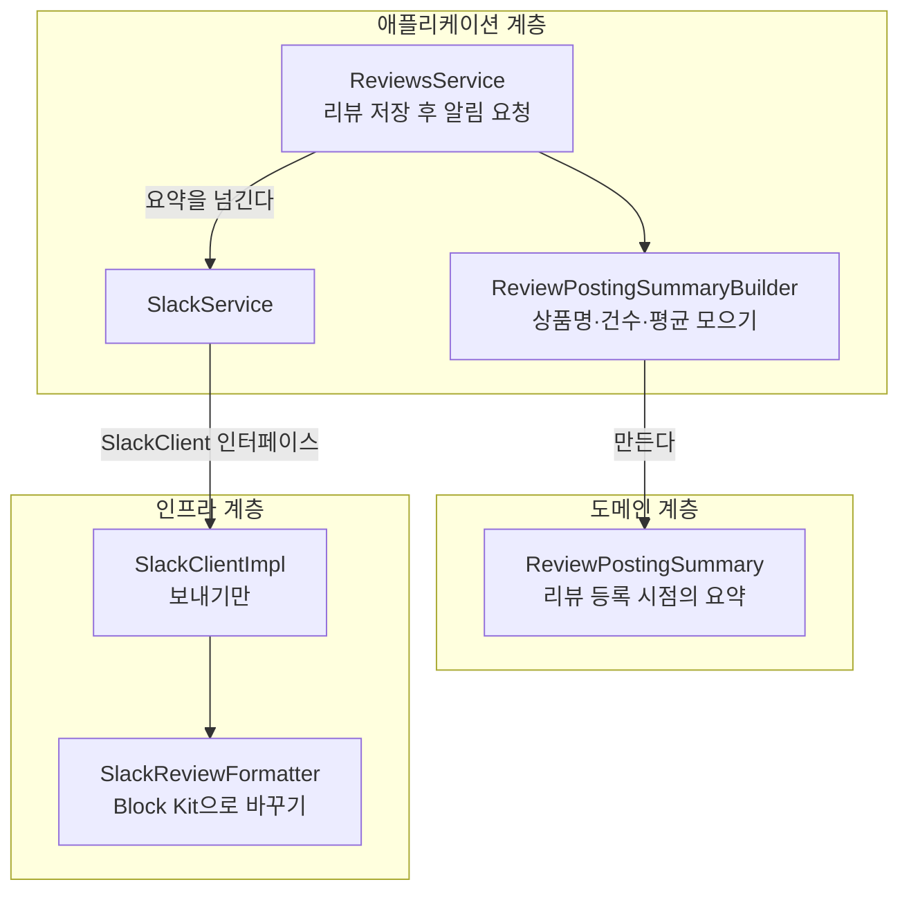

회사 백엔드(Spring Boot)는 리뷰가 등록될 때마다 사내 Slack 채널(이하 **리뷰 알림 채널**)로 알림을 보낸다. 원래는 "등록한 리뷰가 사라진다"는 문제를 조사하려고 붙인 알림이었다. 조사가 끝난 뒤에도 채널은 남았고, 리뷰가 궁금한 사람들이 하나둘 들어와 있었다.

이 채널을 지금보다 쓸모 있게 만드는 일을 맡았다. 목표는 리뷰와 직접 관계없는 직원도 서비스의 리뷰 상황을 자연스럽게 알고 있는 상태였다. 이 글은 그 첫 번째 버전(Ver.1, 2025년 12월 출시)을 정리한 것이다.

- 설문으로 채널의 방향을 정한 과정
- 메시지에 넣은 것과 뺀 것, 강조 표시
- 출시 당일 휴대폰에서 깨진 레이아웃
- 코드 리뷰에서 클래스 이름이 세 번 바뀐 이유
- 출시 다음 날 받은 버그

## 원래 알림

개선 전 알림은 이런 코드로 만들어졌다(항목 이름은 한국어로 옮겼다).

```java
@Override
public void asyncReviewRegisterNotification(Review review) {
    if (!review.hasContent()) {
        return; // 내용이 없는 리뷰는 보내지 않는다
    }

    String text = String.format(
            "【리뷰 ID】%n%s%n【상품 ID】%n%s%n【평가】 %s%n【코멘트】%n%s%n",
            review.getReviewId().getValue(),
            review.getProductId().getValue(),
            review.getRating().getValue(),
            review.getContent().getValue()
    );

    this.notification("#<리뷰 알림 채널>", text);
}
```

채널에는 이렇게 올라왔다(값은 예시).

```text
【리뷰 ID】
3f9b1c2e-8d4a-4e6b-9a51-0c7d2e4f6a18
【상품 ID】
1234
【평가】 4
【코멘트】
촉촉하고 향이 좋아요.
```

조사용으로는 충분했다. 리뷰 ID가 맨 위에 있으니 DB에서 바로 찾을 수 있다. 하지만 리뷰를 **보러** 온 사람에게는 불편했다.

- 메시지 사이에 경계가 없어서, 리뷰가 이어서 올라오면 어디까지가 한 리뷰인지 구분하기 어렵다
- 상품 ID만 있어서 무슨 상품인지 모른다
- 평가가 숫자 하나라 눈에 들어오지 않는다

## 메시지를 고치기 전에 설문부터

무엇을 바꿀지 정하기 전에, 누가 무엇을 하러 이 채널에 오는지부터 물었다.

### 채널을 아는 사람이 적었다

서비스에 관련된 직원(개발, 사업, CS, 상품 기획 등) 전체에게 설문을 돌려 보니, 채널을 **몰라서 들어오지 않은 사람이 80% 이상**이었다. 메시지를 아무리 고쳐도 볼 사람이 없으면 소용이 없다. 사내 모임 같은 자리에서 채널을 알릴 필요가 있다는 결론이 먼저 나왔다.

### 들어와 있는 사람은 세 부류였다

채널에 들어와 있는 사람들에게는 어떻게 쓰고 있는지 물었다.

| 쓰는 방식 | 상황 | 방향 |
| --- | --- | --- |
| 거의 안 본다 | 알림이 보기 어렵고, 볼 이유도 없다 | 보게 만든다 |
| 가볍게 본다 | 어떤 리뷰가 들어오는지 구경하는 정도 | 이런 사람을 늘린다 |
| 업무에 쓴다 | 어떤 업무에 무슨 정보를 보는지 모른다 | 따로 확인한다 |

채널의 방향을 물었을 때는 의견이 반반으로 갈렸다.

- 업무에 필요한 구체적인 정보를 중심으로 전한다
- 누구나 가볍게 들어와서 쉽게 볼 수 있게 한다

둘 다 챙기기보다 하나로 정하기로 했다. 둘을 섞으면 정보가 너무 많아지거나, 어느 쪽에도 맞지 않는 어중간한 채널이 되기 쉽다.

### 업무에 쓰는 사람도 자세히 볼 때는 다른 곳에서 봤다

방향을 정하려고 업무에 쓰는 사람들에게 따로 이야기를 들었다.

- 리뷰 ID는 없어도 된다
- 상품 ID는 상품명과 같이 있는 게 좋다
- 리뷰를 자세히 볼 때는 어차피 관리 화면이나 쇼핑몰에서 본다

그래서 방향은 **업무 정보를 늘리기보다, 리뷰를 쉽게 확인하는 데 집중하는 것**으로 정했다. 업무에 쓰는 사람에게도 채널은 "신경 쓰이는 리뷰를 발견하고, 관리 화면이나 상품 페이지로 넘어가는 입구"면 충분했다.

## Ver.1에서 바꾼 것

| 문제 | 바꾼 것 |
| --- | --- |
| 리뷰끼리 구분이 안 된다 | 메시지 맨 위에 구분선을 넣고, 상품 정보와 회원 정보로 묶었다 |
| 무슨 상품인지 모른다 | 상품명을 넣고, 상품 ID는 상품 페이지 링크로 |
| 평가가 숫자다 | 평가 수만큼 ⭐ |
| 리뷰 ID는 아무도 안 쓴다 | 뺐다 |
| 관리 화면에서 찾을 단서가 없다 | 회원 ID(리뷰어 페이지 링크)와 회원명 |
| 같은 점수라도 누가 줬는지에 따라 의미가 다르다 | 그 사람의 지금까지 평균 평가와 작성 건수 (아래 강조 표시에 쓴다) |

상품명은 리뷰 백엔드가 아니라 쇼핑몰이 갖고 있어서, 알림을 만들 때 쇼핑몰 API에 물어본다. 상품을 찾지 못하면 "알 수 없는 상품명"으로 보낸다.

링크는 리뷰가 고객 화면에서 어떻게 보이는지(위쪽에 나오는지, 눈에 띄는지) 보러 상품 페이지에 가는 사람과, 관리 화면에서 회원을 찾는 사람을 위한 것이다. 전에는 ID를 복사해서 직접 검색해야 했다. Slack의 링크 문법(mrkdwn)은 [다음 글](/posts/slack-message-format-without-block-kit/)에 정리했다.

### 강조 표시: 같은 낮은 점수라도 누가 줬느냐

리뷰 중에는 빨리 봐야 하는 것이 있다. 배송 문제나 고객의 오해 때문에 낮은 점수가 달린 경우다. 그런데 낮은 점수라고 다 같지는 않다.

- 평소에도 1~2점을 자주 주는 사람의 낮은 점수
- 평소에 좋은 리뷰를 써 주던 사람이 갑자기 준 낮은 점수

뒤쪽은 실제로 무언가 문제가 있었을 가능성이 높다. 그래서 두 가지를 따로 표시하기로 했다.

| 조건 | 표시 |
| --- | --- |
| 지금까지의 평균 평가가 4점 이상인 사람이 2점 이하를 줬다 | 맨 위에 🚨 경고 문구 |
| 그 사람의 첫 리뷰다 | 평균 평가 자리에 🎉 첫 리뷰 표시 |

첫 리뷰는 처음 써 본 사람의 경험이 그대로 드러나서, 상품을 처음 접한 사용자의 반응을 보기 좋다.

판단은 평가를 나타내는 값 객체에 메서드로 넣었다.

```java
public class Rating {
    int value;
    // ...
    public boolean isLowRating() {
        return value <= 2;
    }
}

public class RatingAverage {
    BigDecimal value;
    // ...
    public boolean isHighAverageRating() {
        return value.compareTo(BigDecimal.valueOf(4)) >= 0;
    }
}
```

처음 이름은 `isUnderTwoRating()`, `isMoreFourRating()`이었다. 리뷰에서 이런 지적을 받았다.

> 2 이하라는 건 코드를 보면 안다. 그걸로 무엇을 판단하고 싶은지를 이름으로 나타내 달라. 하고 싶은 일은 같아도 기준은 1 이하나 3 이하로 바뀔 수 있다.

실제로 이 기준은 개발 중에 이미 한 번 바뀌었다. 기획 문서와 첫 커밋에서는 1점이었는데, 다음 날 2점 이하로 넓혔다. 이름에 숫자가 들어 있으면 기준이 바뀔 때마다 이름도 바꿔야 한다. `isLowRating()`은 기준이 바뀌어도 그대로 쓸 수 있다.

## 출시 당일, 휴대폰에서 깨진 레이아웃

처음 만든 포매터는 레이아웃을 전부 문자로 만들었다.

```java
// 처음 버전 (요약)
sb.append("-".repeat(110)).append("\n");               // 구분선: 하이픈 110자
sb.append(" ".repeat(72)).append("*【 상품 정보 】*\n"); // 제목: 공백 72칸으로 가운데 정렬
if (isEmergency) {                                      // 경고: 빨간 네모로 감싼 문구
    sb.append("🟥".repeat(10)).append(" 🚨 *우량 고객의 평가 급락* 🚨 ")
      .append("🟥".repeat(10)).append("\n");
}
```

PC에서는 그럴듯했지만 휴대폰에서는 레이아웃이 깨졌다. 길이와 공백 수를 PC 화면 폭에 맞춰 놓았으니, 폭이 좁은 화면에서는 구분선과 빨간 네모 줄이 여러 줄로 꺾이고 공백으로 민 제목도 엉뚱한 곳으로 밀려난다.

그래서 레이아웃을 문자로 흉내 내지 않고 Slack의 Block Kit에 맡겼다. Block Kit은 메시지를 블록 단위의 JSON으로 조립하는 방식이다(블록 종류는 [다음 글](/posts/slack-message-format-without-block-kit/)에 표로 정리했다).

| 처음 (문자) | 바꾼 뒤 (Block Kit) |
| --- | --- |
| 하이픈 110자 구분선 | `divider` 블록 |
| 공백 72칸으로 민 굵은 제목 | `header` 블록 |
| 빨간 네모 줄과 공백으로 민 경고 문구 | `context` 블록 한 줄 |

```java
public List<Map<String, Object>> format(ReviewPostingSummary summary) {
    boolean isEmergency = summary.getPreviousReviewRatingAverage().isHighAverageRating()
            && summary.getCurrentRating().isLowRating();

    List<Map<String, Object>> blocks = new ArrayList<>();
    blocks.add(divider());
    if (isEmergency) {
        blocks.add(buildEmergencyNotice()); // 🚨 과거 평가에 비해 이번 평가가 크게 떨어졌다는 문구
    }
    blocks.add(header("- 상품 정보 -"));
    blocks.add(section(markdown(buildProductBlock(summary))));
    blocks.add(section(markdown(buildReviewBlock(summary))));
    blocks.add(header("- 회원 정보 -"));
    blocks.add(section(markdown(buildMemberBlock(summary))));
    return blocks;
}
```

구분선을 얼마나 길게 그을지, 제목을 어디에 둘지는 이제 Slack이 화면 폭에 맞춰 정한다. 이 수정은 출시 당일, 배포 몇 시간 전에 들어갔다. 운영 환경에 나간 메시지는 이런 모양이다(값은 예시).

```text
────────────────────────────            ← divider
🚨 과거 평가에 비해 이번 평가가 크게 떨어졌습니다. 🚨   ← context (경고일 때만)
- 상품 정보 -                              ← header
【상품명】     :   샘플 상품
【상품 ID】    :   1234                    ← 상품 페이지 링크
【평가】       :   ⭐⭐
【코멘트】
> 향이 생각과 달랐어요.
- 회원 정보 -                              ← header
【회원명】     :   샘플 회원
【회원 ID】    :   5678                    ← 리뷰어 페이지 링크
【평균 평가】  :   4.3 점                   ← 첫 리뷰면 🎉 첫 리뷰 작성 🎉
【작성 건수】  :   12 건
```

두 달 뒤, 알림을 사내 메시지 큐로 옮기면서 Block Kit을 쓸 수 없게 되어 문자열로 돌아가야 했다. 그리고 휴대폰에서 같은 문제를 다시 만났다. 그 이야기는 [Block Kit 없이 문자열로 Slack 알림 꾸미기](/posts/slack-message-format-without-block-kit/)에 있다.

## 코드 리뷰: 클래스 이름이 세 번 바뀐 이유

이 PR은 3주 동안 열려 있었다. 리뷰어 두 분에게 수정 요청을 여덟 번 받았고, 코드에 달린 지적은 51개였다. 기능보다 **어떤 클래스가 무엇을 맡을지**에 대한 이야기가 대부분이었다.

### 보내는 일과 만드는 일을 나누기

처음 코드는 `SlackClientImpl` 하나가 메시지를 만들고 보내는 일까지 다 했다. 첫 지적은 여기였다.

> `SlackClientImpl`은 Slack으로 보내는 역할에 집중하고, 리뷰 내용으로 보낼 내용을 편집하는 역할은 다른 클래스로 나눠 달라. Slack이 아닌 도구에도 같은 내용을 보내게 되면, 그 도구용 연동 클래스만 새로 만들고 나머지는 중복되지 않는 모습이 좋다.

나누는 것까지는 금방 했다. 오래 걸린 건 **나눈 조각을 어느 계층에 두고 뭐라고 부를지**였다. 메시지 재료를 담는 클래스의 이름이 이렇게 바뀌었다.

| 이름 | 이 이름일 때 받은 지적 |
| --- | --- |
| `SlackReviewAlert` | 도메인 클래스가 바깥 계층(저장소)에 의존한다. 값 없이 static 메서드만 있어서 값과 그 행동을 표현하지 못한다. 경고가 아닐 때도 쓰는데 이름이 Alert다 |
| `SlackReviewMessage` | 이 정보는 Slack으로 보낼 때만 필요하니, 도메인이 아니라 인프라 계층에서 다뤄야 한다 |
| `ReviewNotification` | Notification(알림)은 Slack을 바꿔 말한 것일 뿐이다. Slack을 잊고, 리뷰로서 어떤 정보를 모은 클래스인지로 이름을 붙이자 |
| `ReviewPostingSummary` | 최종. "리뷰를 등록한 시점의 요약" |

이름이 바뀔 때마다 일도 같이 옮겨 갔다.

- Slack 블록을 만드는 일은 인프라 계층의 `SlackReviewFormatter`로
- 상품명과 건수, 평균을 모으는 일은 애플리케이션 계층의 `ReviewPostingSummaryBuilder`로
- 도메인에는 Slack을 모르는 `ReviewPostingSummary`만



```java
public RegisterReviewResult registerReview(Review review) {
    reviewRepository.register(review);
    ReviewPostingSummary summary = reviewPostingSummaryBuilder.build(review);
    slackService.asyncReviewRegisterNotification(summary);
    return RegisterReviewResult.SUCCESS;
}
```

```java
@Service
public class ReviewPostingSummaryBuilder {
    // ...
    public ReviewPostingSummary build(Review review) {
        ProductName productName = shopClient.findProduct(review.getProductId().getValue()) // 쇼핑몰 API
                .map(Product::getProductName)
                .orElse(new ProductName("알 수 없는 상품명"));

        PostedReviewCount previousReviewCount = reviewRepository.getCustomerReviewSummary(review.getCustomerId());
        RatingAverage ratingAverage = reviewRepository.getCustomerReviewRatingAverage(review.getCustomerId());

        return new ReviewPostingSummary(review, productName, previousReviewCount, ratingAverage);
    }
}
```

돌아보면 핵심은 이름이었다. 이름에 Slack이나 Notification이 들어 있는 동안에는 그 클래스가 "알림을 위한 것"이라, 도메인에 둘 이유가 없었다. "리뷰를 등록한 시점의 요약"이라는, 데이터 자체를 설명하는 이름을 찾고 나서야 도메인에 두는 게 자연스러워졌다. 이렇게 두면 나중에 메일이나 관리 화면처럼 Slack이 아닌 곳에서도 같은 요약을 쓸 수 있다.

### 평균은 누가 계산하나

평균 평가에서도 리뷰가 몇 번 오갔다.

1. 평균은 이번에만 쓸 것 같아서, 따로 도메인 클래스를 만들어야 하는지 물었다. 답은 "만드는 게 좋다"였다. 평균을 어떻게 계산하는지, 값을 소수 몇 자리까지 가질지 같은 지식은 평균 자신이 가져야 한다. 받는 쪽도 변수 이름이 아니라 `RatingAverage`라는 타입으로 받아야 평균으로 다뤄진다. 마침 이미 있던 `RatingAverage`를 쓰기로 했다
2. 평균을 내는 메서드를 `RatingAverage`에 넣었더니 다른 리뷰어가 지적했다. 평균을 낼 재료를 가진 건 리뷰 목록(`Reviews`)이니 거기서 꺼내는 게 자연스럽다. 값 객체는 결과를 담는 데 집중해야 하고, 값 객체가 목록을 알면 서로 의존하기 쉽다
3. 그런데 건수를 세고, 그걸로 페이징 객체를 만들고, 리뷰를 전부 가져와서 평균을 내는 건 낭비가 많다. DB에서 바로 평균을 가져오자는 제안을 받았다. 방법은 두 가지였다
    - 이미 있는 작성 건수 쿼리가 평균도 돌려주게 한다 (이 쿼리를 쓰는 다른 곳도 고쳐야 한다)
    - 평균 전용 쿼리를 새로 만든다

작성 건수 쿼리는 리뷰 목록의 리뷰어 정보 등 여러 곳에서 이미 쓰고 있었다. 건드리는 범위를 줄이려고 두 번째 방법을 골랐다. 이 선택은 출시 다음 날 버그로 돌아온다.

### 그 밖에 받은 지적

메시지를 만드는 코드는 처음에 `StringBuilder` 하나로 전부 이어 붙이는 긴 메서드였다. "코드만 봐서는 최종 모양이 그려지지 않는다. 계속 중요해질 기능이라면 템플릿 엔진을 쓰고 싶지만 이번에는 과하니, 최소한 블록(상품, 리뷰, 회원)마다 메서드로 나누자"는 지적을 받았다. 위 `format()`의 `buildProductBlock()` 같은 메서드가 그 결과다.

| 지적 | 이유 |
| --- | --- |
| `StringBuilder`를 인자로 넘겨서 그 안에 쓰지 말고, 메서드가 문자열을 돌려주게 | 인자를 바꾸는(부작용이 있는) 메서드는 흐름을 따라가기 어렵다 |
| 한 메서드에서만 쓰는 지역 변수는 그 메서드 안으로 | 변수가 살아 있는 범위는 좁을수록 좋다 |
| `0x1F389` 같은 이모지 코드는 상수로 | 매직 넘버는 무엇인지 한눈에 알 수 없다 |
| 모델을 getter로 풀어서 넘기지 말고 객체째 넘기기 | getter를 쓰는 곳이 늘수록 내부가 드러나 캡슐화가 깨진다 |
| 리팩터링 중에 빠진 "내용 없는 리뷰는 보내지 않는다" 조건 | 구조를 바꾸다가 동작까지 바꿔 버렸다. 다시 넣었다 |

## 출시 다음 날 받은 버그: 작성 1건인데 평균 0점

출시 다음 날, 채널에 올라온 알림 하나가 이상하다는 이야기가 나왔다.

```text
【평균 평가】  :   0 점
【작성 건수】  :   1 건
```

평가는 1~5점이니, 리뷰가 1건 있는데 평균이 0점일 수는 없다.

원인은 두 쿼리가 "이 사람이 쓴 리뷰"를 서로 다르게 세고 있었던 것이다. 리뷰는 등록 직후 '비공개'로 저장되고 나중에 '공개'로 바뀐다. 그런데 두 쿼리가 세는 범위가 달랐다.

| 쿼리 | 세는 리뷰 |
| --- | --- |
| 작성 건수 (원래 있던 쿼리) | '공개' 리뷰 + 내용도 사진도 없는 '비공개' 리뷰 |
| 평균 평가 (Ver.1에서 새로 만든 쿼리) | '공개' 리뷰만 |

별점만 남긴 리뷰(내용도 사진도 없는 리뷰)는 비공개인 채로도 작성 건수에는 들어가지만, 평균에는 들어가지 않았다. 그래서 지금까지 별점만 한 번 남긴 사람은 건수가 1인데, 평균 쿼리에는 걸리는 행이 없었다. 평균이 없을 때는 `RatingAverage.empty()`(값 0)로 나타냈기 때문에, 에러 대신 "0 점"이 그대로 나갔다. 별점만 남긴 리뷰는 알림으로 오지 않으니, 채널에서 보면 어디서 나온 1건인지도 알 수 없었다.

평균 쿼리의 조건을 작성 건수 쿼리와 똑같이 맞춰서 고쳤다(테이블과 컬럼 이름은 바꿨다).

```sql
-- 수정 전 (Ver.1)
SELECT round(avg(rating), 1) AS rating_average
FROM review
WHERE customer_id = #{customerId.value}
  AND status = 'PUBLIC'
```

```sql
-- 수정 후: 작성 건수 쿼리와 같은 조건으로 센다
SELECT round(avg(r.rating), 1) AS rating_average
FROM review r
         LEFT JOIN (SELECT review_id, COUNT(*) AS image_count
                    FROM review_image
                    WHERE status = 'PUBLIC'
                    GROUP BY review_id) AS image
                   ON r.review_id = image.review_id
WHERE r.customer_id = #{customerId.value}
  AND (
      r.status = 'PUBLIC' OR (
          r.status = 'PRIVATE'
          AND r.content IS NULL
          AND image.image_count IS NULL
      )
  )
```

리뷰에서 요청을 받아, 두 쿼리가 기대한 건수와 평균을 돌려주는지 확인하는 DB 테스트도 추가했다.

같은 반영에서 회원명도 뺐다. 회원명까지 궁금해할 사람은 없다고 봤고, 회원 ID 링크를 누르면 바로 리뷰어 페이지로 갈 수 있기 때문이다.

## 다시 본다면

### "주의할 리뷰인가"는 도메인이 판단하게

최종 코드에서 경고를 띄울지(`isEmergency`)와 첫 리뷰인지(작성 건수가 0인지)는 인프라 계층의 포매터가 정한다. 재료(`isLowRating()`, `isHighAverageRating()`)는 도메인에 있지만, 둘을 묶어 "주의할 리뷰"라고 정하는 규칙은 포매터 안에 있다. 이건 Slack에 어떻게 보일지가 아니라 업무 규칙이니, 요약 객체가 답하는 편이 맞다.

```java
public class ReviewPostingSummary {
    // ...
    public boolean isSuddenDrop() {
        return previousReviewRatingAverage.isHighAverageRating() && currentRating.isLowRating();
    }

    public boolean isFirstReview() {
        return previousReviewCount.getValue() == 0;
    }
}
```

그러면 포매터는 어떻게 보여 줄지만 정한다. 경계값(평균 4.0, 평가 2점)을 하나씩 확인하는 테스트도 Slack 블록에서 문구를 찾을 필요 없이 도메인 단위 테스트로 쓸 수 있다. 첫 리뷰어가 승인하면서 남긴 다음 과제도 "도메인 정보와 Slack 포맷 나누기"와 "경고 판단 테스트 늘리기"였다.

같은 맥락에서, 평가가 1~5점인지는 `Rating`이 만들어질 때 보장해야 한다는 지적도 있었다. 지금은 그 보장이 없어서 포매터가 ⭐을 그리기 전에 범위를 다시 확인한다.

### 같은 정의는 한 곳에

평균 0점 버그는 조건을 맞춰서 고쳤지만, 이제 같은 조건이 두 쿼리에 복사되어 있다. 누군가 한쪽만 고치면 다시 어긋난다. 리뷰에서 제안받은 첫 번째 방법(작성 건수 쿼리가 평균도 돌려준다)을 골랐다면, "어떤 리뷰를 셀지"가 한 곳에만 있어서 이 버그는 생기지 않았을 것이다.

```xml
<select id="getCustomerReviewSummary" resultType="CustomerReviewSummaryRecord">
  SELECT count(*)                AS reviewCount,
         round(avg(r.rating), 1) AS ratingAverage -- 같은 조건에서 평균도 계산
  FROM review r
           LEFT JOIN (...) AS image ON r.review_id = image.review_id
  WHERE r.customer_id = #{value}
    AND (...)
</select>
```

호출부를 고치는 범위가 부담스러웠다면, 조건만 MyBatis의 `<sql>` 조각으로 빼서 두 쿼리가 `<include>`로 같이 쓰게 하는 방법도 있었다. 새 쿼리를 만들기 전에 **이미 있는 정의를 그대로 쓸 수 있는지** 먼저 봤어야 했다.

### 목표 지표

목표 지표는 채널 참여자 수였다. 그런데 설문에서 봤듯이 참여자 수는 채널을 아느냐(홍보)에 크게 좌우된다. 알림 자체가 보기 좋아졌는지는 참여자 수만으로는 알기 어렵다. 메시지에 달리는 리액션이나 스레드 답글처럼 알림에 직접 붙는 반응을 같이 봤다면, 홍보 효과와 알림 개선 효과를 따로 볼 수 있었을 것이다.

## 배운 점

- 메시지를 고치기 전에 누가 무엇을 하러 오는지 물었더니, 뺄 것(리뷰 ID)과 더할 것(상품명, 링크)이 정해졌다
- 같은 낮은 점수라도 누가 줬느냐에 따라 의미가 다르다. 그 사람의 평소 평균이 좋은 기준이 된다
- 메서드 이름에는 기준값이 아니라 판단을 담는다. 기준은 바뀐다
- 클래스 이름에 Slack이나 Notification이 들어 있으면 도메인이 인프라를 끌고 온다. 데이터 자체를 설명하는 이름을 찾으면 둘 곳도 정해진다
- 공백과 기호로 만든 레이아웃은 화면 폭이 바뀌면 깨진다. 쓸 수 있다면 레이아웃은 Block Kit에 맡긴다
- 같은 개념을 두 곳에서 정의하면 언젠가 어긋난다

## 이어지는 글

Ver.2에서는 Webhook 종료에 맞춰 알림을 사내 메시지 큐로 옮겼다.

- [Slack 알림을 Webhook에서 사내 메시지 큐로 옮기며 Revert를 네 번 한 이야기](/posts/slack-webhook-to-message-queue/)
- [Slack 알림의 @Async를 떼어 낸 이유와, 늘어난 시간을 Datadog으로 잰 방법](/posts/spring-async-to-sync-datadog/)
- [Block Kit 없이 문자열로 Slack 알림 꾸미기 (mrkdwn, 모바일 레이아웃, 테스트 채널)](/posts/slack-message-format-without-block-kit/)
