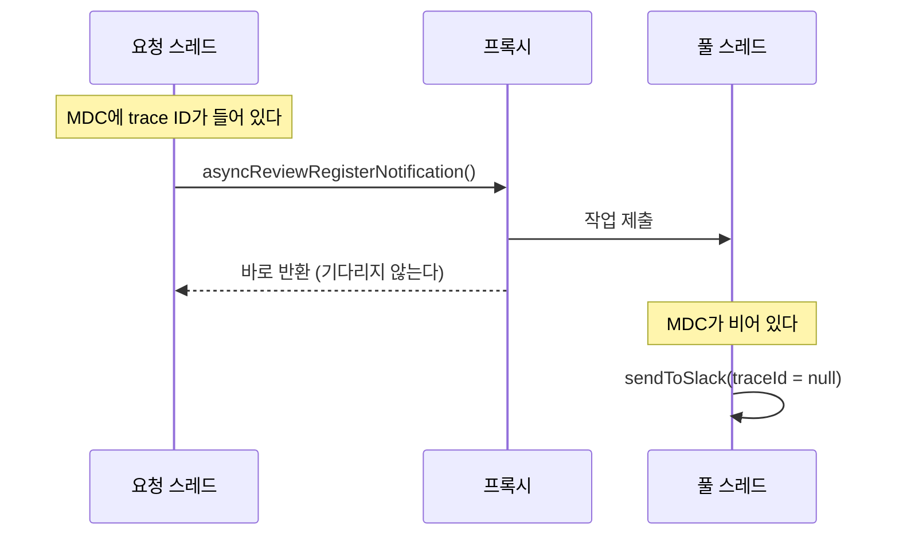
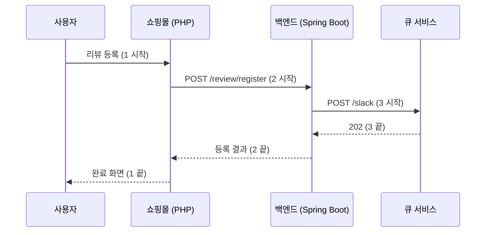

리뷰가 등록되면 사내 Slack 채널로 알림을 보내는 기능을 사내 메시지 큐 서비스(이하 **큐 서비스**)로 옮기다가, 큐 서비스로 보내는 `traceId`가 `null`이 되어 메시지가 조용히 버려지는 문제를 만났다. 원인은 알림 메서드에 붙어 있던 `@Async`였다. 이전까지의 과정은 [Slack 알림을 Webhook에서 사내 메시지 큐로 옮기며 Revert를 네 번 한 이야기](/posts/slack-webhook-to-message-queue/)에 정리해 두었다.

이 글에서는 `@Async`를 떼고 동기로 바꾸기까지 고민한 것과, 그 대가로 리뷰 등록이 실제로 얼마나 느려졌는지 Datadog으로 확인한 과정을 정리한다.

## 문제: `@Async` 스레드에서는 MDC가 비어 있다

백엔드는 큐 서비스로 보내는 `traceId`에 ALB가 붙여 주는 `X-Amzn-Trace-Id` 헤더 값을 쓴다. 서블릿 필터가 요청이 들어올 때 이 값을 MDC에 넣어 두고, 큐 서비스 클라이언트가 MDC에서 꺼내 쓰는 구조다.

그리고 알림은 이렇게 비동기로 보내고 있었다.

```java
@Configuration
@EnableAsync
public class AsyncConfiguration {
    @Bean
    Executor taskExecutor() {
        var executor = new ThreadPoolTaskExecutor();
        executor.setCorePoolSize(1);
        executor.setMaxPoolSize(1);
        executor.setQueueCapacity(10);
        executor.initialize();
        return executor;
    }
}

public interface SlackClient {
    @Async
    void asyncReviewRegisterNotification(ReviewPostingSummary summary);
}
```

`@Async`가 붙은 메서드를 부르면, Spring이 끼워 넣은 프록시가 호출을 가로채서 메서드 본문을 `taskExecutor`에 작업으로 넘기고 바로 돌아온다. 직접 쓴다면 `executor.submit(() -> 메서드 본문)`을 호출하는 것과 비슷하다. 요청 스레드는 알림 전송을 기다리지 않는다.

문제는 MDC가 **스레드마다 따로 갖는 저장소**(ThreadLocal)라는 점이다. 필터가 값을 넣은 건 요청 스레드인데, 알림 메서드는 스레드 풀의 다른 스레드에서 돈다. 그 스레드의 MDC에는 아무것도 없으니 `MDC.get("alb-trace-id")`는 `null`을 돌려준다.



## 선택지 세 가지

당시 조사 메모에 정리한 선택지는 세 가지였다.

| 방법 | 장점 | 단점 |
| --- | --- | --- |
| 1. `@Async`를 없애고 동기로 보낸다 | 추가 구현 없이 요청 스레드의 trace ID를 그대로 쓴다 | 리뷰 등록 완료까지 약 70ms 늘어난다 |
| 2. 백엔드에서 trace ID를 새로 만들어 보낸다 (쇼핑몰은 이미 이렇게 보낸다) | 비동기를 유지한다. 로컬에서도 테스트할 수 있다 | `@Async`를 제대로 설계해야 한다 (스레드 상한 등) |
| 3. 비동기를 유지하고 trace ID를 파라미터로 넘긴다 | trace ID를 새로 만들 필요가 없다 | 마찬가지로 `@Async`를 제대로 설계해야 한다 |

약 70ms는 "알림 메시지를 만들어 큐 서비스로 보내기까지" 걸리는 시간을 반영 전에 재 본 값이다.

2번에는 단점이 하나 더 있다. trace ID는 "이 Slack 메시지가 어느 요청에서 나왔는지" 로그를 따라가기 위한 값인데, 새로 만들면 ALB나 백엔드 로그와 이어지지 않는다.

### "`@Async`를 제대로 설계해야 한다"는 게 무슨 뜻이었나

2번과 3번의 단점은 당시 메모에 한 줄로만 적어 두었는데, 설정을 다시 보면 구체적인 위험이 있었다. 위의 스레드 풀은 **스레드 1개, 대기열 10개**다. 알림이 한꺼번에 몰려 대기열이 가득 차면, `ThreadPoolTaskExecutor`는 기본 정책(AbortPolicy)대로 `TaskRejectedException`을 던진다. 그리고 이 예외는 작업을 제출한 쪽, 즉 **요청 스레드로** 올라온다.

```java
public RegisterReviewResult registerReview(Review review) {
    reviewRepository.register(review);                     // 1. 리뷰는 여기서 이미 저장된다
    ReviewPostingSummary summary = reviewPostingSummaryBuilder.build(review);
    slackService.asyncReviewRegisterNotification(summary); // 2. 대기열이 가득 차면 여기서 예외
    return RegisterReviewResult.SUCCESS;
}
```

리뷰는 저장됐는데 응답은 에러가 되는 셈이다. 알림은 하루 수십 건이라 이런 일이 실제로 일어날 가능성은 낮았다. 하지만 바로 그 이유 때문에, 잘못 설계해도 **아무도 알아채지 못할** 가능성이 컸다. 비동기를 유지하려면 풀 크기와 대기열, 가득 찼을 때 버릴지(DiscardPolicy) 호출한 스레드에서 그냥 실행할지(CallerRunsPolicy) 같은 정책까지 다시 정해야 했다.

### 동기를 고른 이유

결국 1번을 골랐다.

- 큐 서비스는 이미 **비동기**다. API Gateway가 요청을 받자마자 `202`를 돌려주고, 실제 Slack 전송은 뒤쪽의 Lambda가 한다. 백엔드가 기다리는 건 "큐 서비스가 요청을 받았다"는 응답까지라서, 백엔드까지 비동기로 만들 이유가 크지 않았다
- 늘어나는 시간은 약 70ms로 예상됐다
- 비동기를 유지하면 위의 스레드 풀 설계를 새로 해야 한다

## 동기로 바꾼 코드

바꾼 건 인터페이스에서 `@Async`를 지운 것이 전부다.

```java
// 변경 전
public interface SlackClient {
    @Async
    void asyncReviewRegisterNotification(ReviewPostingSummary summary);
}

// 변경 후
public interface SlackClient {
    void reviewRegisterNotification(ReviewPostingSummary summary);
}
```

처음 PR에서는 `@Async`만 지웠는데, 코드 리뷰에서 이런 지적을 받았다.

> 메서드 이름에 `async`가 남아 있으니 이것도 리팩터링하자. 이 메서드를 부르는 서비스의 메서드에도 `async`가 붙어 있으니 그것도 같이.

이름은 `asyncReviewRegisterNotification`인데 실제로는 동기로 돈다면 이름이 거짓말을 하는 셈이다. 서비스, 구현체, 테스트 이름까지 `reviewRegisterNotification`으로 맞췄다. "어떻게(async)" 도는지를 이름에 넣어 두면, 구현이 바뀔 때마다 이름도 같이 바꿔야 한다.

## 동기의 대가 재기: Datadog 대시보드

동기로 바뀌면, 사용자가 리뷰를 등록하고 완료 화면을 보기까지의 시간이 늘어난다. 얼마나 늘었는지 보려고 Datadog APM 지표로 대시보드를 만들었다. 리뷰 등록 요청은 쇼핑몰(PHP) → 백엔드 → 큐 서비스 순서로 흐르기 때문에, 구간을 세 개로 나눠서 쟀다.



| 위젯 | 재는 것 | 고른 span |
| --- | --- | --- |
| 1. 리뷰 등록 전체 | 사용자가 기다리는 시간 | 쇼핑몰의 리뷰 등록 요청 (server) |
| 2. 백엔드 리뷰 등록 API | 백엔드가 쓰는 시간 | 쇼핑몰이 백엔드를 부르는 curl 호출 (client) |
| 3. 큐 서비스 호출 | 동기로 바뀐 부분 | 백엔드가 큐 서비스를 부르는 HTTP 호출 (client) |

위젯마다 평균, p95, 최대값을 같이 그렸다. 평균만 보면 가끔 튀는 요청이 묻히고, 최대값만 보면 우연한 한 건에 휘둘리기 때문이다. APM의 trace metrics는 샘플링 설정과 상관없이 전체 요청으로 계산되므로, 요청 수가 적은 API라도 빠짐없이 잡힌다.

## 결과

이 글을 쓰면서 바꾸기 전후 한 달씩을 다시 비교해 봤다. 비동기 기간은 1월 5일 ~ 2월 3일, 큐 서비스로 동기 전송한 기간은 마지막 반영 다음 날인 2월 18일부터 한 달이다.

**3. 큐 서비스 호출 (동기로 바뀐 부분)**

| 평균 | 중앙값 | p95 | 최대 |
| --- | --- | --- | --- |
| 61ms | 55ms | 98ms | 260ms |

반영 전에 예상한 약 70ms와 거의 같다.

**2. 백엔드 리뷰 등록 API**

| 기간 | 평균 | 중앙값 | p95 |
| --- | --- | --- | --- |
| 비동기 (1/5~2/3) | 108ms | 125ms | 149ms |
| 동기 + 큐 서비스 (2/18~3/17) | 160ms | 142ms | 229ms |

**1. 리뷰 등록 전체 (사용자가 기다리는 시간)**

| 기간 | 평균 | 중앙값 | p95 |
| --- | --- | --- | --- |
| 비동기 (1/5~2/3) | 360ms | 289ms | 618ms |
| 동기 + 큐 서비스 (2/18~3/17) | 404ms | 313ms | 679ms |

사용자가 기다리는 시간으로 보면 평균 44ms, 중앙값 23ms가 늘었다. 내용 없이 별점만 남긴 리뷰는 알림을 보내지 않기 때문에, 모든 요청이 3번 구간만큼 늘어나지는 않는다. 수백 ms 중 수십 ms라서 받아들일 만한 비용이라고 판단했다.

### 우연히 생긴 비교 구간: 동기로 Webhook을 부르면

Revert를 반복하는 사이에 의도하지 않은 구간이 하나 생겼다. `@Async`를 떼는 변경은 그대로 둔 채 큐 서비스로 옮기는 변경만 되돌린 기간(2/6~2/17)에는, 백엔드가 **Slack Webhook을 동기로** 부르고 있었다.

| 기간 | 상태 | 2번 평균 | 2번 p95 | 1번 평균 |
| --- | --- | --- | --- | --- |
| 1/5~2/3 | 비동기 + Webhook | 108ms | 149ms | 360ms |
| 2/6~2/17 | 동기 + Webhook | 284ms | 506ms | 516ms |
| 2/18~3/17 | 동기 + 큐 서비스 | 160ms | 229ms | 404ms |

같은 "동기"라도 Webhook을 부를 때는 백엔드 API가 평균 176ms 늘었고, 큐 서비스를 부를 때는 52ms 늘었다. Webhook은 인터넷 너머의 Slack 서버까지 다녀와야 하지만, 큐 서비스는 같은 AWS 리전 안에서 요청을 받자마자 `202`를 돌려준다. **동기로 바꾸는 비용은 무엇을 동기로 부르느냐에 달려 있었다.** 거꾸로 보면, Webhook을 쓰던 시절에 알림을 `@Async`로 보낸 데에는 충분한 이유가 있었던 셈이다.

### 2초 걸린 요청은 동기 때문이었을까

큐 서비스로 처음 동기 전송을 시작한 날, 반영 후 6시간 사이에 1번 구간이 2초쯤 걸린 요청이 두 건 보였다. 당시 메모에도 "우연일까? 동기 처리 때문일까?"라고 적어 두었다.

이 글을 쓰면서 같은 시간대(2/4 오후 ~ 2/5 오전)를 다시 보니, 1번의 최대는 2.07초였지만 2번의 최대는 0.34초, 3번의 최대는 0.20초였다. 2번은 3번을 포함하는 구간이니, 2초 중 적어도 1.7초는 **백엔드 호출 밖에서** 쓰였다. 비동기 기간에도 1번이 4초까지 걸린 요청이 있었다. 동기 처리 때문은 아니었다.

## 다시 본다면

### 타임아웃부터 확인했을 것

동기로 바꾼다는 건, 큐 서비스가 느려지면 리뷰 등록도 그만큼 느려진다는 뜻이다. 그 상한을 정하는 게 타임아웃인데, 이 부분을 확인하지 않았다.

당시 큐 서비스 클라이언트 설정에는 connect 5초, read 60초가 적혀 있었다. 그런데 실제로는 **적용되지 않고 있었다.** Spring Boot 3.4부터 `RestClientBuilderConfigurer#configure`가 requestFactory를 자동 구성된 것으로 덮어쓰는데, 설정 코드가 타임아웃을 넣은 **다음에** `configure`를 부르고 있었기 때문이다.

```java
// 당시 코드: 타임아웃을 넣은 requestFactory를 configure가 덮어쓴다
RestClient.Builder builder = RestClient.builder()
        .requestFactory(ClientHttpRequestFactories.get(settings)); // connect 5초, read 60초
configurer.configure(builder);                                       // 여기서 requestFactory가 바뀐다
return builder;
```

```java
// 고친 코드: configure를 먼저 부르고, 타임아웃은 그 뒤에 적용한다
RestClient.Builder builder = RestClient.builder();
configurer.configure(builder);
return builder.requestFactory(ClientHttpRequestFactoryBuilder.detect().build(settings));
```

이 문제는 몇 달 뒤 다른 팀원이 발견해서 고쳤고, 타임아웃이 실제로 들어갔는지 확인하는 회귀 테스트도 추가했다. 측정한 한 달 동안 3번 구간은 가장 느린 것도 0.26초라 실제 피해는 없었다. 하지만 큐 서비스가 응답하지 않았다면 리뷰 등록 요청도 같이 붙잡혀 있었을 것이다.
그리고 타임아웃이 제대로 걸렸더라도, 알림 한 건에 60초는 길다. 실패해도 로그만 남기는 알림이니 1~2초 정도로 짧게 끊는 편이 맞다고 생각한다.

### 비동기를 유지하는 방법도 하나 더 있었다

MDC를 풀 스레드로 복사해 주는 `TaskDecorator`를 쓰면, `@Async`를 유지하면서도 요청 스레드의 trace ID를 그대로 쓸 수 있다.

```java
executor.setTaskDecorator(runnable -> {
    Map<String, String> context = MDC.getCopyOfContextMap(); // 요청 스레드에서 복사해 두고
    return () -> {
        if (context != null) {
            MDC.setContextMap(context);                     // 풀 스레드에 붙여 넣는다
        }
        try {
            runnable.run();
        } finally {
            MDC.clear();                                    // 스레드가 재사용되니 꼭 지운다
        }
    };
});
```

`decorate`는 작업을 제출하는 스레드(요청 스레드)에서 불리고, 돌려준 `Runnable`은 풀 스레드에서 실행된다. 그래서 복사는 요청 스레드에서, 붙여 넣기는 풀 스레드에서 일어난다.
다만 이 방법도 스레드 풀 설계(크기, 대기열, 가득 찼을 때의 정책)를 피할 수는 없다. 큐 서비스가 이미 비동기라는 점을 생각하면 동기를 고른 판단은 지금도 맞았다고 본다. 비동기를 유지해야 하는 상황이었다면 이 방법을 먼저 검토했을 것이다.

### `@EnableAsync` 설정도 같이 지웠을 것

`@Async`를 쓰는 곳이 하나도 남지 않았는데, `@EnableAsync`와 스레드 풀 설정은 그대로 남았다. 이 설정은 몇 달 뒤 다른 팀원이 "사용하지 않는 설정"으로 정리했다. 기능의 마지막 사용처를 지울 때는 그 기능을 위한 설정까지 같이 지워야 다음 사람이 헷갈리지 않는다.

## 배운 점

- `@Async`는 메서드 본문을 다른 스레드로 넘길 뿐이다. MDC처럼 ThreadLocal에 들어 있는 값은 따라가지 않는다 (Spring Security의 SecurityContext나 트랜잭션도 기본적으로는 마찬가지다)
- 비동기도 공짜가 아니다. 스레드 풀의 크기와 대기열, 가득 찼을 때 어떻게 할지까지 정해야 한다
- 동기로 바꾸는 비용은 **무엇을 부르느냐**에 달려 있다. 이미 비동기인 큐 서비스를 부르는 데는 수십 ms면 충분했지만, 같은 동기라도 Webhook을 부를 때는 그 세 배가 넘게 늘었다
- 바꾼 부분만이 아니라 사용자가 기다리는 전체 시간까지 구간별로 재 두면, "느려진 게 내 변경 때문인가"라는 질문에 데이터로 답할 수 있다
- 동기 호출에서는 타임아웃이 곧 최악의 대기 시간이다. 그리고 설정 코드에 숫자가 적혀 있다고 해서 실제로 적용된 것은 아니다
- 메서드 이름에는 "어떻게"가 아니라 "무엇을" 하는지를 넣는다
