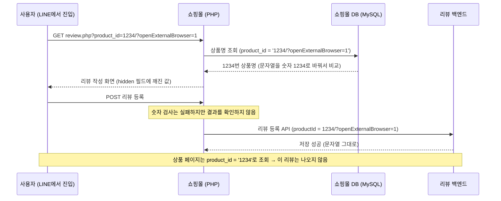

회사 쇼핑몰에서 **공개 상태인데도 상품 페이지에 나오지 않는 리뷰**가 수백 건 발견된 적이 있다.
데이터는 발견 직후 바로 정리됐지만 "애초에 이런 값이 왜 들어왔는지"는 밝혀지지 않은 채 남아 있었고, 이 근본 원인 조사를 내가 이어받았다.
원인을 추적한 과정과, 잘못 들어온 값을 **고쳐서 받을지(필터링) 거절할지(검증)** 고민한 내용을 정리해 둔다.

## 문제 상황

- 공개 상태인 리뷰가 상품 페이지에 표시되지 않는다
- 관리 화면에서는 조건 없이 조회하면 보이지만, **상품명으로 검색하면 나오지 않는다**
- 문제의 리뷰들은 상품 ID가 이런 값으로 저장되어 있었다

| 구분 | 저장된 상품 ID |
| --- | --- |
| 정상 리뷰 | `1234` |
| 문제 리뷰 | `1234/?openExternalBrowser=1` |

상품 페이지는 상품 ID `1234`로 리뷰를 조회한다. 리뷰를 저장하는 쪽의 상품 ID 컬럼은 문자열이라서 `'1234'`와 `'1234/?openExternalBrowser=1'`은 **완전히 다른 값**이고, 그래서 조회 결과에서 빠진 것이다.
관리 화면의 상품명 검색도 "상품명 → 상품 ID → 리뷰" 순서로 찾기 때문에 같은 이유로 나오지 않았다.

이런 리뷰는 몇 달에 걸쳐 조금씩 쌓였고, 발견 직후 다른 팀원이 데이터를 바로잡았다.

```sql
-- 앞쪽 숫자만 남기고 뒤에 붙은 문자열을 제거
UPDATE review
SET product_id = regexp_replace(product_id, '^([0-9]+).*', '\1')
WHERE product_id LIKE '%/?openExternalBrowser=1';
```

정리한 뒤로 같은 데이터는 새로 생기지 않았다. 하지만 **어디서 온 값인지 모르면 언제든 다시 생길 수 있는** 상태였다.

## 구조

리뷰 작성에는 두 시스템이 관여한다.

- **쇼핑몰**: EC-CUBE 2 기반 PHP 애플리케이션. 상품 정보는 쇼핑몰 DB(MySQL)에 있다
- **리뷰 백엔드**: 리뷰를 저장하는 별도 API 서버

리뷰가 등록되는 흐름은 이렇다.

1. 상품 페이지에서 리뷰 작성 페이지로 이동한다: `/products/review.php?product_id=1234`
2. 리뷰 작성 페이지는 GET 파라미터 `product_id`로 상품명을 조회하고, 그 값을 폼의 hidden 필드에 넣는다
3. 폼을 제출하면 쇼핑몰이 리뷰 백엔드 API에 상품 ID와 리뷰 내용을 보낸다

## 재현: `&` 대신 `/?`

`openExternalBrowser=1`은 LINE에서 쓰는 파라미터다. LINE 앱 안에서 링크를 누르면 LINE 내장 브라우저로 열리는데, URL에 `openExternalBrowser=1`을 붙여 두면 **기본 브라우저(Safari, Chrome 등)로 열린다**.

문제는 이 파라미터를 붙이는 방법이었다. 리뷰 작성 페이지 URL로 재현해 보니 원인은 금방 보였다.

```text
❌ /products/review.php?product_id=1234/?openExternalBrowser=1
✅ /products/review.php?product_id=1234&openExternalBrowser=1
```

URL의 쿼리 문자열은 **첫 번째 `?`부터** 시작하고, 파라미터는 **`&`로만** 나뉜다. 그 뒤에 나오는 `?`나 `/`는 그냥 값의 일부다.

| URL | 서버가 받는 `product_id` |
| --- | --- |
| `review.php?product_id=1234&openExternalBrowser=1` | `1234` |
| `review.php?product_id=1234/?openExternalBrowser=1` | `1234/?openExternalBrowser=1` |

이미 `?product_id=...`로 쿼리가 시작된 URL에 파라미터를 하나 더 붙이려면 `&`를 써야 하는데, `/?`로 붙이는 바람에 **뒤쪽 전체가 `product_id` 값에 합쳐진** 것이다.
게다가 `product_id`에는 사실상 아무 값이나 들어갈 수 있었다. `review.php?product_id=1234//////` 같은 URL도 그대로 통과했다.

### 왜 하필 `/?`였을까

상품 상세 페이지는 `/item/1234`처럼 **경로 형태의 URL**을 쓴다. 실제로 LINE 메시지에 들어간 상품 링크도 이런 모양이었다.

```text
/item/1234/?openExternalBrowser=1&utm_source=line&...
```

이 URL에는 문제가 없다. `?`가 쿼리의 시작이 되고, 서버의 리라이트 규칙도 경로에서 **숫자만** 꺼내 쓰기 때문이다.

```apache
# /item/1234/... → detail.php?product_id=1234&(원래 쿼리 문자열)
RewriteRule ^item/([0-9]+) products/detail.php?product_id=$1&%{QUERY_STRING} [L]
```

그런데 "URL 끝에 `/?openExternalBrowser=1`을 붙인다"는 같은 방식을 이미 쿼리 문자열이 있는 리뷰 작성 URL에 적용하면, 앞에서 본 깨진 URL이 된다. 가장 그럴듯한 가설은 이것이었다.

## 발생원 추적: 이 URL은 누가 만들었나

URL을 만든 곳이 우리 코드라면 그 부분을 고치면 끝이다. 그래서 먼저 쇼핑몰 코드를 확인했다.

- 쇼핑몰 코드에서 `openExternalBrowser`를 쓰는 곳은 LINE 쿠폰 링크를 만드는 한 곳뿐이었고, 여기서는 `&openExternalBrowser=1`로 올바르게 붙이고 있었다
- 상품 상세 페이지에 있는 리뷰 작성 링크도 `review.php?product_id=1234` 형태로 정상이었다

다음으로 **사용자 입장에서** 각 채널의 링크를 직접 눌러 봤다.

| 채널 | 결과 |
| --- | --- |
| LINE 메시지의 상품 광고 | `/item/1234/?openExternalBrowser=1&...`로 열림. 여기서 리뷰 작성으로 이동하면 정상 URL |
| X (Twitter) | 외부 브라우저로 열어도 정상 URL |
| Instagram | `openExternalBrowser` 없이 인스타그램 안에서 열림 |
| YouTube 설명란 | `/?openExternalBrowser=1&...` — LINE이 아닌 채널의 링크에도 이 파라미터가 붙어 있었다 |

지금 열려 있는 링크에서는 깨진 URL을 찾을 수 없었다. 다만 YouTube 링크처럼 **채널마다 사람이 직접 파라미터를 붙여 링크를 만들고 있다**는 건 알 수 있었다.
그래서 가장 유력한 후보는 마케팅 도구에서 LINE 메시지 링크를 설정할 때의 실수였다. 문제 리뷰가 마지막으로 등록된 건 조사 시점보다 약 1년 전이었고 그 뒤로는 새로 생기지 않았으니, 원인이 된 링크는 이미 쓰이지 않는 것으로 보였다.

결론은 **이 URL은 쇼핑몰 바깥에서 만들어졌다**는 것이다. 바깥에서 만들어진 URL은 우리가 고칠 수 없고, 비슷한 실수가 다시 나오지 않는다는 보장도 없다. 그렇다면 남은 방법은 **쇼핑몰 입구에서 막는 것**이다.

## 왜 아무도 몰랐을까

그 전에 짚어 볼 것이 있다. 이 값은 리뷰 작성 화면을 띄우고, 폼을 검사하고, 백엔드에 저장하기까지 **에러를 한 번도 내지 않았다**. 그래서 몇 달 동안 아무도 몰랐다.

### MySQL이 문자열을 숫자로 알아서 바꿔 줬다

리뷰 작성 페이지는 GET으로 받은 `product_id`로 상품명을 조회한다.

```php
// dtb_products.product_id 는 INT 컬럼
$objQuery->get('name', 'dtb_products', 'product_id = ?', [$productId]);
```

`$productId`가 `'1234/?openExternalBrowser=1'`이어도 상품명은 정상적으로 조회됐다. MySQL은 숫자와 문자열을 비교할 때 문자열을 숫자로 바꾸는데, 이때 **앞쪽의 숫자 부분만 읽고 나머지는 버린다**(경고만 남긴다).

```sql
SELECT 1234 = '1234/?openExternalBrowser=1';  -- 1 (참)
```

그래서 리뷰 작성 화면은 아무 문제 없이 떴고, 깨진 값은 그대로 폼의 hidden 필드에 들어갔다.

### 검사는 했지만 결과를 보지 않았다

사실 `product_id`에는 숫자 검사 규칙이 걸려 있었다.

```php
$objFormParam->addParam('商品ID', 'product_id', INT_LEN, 'n', ['NUM_CHECK', 'EXIST_CHECK', 'MAX_LENGTH_CHECK']);
```

그런데 폼을 제출할 때(`complete`)는 검사 결과를 변수에 담기만 하고, **확인하지 않은 채** 바로 등록 API를 호출하고 있었다.

```php
case 'complete':
    $this->arrErr = $this->lfCheckError($objFormParam); // product_id 숫자 검사 → 에러가 잡힌다
    // ↓ 그런데 $this->arrErr 를 확인하지 않고 바로 등록
    $reviewId = $this->reviewService->registerReview([
        'productId' => $objFormParam->getValue('product_id'),
        // ...
    ]);
```

이건 PR 코드 리뷰에서 지적을 받고 알게 됐다. 이 글을 쓰면서 이력을 찾아보니, 몇 년 전 리뷰 저장을 별도 백엔드 API로 옮길 때 생긴 일이었다. `if (empty($this->arrErr))`로 감싸져 있던 기존 등록 코드는 통째로 주석 처리됐는데, 새로 넣은 API 호출은 그 조건문 **밖에** 놓였다.

리뷰 백엔드도 받은 상품 ID를 문자열 그대로 저장했다. 결국 깨진 값은 세 단계를 모두 통과했고, 문제는 한참 뒤 조회할 때가 되어서야 "리뷰가 안 보인다"는 모습으로 드러났다.



> Spring MVC에서 `@RequestParam Long productId`로 받았다면 `1234/?openExternalBrowser=1`은 `Long`으로 바꿀 수 없어서, 컨트롤러에 들어가기도 전에 **400 Bad Request**가 났을 것이다. PHP의 `$_GET` 값은 전부 문자열이라 이런 타입 검사가 저절로 일어나지 않는다. 검사 코드를 직접 써야 하고, **그 결과를 확인하는 것**까지 챙겨야 한다.
{: .prompt-info }

## 필터링 vs 검증: 사용자에게 에러를 보여줘야 할까

입구에서 막는 방법은 두 가지가 있었다.

| 방식 | `1234/?openExternalBrowser=1`이 들어오면 | 장점 | 단점 |
| --- | --- | --- | --- |
| 검증 (Validation) | 에러를 보여주고 등록하지 않는다 | 잘못된 데이터가 확실히 막힌다 | 잘못이 없는 사용자가 리뷰를 쓰지 못한다 |
| 필터링 (Filtering) | 숫자만 뽑아서 `1234`로 등록한다 | 사용자는 아무 불편 없이 리뷰를 쓴다 | 규칙이 틀리면 엉뚱한 값으로 조용히 바뀐다 |

코드 리뷰에서도 "잘못된 URL이니까 등록시키지 않는 게 맞지 않느냐"는 의견이 나왔다. 데이터만 보면 맞는 말이다. 위의 Spring 예시처럼 400을 내는 쪽이 오히려 정석에 가깝다.

그래도 나는 필터링을 택했다.

- 이 URL로 들어온 사용자는 **LINE에서 링크를 눌러 리뷰를 쓰려고 했을 뿐**이다. 부정한 요청이 아니라 정상적인 흐름이다
- URL을 망가뜨린 건 사용자가 아니라 링크를 만든 쪽이다. 그런데 에러가 나면 사용자에게는 "리뷰를 쓰려다 에러가 났다"는 **나쁜 경험**만 남는다
- 깨진 값에서도 사용자의 의도(1234번 상품)는 분명하게 읽어낼 수 있다

그래서 역할을 이렇게 나누기로 했다.

- **쇼핑몰 (사용자와 만나는 입구)**: 숫자만 추출해서 정상적인 상품 ID로 넘긴다. 숫자가 하나도 없을 때만 기존과 같은 "상품을 찾을 수 없습니다" 에러를 보여준다
- **리뷰 백엔드 (데이터를 저장하는 곳)**: 숫자가 아닌 상품 ID가 들어오면 에러를 돌려준다. 필터링으로도 살릴 수 없는 비정상적인 값은 여기서 막는다

알고 받아들인 부작용도 있다. 나중에 상품 ID에 문자가 섞인 형식(예: `1234ChristmasEvent`)이 생기면 필터링이 숫자 부분만 남겨 버린다. 이 점은 작업 티켓에 부작용으로 적어 두고 진행했다.

## 구현

```php
private function filterProductId($productId)
{
    $before = (string)$productId;
    if (preg_match('/(\d+)/', $before, $matches)) {
        return $matches[1]; // 처음 나오는 숫자 덩어리
    }
    return null;            // 숫자가 하나도 없으면 null
}
```

이 함수를 리뷰 작성 화면을 그릴 때와 폼을 제출할 때 **두 군데 모두** 적용했다.

```php
// 1) 화면 표시: hidden 필드에 들어갈 값부터 정리
$this->arrForm['product_id'] = $this->filterProductId($this->arrForm['product_id']);
if ($this->arrForm['product_id'] === null) {
    SC_Utils_Ex::sfDispSiteError(PRODUCT_NOT_FOUND);
}

// 2) 폼 제출: 등록 직전에 한 번 더
case 'complete':
    $productId = $this->filterProductId($objFormParam->getValue('product_id'));
    if ($productId === null) {
        SC_Utils_Ex::sfDispSiteError(PRODUCT_NOT_FOUND);
    }
    // 이후 중복 체크와 등록 API 호출에는 모두 $productId 를 쓴다
```

화면 표시 단계에서 정리하면 hidden 필드에도 `1234`가 들어가므로 대부분은 여기서 해결된다. 제출 단계의 필터는 폼을 거치지 않고 바로 들어오는 요청까지 막기 위한 두 번째 방어선이다.
배포 체크 항목으로는 스테이징에서 깨진 URL로 리뷰를 등록하고, DB에 `1234`로 저장되는지 확인하는 것을 넣었다.

### 코드 리뷰에서 고친 것들

| 리뷰 당시 코드 | 지적받은 점 | 수정 |
| --- | --- | --- |
| 중복 체크에 `getValue('product_id')`를 그대로 사용 | 필터링 **전** 값이 넘어가고 있다 | 필터링한 `$productId`로 통일 |
| `preg_match(...)` 뒤 바로 `return $mew[1];` | 정규식이 맞지 않으면 `$mew[1]`이 정의되지 않는다 | 매치 실패 시 `null`을 반환하고, 호출하는 쪽에서 에러 처리 |
| 전용 에러 메시지를 따로 만듦 | 아래쪽 "상품 없음" 처리와 형식이 다르다 | 기존과 같은 `PRODUCT_NOT_FOUND` 사용 |
| 변수명 `$mew` | 오타 같다. 의미 있는 이름으로 | `$matches` |

함수도 처음에는 `checkProductId`라는 이름으로 `(int)` 변환을 하고, 실패하면 `0`을 돌려줬다.
하지만 이 함수는 값을 검사하는 게 아니라 **걸러내는** 함수라서 `filterProductId`로 이름을 바꾸고, 타입은 원래대로(문자열) 두었다.

## 리뷰 백엔드에서도 검증해야 할까

리뷰 백엔드 쪽 검증은 아직 넣지 않았다. 작업하다가 이런 의문이 생겼기 때문이다.

> 상품 ID는 관리자가 상품을 등록할 때 쇼핑몰 안에서 시퀀스(`nextval()`)로 자동 생성된다. 정상적인 경로라면 숫자 말고는 들어올 수 없고, 쇼핑몰에서도 이미 걸러 준다. 그런데 리뷰 백엔드에서 같은 검사를 또 해야 할까?

| 관점 | 생각 |
| --- | --- |
| 한 곳에서만 | 같은 규칙이 두 곳에 있으면, 규칙이 바뀔 때 양쪽을 함께 고쳐야 한다 |
| 양쪽 모두 | 리뷰 백엔드 입장에서 쇼핑몰은 API를 호출하는 클라이언트 중 하나일 뿐이다. 자기가 저장하는 데이터의 규칙은 스스로 지켜야 한다 |

이번 사고만 놓고 보면, 쇼핑몰 쪽 검사가 사실상 꺼져 있던 동안 리뷰 백엔드에 검증이 있었다면 **그게 마지막 방어선**이 되어 줬을 것이다.
사고 회고에서도 "두 시스템이 주고받는 데이터의 규칙부터 정해야 한다"는 이야기가 나왔고, 이 부분은 계속 고민 중이다.

## 다시 본다면

### 정규식에 `^`를 붙였을 것

`/(\d+)/`는 **위치와 상관없이 처음 나오는 숫자**를 가져온다. 그래서 앞에 숫자가 없는 값이 들어오면 엉뚱한 숫자를 뽑는다.

| 입력 | `/(\d+)/` | `/^(\d+)/` |
| --- | --- | --- |
| `1234/?openExternalBrowser=1` | `1234` | `1234` |
| `1234//////` | `1234` | `1234` |
| `/?openExternalBrowser=1` | `1` ⚠️ | 없음 → 에러 |

세 번째처럼 상품 ID 자리가 비어 있는 링크라면, 1번 상품이 있을 경우 **그 상품의 리뷰로 등록**되어 버린다. 데이터 정리 SQL이 `^([0-9]+)`를 썼던 것처럼, 맨 앞의 숫자만 인정하는 편이 안전하다.

### 필터링했다는 사실은 로그로 남겼을 것

지금은 값을 조용히 고쳐 주기 때문에, 깨진 링크가 다시 돌아다녀도 **아무도 알 수 없다**. 이번 문제가 몇 달 동안 드러나지 않은 것과 같은 구조다.
사용자에게는 보여주지 않더라도 "원래 값 → 고친 값"을 로그로 남겨 두면, 이상한 링크가 다시 나타났을 때 바로 알아차리고 발생원을 찾아갈 수 있다.

## 배운 점

- URL에 파라미터를 추가할 때는 **이미 쿼리 문자열이 있는지**에 따라 `?`와 `&`를 골라야 한다. 문자열을 손으로 이어 붙이기보다 `URLSearchParams`, `http_build_query` 같은 도구를 쓰는 게 안전하다
- **에러가 나지 않는 게 꼭 좋은 건 아니다.** MySQL의 암묵적 형변환과 무시된 검사 결과 때문에 잘못된 값이 경고 없이 저장됐고, 몇 달 동안 아무도 몰랐다
- 검사 코드는 **결과를 확인하는 코드까지** 있어야 의미가 있다
- 잘못된 입력을 거절할지 고쳐서 받을지는 데이터만 보고 정할 일이 아니다. **그 입력이 사용자의 잘못으로 생긴 것인지**도 함께 봐야 한다. 그리고 고쳐서 받는다면, 고쳤다는 흔적은 남겨 두는 게 좋다
