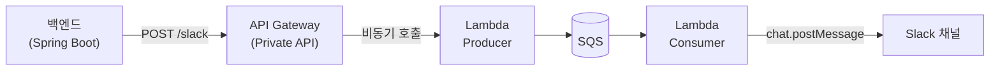
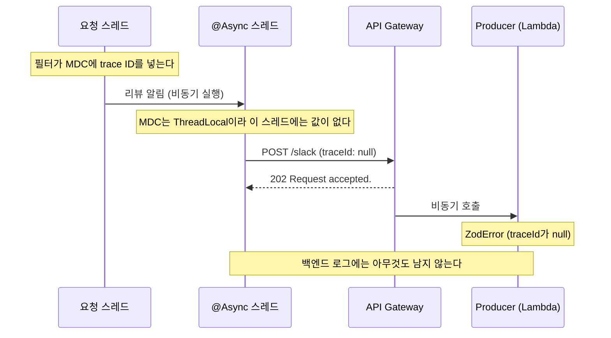

회사 백엔드(Spring Boot)에는 리뷰가 등록되면 사내 Slack 채널로 알림을 보내는 기능이 있다. 이 알림은 Slack Incoming Webhook으로 보내고 있었는데, 보안상의 이유로 Webhook을 정리하게 되면서 **사내 메시지 큐 서비스를 거쳐 Slack API로 보내는 방식**으로 옮겼다.

코드 변경은 크지 않았다. 그런데 이 변경은 main에 다섯 번 들어갔고, 그중 네 번 Revert됐다. 1월 21일에 처음 반영하고 2월 17일에 마지막으로 반영하기까지 4주 가까이 걸렸다.
원인은 하나가 아니었고, 그중 절반은 코드 밖에 있었다. 그 원인을 하나씩 찾아낸 과정을 정리해 둔다.

## 배경: Webhook에서 사내 메시지 큐로

### Incoming Webhook

Incoming Webhook은 Slack이 발급한 URL로 JSON을 POST하면 채널에 메시지가 올라가는 방식이다. 기존 코드도 Block Kit 형식의 JSON을 만들어서 `RestTemplate`으로 보내기만 하면 됐다.

간단한 대신 **URL 자체가 인증 정보**다. URL이 새어 나가면 누구든 그 채널에 메시지를 보낼 수 있다.

### 사내 메시지 큐 서비스

옮겨 갈 곳은 사내에서 이미 쓰고 있던 메시지 큐 서비스(이하 **큐 서비스**)였다. 외부 서비스 호출을 비동기로 처리하려고 만든 서비스로, Slack 알림 말고도 결제나 메일 같은 처리를 맡고 있다.



- 백엔드는 큐 서비스 API에 **채널 ID와 메시지 문자열**만 보낸다
- Slack 봇 토큰은 큐 서비스만 갖고 있다. 실제 전송은 Consumer가 Slack Web API(`chat.postMessage`)로 한다
- API Gateway는 Producer Lambda를 **비동기로 호출하고, 요청을 받자마자 `202`를 돌려준다.** 호출하는 쪽이 Lambda 콜드 스타트를 기다리지 않게 하려는 설계다

마지막 항목이 나중에 중요해진다.

## 코드 변경: 이미 있던 패턴을 따라서

백엔드에는 이미 큐 서비스로 Slack 알림을 보내는 코드가 있었다. 결제 API 호출이 실패하면 에러 내용을 Slack으로 보내는 클라이언트다. 이 코드를 참고해서 리뷰 알림도 같은 방식으로 바꿨다.

```java
// 변경 전: Webhook URL로 Block Kit JSON을 직접 POST
@Override
public void asyncReviewRegisterNotification(ReviewPostingSummary summary) {
    if (summary.getContent().isEmpty()) {
        return;
    }
    notification("#product-review", slackReviewFormatter.format(summary));
}

private void notification(String channel, List<Map<String, Object>> blocks) {
    Map<String, Object> content = Map.of("channel", channel, "blocks", blocks);
    restTemplate.postForEntity(slackWebhookUrl, content, String.class);
}
```

```java
// 변경 후: 메시지 문자열을 만들어 큐 서비스에 넘긴다
@Value("${queue.channel.review}")
String reviewSlackChannel; // 채널 ID는 환경별 설정값

@Override
public void asyncReviewRegisterNotification(ReviewPostingSummary summary) {
    if (summary.getContent().isEmpty()) {
        return;
    }
    String message = slackReviewFormatter.format(summary);
    queueService.sendToSlack(message, reviewSlackChannel);
}
```

- 리뷰를 등록하는 서비스 코드(application 계층)는 `SlackClient` **인터페이스**만 알고 있었다. 그래서 바꾼 건 infrastructure 계층의 구현체와 포매터뿐이고, 서비스 코드는 건드리지 않았다
- 큐 서비스는 Block Kit JSON이 아니라 **문자열 하나**를 받는다. 그래서 포매터의 반환 타입도 블록 목록(`List<Map<String, Object>>`)에서 `String`으로 바꿨다
- Webhook URL 설정은 지우고, 리뷰 채널 ID를 환경별 설정으로 추가했다

로컬 프로필에서는 큐 서비스 클라이언트 대신 **로그만 남기는 Mock**이 주입된다. 로컬에서 확인할 수 있는 건 "무엇을 보내려고 하는지"까지이고, 실제로 큐 서비스에 요청이 가는 건 스테이징부터다.

그리고 `SlackClient` 인터페이스는 이렇게 생겼다. 이 `@Async`는 뒤에서 다시 나온다.

```java
public interface SlackClient {
    @Async
    void asyncReviewRegisterNotification(ReviewPostingSummary summary);
}
```

## 스테이징에서 메시지가 오지 않았다

1월 21일, PR을 main에 머지하고 스테이징에서 리뷰를 등록해 봤다. Slack 채널에는 아무것도 오지 않았다.

우리 팀은 main에 머지하면 스테이징에 배포되고, 스테이징에서 확인한 다음 Blue/Green으로 운영 환경에 배포한다. main과 스테이징은 모두가 같이 쓰기 때문에, 고장 난 변경이 main에 남아 있으면 **다른 사람의 릴리스까지 막힌다.** 그래서 원인을 모르는 채로 그날 바로 Revert했다.

백엔드가 큐 서비스로 요청을 보내는 것까지는 확인했기 때문에, 처음에는 큐 서비스 쪽을 의심했다. 하지만 그걸 확인하려면 스테이징에서 코드를 돌려 봐야 하고, 그러려면 다시 main에 머지해야 한다.

## 다른 사람을 막지 않고 확인하기: 테스트 전용 API

그래서 **배포해도 아무 영향이 없는 작은 API**를 먼저 넣기로 했다. 리뷰 로직 없이 `sendToSlack`만 호출하는 API다.

처음에는 기존 `ReviewController`에 메서드를 추가했는데, 코드 리뷰에서 이런 의견을 받았다.

> 리뷰 기능(Service)을 쓰는 게 아니라 큐 서비스만 테스트하고 싶은 거라면, 기존 컨트롤러에 추가하지 말고 테스트용 컨트롤러를 새로 만드는 게 좋다.
>
> - `ReviewController`에 필요 없는 Service가 DI된다
> - `ReviewController`에 두면 경로가 `/review/**`가 된다
> - 나중에 지울 때 컨트롤러가 따로 있는 편이 편하다
>
> 새 컨트롤러에 `@Profile("!prod")`를 붙이면 실수로라도 운영 환경에서는 동작하지 않으니 더 안전하다.

그래서 이렇게 바꿨다.

```java
@Profile("!prod") // prod 프로필에서는 빈으로 등록되지 않는다
@RestController
public class QueueTestController {
    private static final Logger log = LoggerFactory.getLogger(QueueTestController.class);

    final QueueService queueService;

    public QueueTestController(QueueService queueService) {
        this.queueService = queueService;
    }

    @GetMapping("/queue/test")
    public void test(
            @RequestParam("context") String context,
            @RequestParam("channelId") String channelId
    ) {
        try {
            queueService.sendToSlack(context, channelId);
            log.warn("전송 성공!!! channelId: {}, message: {}", channelId, context);
        } catch (Exception e) {
            log.warn("전송 실패... 이유: {}", e.getMessage(), e);
        }
    }
}
```

`@Profile("!prod")`는 **prod 프로필이 아닐 때만** 이 빈을 등록한다는 뜻이다. 운영 서버에도 같은 코드가 배포되지만, 컨트롤러 빈이 없으니 이 경로는 아예 존재하지 않는다. 테스트용 코드를 운영 환경까지 같이 배포할 수밖에 없는 구조에서 쓰기 좋은 안전장치였다.

## 실패했는데 "성공"이 찍혔다

테스트 API를 스테이징에서 호출하자 로그가 이렇게 나왔다.

```text
WARN  Slack 전송 요청에 실패했습니다 message: thisistest channelId: C0XXXXXXXXX
WARN  전송 성공!!! channelId: C0XXXXXXXXX, message: thisistest
```

실패 로그와 성공 로그가 **둘 다** 찍혔다. 큐 서비스 클라이언트를 열어 보니 이유가 보였다.

```java
public void sendToSlack(String message, String channelId) {
    QueueSlackRequest request = new QueueSlackRequest(MDC.get("alb-trace-id"), channelId, message);
    try {
        QueueResponse body = restClient.post()
                .uri("/slack")
                .body(request)
                .retrieve()
                .body(QueueResponse.class);

        if (body == null || !body.isOk()) {
            log.warn("Slack 전송 요청에 실패했습니다 message: {} channelId: {}", message, channelId);
        }
    } catch (Exception e) {
        log.warn("Slack 전송 요청에 실패했습니다 message: {} channelId: {}", message, channelId);
    }
}
```

- 클라이언트가 **예외를 안에서 전부 잡고** 로그만 남긴다. 호출한 쪽(테스트 API)에는 예외가 올라오지 않으니 "성공"을 찍었다
- 실패하는 경우는 두 가지(응답이 이상할 때, 예외가 났을 때)인데 **로그 메시지가 똑같다.** 어느 쪽인지 알 수 없다
- `catch` 블록이 예외 객체를 로그에 넘기지 않아서 **예외 메시지도 스택 트레이스도 남지 않는다**

알림이 실패했다고 리뷰 등록이나 결제 처리까지 실패하면 안 되니까, 클라이언트가 예외를 삼키는 것 자체는 납득이 가는 설계다. 대신 그만큼 **로그가 원인을 말해 줘야 한다.** 그래서 로그부터 고쳤다.

```java
try {
    // ... (요청 부분은 같다)
    if (body == null || !body.isOk()) {
        log.warn("응답이 정상이 아니어서 Slack 전송 요청에 실패했습니다. message: {} channelId: {}",
                message, channelId);
    }
} catch (Exception e) {
    log.warn("예외가 발생해서 Slack 전송 요청에 실패했습니다. message: {} channelId: {} exception: {}",
            message, channelId, e.getMessage(), e);
}
```

> SLF4J는 마지막 인자가 `Throwable`이고 그 인자에 대응하는 `{}`가 없으면, 그 인자를 예외로 보고 **스택 트레이스까지** 출력한다. `e.getStackTrace()`가 아니라 `e`를 그대로 넘겨야 예외 클래스와 메시지, 원인(cause)까지 빠짐없이 남는다.
{: .prompt-tip }

## 막힌 곳은 네 군데였다

로그를 나누고 테스트 API로 하나씩 확인해 보니, 막힌 곳은 한 군데가 아니었다. 해결한 순서대로 정리하면 이렇다.

| | 구간 | 증상 | 원인 | 해결 |
| --- | --- | --- | --- | --- |
| 1 | Consumer → Slack | 메시지가 오지 않음 | 큐 서비스의 Slack 앱이 채널에 추가되어 있지 않았다 | 채널에 앱 추가 |
| 2 | 백엔드 → API Gateway | I/O 예외, 403 | 백엔드 VPC에서 큐 서비스로 가는 네트워크 경로가 없었고, URL 설정도 틀려 있었다 | VPC 엔드포인트와 리소스 정책 추가, URL 수정 |
| 3 | API Gateway → Producer | 백엔드는 `202`를 받았지만 Producer에서 에러 | `traceId`가 `null`이었다 | `@Async` 제거 |
| 4 | Slack 화면 | 굵은 글씨와 링크가 기호 그대로 보임 | 큐 서비스가 메시지를 코드 블록으로 감싸서 보냈다 | 코드 블록 여부를 고르는 옵션 추가 |

네 가지 중 코드를 고친 건 3과 4뿐이다. 1과 2는 **코드에는 아무 문제가 없었다.**

### 1. Slack 앱: Webhook과 Web API는 권한을 보는 곳이 다르다

1월 28일에는 Slack 쪽 설정이 빠져 있다는 걸 알았다. 큐 서비스가 쓰는 Slack 앱이 리뷰 알림 채널에 **추가되어 있지 않았다.**

- **Webhook**: 발급받을 때 보낼 채널이 정해지고, URL만 있으면 그 채널에 보낼 수 있다. 권한이 URL에 들어 있는 셈이다
- **Web API + 봇 토큰**: 메시지를 보내는 주체가 앱(봇)이다. 앱이 그 채널에 들어가 있어야 보낼 수 있다 (공개 채널이라면 `chat:write.public` 권한으로 채널에 들어가지 않고 보내는 방법도 있다)

리뷰 알림 채널은 그동안 Webhook으로만 메시지를 받아 왔으니, 큐 서비스의 앱이 채널에 들어가 있을 이유가 없었다.

이 실패는 Consumer에서 일어나고, 실패한 메시지는 DLQ(Dead Letter Queue)로 옮겨진다. 백엔드 로그에는 아무것도 남지 않는데, 그 이유는 3번에서 다시 나온다.

코드는 한 줄도 바꿀 필요가 없었기 때문에, 앱을 추가하고 같은 코드를 그대로 다시 반영했다. 하지만 이때는 백엔드에서 큐 서비스로 가는 네트워크가 아직 막혀 있었다(2번). 메시지는 이번에도 오지 않았고, 그날 다시 Revert했다.

### 2. 네트워크: 애초에 연결이 안 됐다

큐 서비스의 API Gateway는 **Private API**다. 인터넷에서는 들어갈 수 없고, 리소스 정책으로 **지정한 VPC 엔드포인트를 거친 요청만** 받는다.

```json
{
  "Effect": "Deny",
  "Principal": "*",
  "Action": "execute-api:Invoke",
  "Resource": "*",
  "Condition": {
    "StringNotEquals": { "aws:SourceVpce": "vpce-xxxxxxxx" }
  }
}
```

그런데 백엔드가 있는 VPC에는 이 API로 들어갈 VPC 엔드포인트가 없었다. 테스트 API에서 보이던 I/O 예외가 이것이었고, 1월 29일에 인프라 담당 팀원이 길을 열어 줬다.

1. 백엔드 VPC에 API Gateway용 VPC 엔드포인트를 만든다
2. API Gateway 리소스 정책에서 새 엔드포인트를 허용한다
3. API를 다시 배포한다 (REST API는 리소스 정책을 바꾼 뒤 다시 배포해야 반영된다)
4. 백엔드 VPC 안에 테스트용 인스턴스를 띄워서 이름 해석과 통신이 되는지 확인한다

중간에 403도 한 번 만났는데, 큐 서비스 URL 설정을 고쳐서 해결했다.

여기서 놀란 점이 있다. 백엔드에는 결제 에러 알림처럼 **큐 서비스를 쓰는 코드가 이미 있었는데도**, 백엔드에서 큐 서비스로 가는 길은 열려 있지 않았다. 결제 API 호출이 실패할 때만 불리는 코드라서, 연결이 안 된다는 사실이 드러나지 않았던 것으로 보인다. 참고한 코드가 **있다**는 것과 그 경로가 **실제로 동작한다**는 것은 별개였다.

### 3. traceId: `202`를 받았는데 메시지는 버려졌다

2월 2일 오전, 테스트 API로 메시지가 채널에 도착하는 것까지 확인하고 오후에 다시 반영했다. 그런데 리뷰를 등록해도 여전히 메시지가 오지 않았다. 백엔드 로그에는 에러가 없었고, 큐 서비스 Producer의 CloudWatch 로그를 보고 나서야 원인이 보였다.

```text
ERROR POST slack 요청 처리 중 에러가 발생했습니다
  ZodError: Expected string, received null (path: ["traceId"])
  requestEvent.body: { "traceId": null, "channelId": "C0XXXXXXXXX", "message": "..." }
```

로그에 같이 찍혀 있던 테스트 리뷰 본문은 "이거는 진짜 돼야 된다 진짜 제발"이었다.

> Zod는 TypeScript용 스키마 검증 라이브러리다. Java의 Bean Validation처럼 들어온 값의 형식을 검사하는데, 큐 서비스는 `traceId`에 `null`이 들어오면 요청을 거부한다.
{: .prompt-info }

**백엔드는 왜 몰랐을까.** API Gateway가 Lambda를 **비동기(`Event`)로 호출**하고, 요청을 받는 즉시 정해진 응답을 돌려주기 때문이다.

```ts
new apigw.LambdaIntegration(producerFunction, {
    proxy: false,
    requestParameters: {
        // Lambda를 비동기로 호출한다 (결과를 기다리지 않는다)
        'integration.request.header.X-Amz-Invocation-Type': "'Event'",
    },
    integrationResponses: [{
        statusCode: '202',
        responseTemplates: { 'application/json': '{ "message": "Request accepted." }' },
    }],
});
```

그리고 백엔드의 성공 판정은 이 문구를 확인하는 게 전부였다.

```java
public boolean isOk() {
    return message.equals("Request accepted.");
}
```

백엔드가 알 수 있는 건 "API Gateway가 요청을 **받았다**"까지다. 그 뒤 Producer에서 검증에 실패하든 Consumer에서 Slack 전송에 실패하든, 백엔드 로그에는 아무것도 남지 않는다. 1번의 Slack 앱 문제가 백엔드에서 보이지 않았던 것도 같은 이유다. 큐 서비스 README에도 "Producer가 실패해도 API Gateway는 정상 응답을 돌려준다"고 적혀 있었다. 설계대로 동작한 셈이다.

**traceId는 왜 null이었을까.** 백엔드는 ALB가 붙여 주는 `X-Amzn-Trace-Id` 헤더 값을 `traceId`로 보낸다. 서블릿 필터가 요청마다 이 값을 MDC에 넣어 두고, 큐 서비스 클라이언트가 MDC에서 꺼내 쓰는 구조다.

```java
// 서블릿 필터: 요청이 들어오면 trace ID를 MDC에 넣는다
try (MDC.MDCCloseable ignored = MDC.putCloseable("alb-trace-id", request.getHeader("X-Amzn-Trace-Id"))) {
    filterChain.doFilter(request, response);
}

// 큐 서비스 클라이언트: MDC에서 꺼내 요청 본문에 넣는다
QueueSlackRequest request = new QueueSlackRequest(MDC.get("alb-trace-id"), channelId, message);
```

MDC(Mapped Diagnostic Context)는 SLF4J가 제공하는 로그용 저장소인데, 값을 **ThreadLocal**에 저장한다. 값을 넣은 스레드에서만 보인다는 뜻이다.

그런데 리뷰 알림 메서드에는 `@Async`가 붙어 있었고, 백엔드에는 `@EnableAsync`와 전용 스레드 풀이 설정되어 있었다. 이 메서드는 요청 스레드가 아니라 **스레드 풀의 다른 스레드**에서 실행되고, 그 스레드의 MDC는 비어 있다.



같은 `sendToSlack`이라도 **어느 스레드에서 부르느냐**에 따라 결과가 달랐다.

| 호출하는 곳 | 실행 스레드 | `traceId` |
| --- | --- | --- |
| 결제 에러 알림 | 요청 스레드 | 있음 |
| 테스트 API | 요청 스레드 | 있음 |
| 리뷰 알림 | `@Async` 스레드 | **null** |

참고한 결제 쪽 코드도, 직접 만든 테스트 API도 요청 스레드에서 `sendToSlack`을 불렀다. 그래서 테스트 API로는 성공했고 실제 리뷰 알림만 실패했다. **테스트한 경로와 실제 경로가 달랐던 것이다.** 로컬에는 ALB가 없어서 trace ID가 아예 없고 큐 서비스 클라이언트도 Mock이라, 로컬에서 미리 확인할 방법도 없었다.

해결은 `@Async`를 떼고 동기로 바꾸는 쪽을 택했다. 리뷰 등록 완료까지 약 70ms가 늘어나는 대신, 요청 스레드에 있는 trace ID를 그대로 쓸 수 있다.

### 4. Markdown: 메시지는 왔는데 기호가 그대로 보였다

2월 3일에 `@Async`를 떼어 내고 다음 날 다시 반영하자, 드디어 메시지가 왔다. 이번에는 운영 환경 배포까지 마쳤다. 그런데 채널에 올라온 메시지가 이상했다. 굵게 보여야 할 항목 이름에는 별표(`*`)가 그대로 붙어 있었고, 링크도 `<URL|텍스트>` 모양의 문자열 그대로 보였다.

큐 서비스의 Consumer는 **모든 메시지를 코드 블록으로 감싸서** 보내고 있었다. 에러 로그 같은 메시지라면 코드 블록이 읽기 편하지만, 코드 블록 안에서는 Slack의 mrkdwn 문법(`*굵게*`, `<URL|텍스트>` 링크 등)이 해석되지 않는다.

```ts
// 큐 서비스 Consumer (변경 전): 무조건 코드 블록으로 감싼다
text: '```' + messageChunk + '```',
```

mrkdwn으로 꾸민 리뷰 알림에는 맞지 않는 동작이라, 다음 날 다시 Revert했다. 그리고 큐 서비스(TypeScript) 쪽에도 PR을 올려서 **코드 블록으로 감쌀지 고르는 옵션**(`isCodeBlock`)을 추가했다.

```ts
// 큐 서비스 Consumer (변경 후): 옵션이 없으면 지금까지처럼 코드 블록
const text = isCodeBlock ? '```' + messageChunk + '```' : messageChunk;
// ...
createBlocksFromMessage(slackRequest.message, slackRequest.isCodeBlock ?? true);
```

```java
// 백엔드: 기존 호출부(결제 에러 알림)는 그대로 두도록 오버로드를 남긴다
public void sendToSlack(String message, String channelId, boolean isCodeBlock) {
    queueClient.sendToSlack(message, channelId, isCodeBlock);
}

public void sendToSlack(String message, String channelId) {
    sendToSlack(message, channelId, true);
}
```

기본값을 `true`로 두어서 **이 옵션을 모르는 기존 호출부는 아무것도 바뀌지 않게** 했고, 리뷰 알림만 `false`를 넘긴다. 큐 서비스는 다른 시스템도 같이 쓰는 서비스라, 기존 동작을 바꾸지 않는 게 우선이었다.

이때부터는 포매터를 고칠 때마다 main에 반영해 보는 대신, 로컬에서 포매터로 만든 문자열을 스테이징의 테스트 API에 넣어 **테스트 채널로 실제로 보내 보는** 방식으로 확인했다.

## 4주 동안 일어난 일

| 날짜 | 한 일 | 결과 |
| --- | --- | --- |
| 1/21 | 1차 반영 | 메시지가 오지 않음 → 당일 Revert |
| 1/22 | 테스트 전용 API 배포 | 실패 로그와 "성공" 로그가 같이 찍힘 |
| 1/26 | 실패 로그 구분, 예외 정보 추가 | — |
| 1/28 | Slack 앱을 채널에 추가하고 2차 반영 (1번) | 여전히 오지 않음 → 당일 Revert |
| 1/29~2/2 | VPC 엔드포인트·리소스 정책 추가, URL 수정 (2번) | 테스트 API로 전송 성공 |
| 2/2 | 3차 반영 | `traceId`가 `null` (3번) → 당일 Revert |
| 2/3 | `@Async` 제거 | — |
| 2/4 | 4차 반영, 운영 환경 배포 | 메시지는 오지만 Markdown이 적용되지 않음 (4번) → 다음 날 Revert |
| 2/10 | 큐 서비스에 `isCodeBlock` 옵션 추가 | — |
| 2/17 | 5차 반영, 운영 환경 배포 | 완료 |
| 2/27 | 테스트 API 삭제 | — |

GitHub에서 Revert 버튼을 누를 때마다 커밋 메시지는 이렇게 쌓여 갔다.

```text
Revert "Refactoring : webhook -> queue"
Revert "Revert "Refactoring : webhook -> queue""
Revert "Revert "Revert "Refactoring : webhook -> queue"""
Revert "Revert "Revert "Revert "Refactoring : webhook -> queue""""
```

GitHub가 만들어 주는 브랜치 이름에도 Revert할 때마다 `revert-` 접두사가 하나씩 붙어서, 마지막에는 `revert-`가 일곱 번 이어진 이름이 됐다. 그래서 마지막 반영은 Revert를 다시 되돌리는 대신, 그동안의 수정(`isCodeBlock`, 포맷 수정)을 모은 **새 브랜치**로 올렸다.

## 다시 본다면

### 테스트 API도 실제 기능과 같은 경로로 불렀을 것

테스트 API는 큐 서비스까지 가는 길을 확인하는 데는 충분했다. 하지만 `sendToSlack`을 요청 스레드에서 직접 불렀기 때문에, 실제 리뷰 알림이 지나가는 `@Async` 스레드는 거치지 않았다. 테스트 API가 `SlackClient`의 알림 메서드를 더미 데이터로 부르게 했다면, traceId 문제는 반영하기 전에 드러났을 것이다.

### 코드 밖의 전제 조건부터 확인했을 것

네 가지 원인 중 두 가지는 코드 밖에 있었다. 새 연동을 붙이기 전에 아래 항목을 먼저 확인했다면 Revert 횟수를 꽤 줄일 수 있었을 것이다.

- 백엔드에서 상대 API까지 **네트워크 경로**가 열려 있는가 (VPC 엔드포인트, 리소스 정책)
- 메시지를 보내는 **Slack 앱이 채널에 들어가 있는가**
- **환경마다 다른 설정값**(URL, 채널 ID)이 각 환경에 맞게 들어가 있는가

### traceId가 비어 있을 때를 대비했을 것

지금은 동기로 바뀌어서 요청 스레드의 trace ID가 들어간다. 하지만 ALB를 거치지 않는 요청이나 스케줄러처럼 요청 밖에서 `sendToSlack`을 부르면 `traceId`는 다시 `null`이 되고, 메시지는 또 **아무 흔적 없이** 버려진다.
trace ID를 백엔드에서 만들어 보내는 방법도 당시 후보 중 하나였다. 동기화와는 별개로, MDC에 값이 없을 때의 대비책으로 넣어 두는 편이 안전하다.

```java
String traceId = Optional.ofNullable(MDC.get("alb-trace-id"))
        .orElseGet(() -> UUID.randomUUID().toString()); // 요청 밖에서 불려도 null이 되지 않게
```

## 배운 점

- 비동기 큐가 돌려주는 `202 Accepted`는 "받았다"는 뜻이지 "처리했다"는 뜻이 아니다. 결과는 그 뒤쪽(Producer, Consumer, DLQ)의 로그에서 확인해야 한다
- 알림이 실패해도 본 기능은 계속 돌도록 예외를 삼키는 건 괜찮다. 대신 로그만 보고도 **어디서, 왜** 실패했는지 구분할 수 있어야 한다
- 기존 코드를 참고할 때는 그 코드가 동작하는 **전제**(어느 스레드에서, 어떤 네트워크 경로로 불리는지)까지 확인해야 한다. 같은 메서드도 `@Async` 스레드에서 부르니 결과가 달랐다
- 코드 밖의 설정도 배포의 일부다. "코드에는 문제가 없다"는 결론에 닿기까지가 가장 오래 걸렸다
- main 머지가 곧 공용 스테이징 배포인 구조에서는, 망가졌을 때 빨리 되돌리는 게 맞다. 다만 같은 일이 되풀이된다면 되돌리지 않고도 확인할 수 있는 장치(테스트 API 같은)를 먼저 만드는 편이 낫다

이 글에서 짧게 넘어간 것들, 그러니까 `@Async`를 동기로 바꾼 판단과 늘어난 시간을 확인한 방법, 테스트 채널로 실제 메시지를 보내 보는 장치, Block Kit 없이 메시지 포맷을 다시 잡은 과정은 따로 정리할 생각이다.
