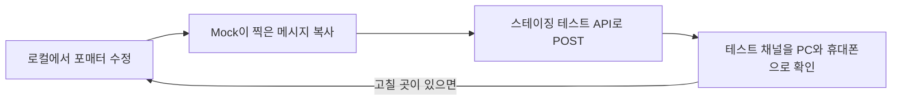

리뷰가 등록되면 사내 Slack 채널로 알림이 간다. 이 알림을 Webhook에서 사내 메시지 큐 서비스(이하 **큐 서비스**)로 옮기면서 메시지 포맷도 처음부터 다시 짜야 했다. Webhook 때는 Block Kit JSON을 직접 만들어 보냈는데, 큐 서비스는 **문자열 하나**만 받기 때문이다. 옮기는 과정은 [Slack 알림을 Webhook에서 사내 메시지 큐로 옮기며 Revert를 네 번 한 이야기](/posts/slack-webhook-to-message-queue/)에 정리했다.

이 글에서는 문자열만으로 알림을 꾸미면서 부딪힌 것들(mrkdwn, 코드 블록, 모바일 레이아웃)과, 로그가 아니라 실제 Slack 화면으로 확인하려고 만든 장치를 정리한다.

## Block Kit에서 문자열로

### Webhook 때는 Block Kit

Block Kit은 Slack 메시지를 블록 단위의 JSON으로 조립하는 방식이다. 기존 포매터는 이런 블록 목록을 만들었다.

```json
[
  { "type": "divider" },
  { "type": "header", "text": { "type": "plain_text", "text": "- 상품 정보 -" } },
  { "type": "section", "text": { "type": "mrkdwn", "text": "*【상품명】*   :   샘플 상품\n..." } },
  { "type": "section", "text": { "type": "mrkdwn", "text": "*【평가】*   :   ⭐⭐⭐⭐⭐\n..." } },
  { "type": "header", "text": { "type": "plain_text", "text": "- 회원 정보 -" } },
  { "type": "section", "text": { "type": "mrkdwn", "text": "*【회원 ID】*   :   ..." } }
]
```

| 블록 | 하는 일 |
| --- | --- |
| `divider` | 가로 구분선 |
| `header` | 크고 굵은 제목 (plain_text만 쓸 수 있다) |
| `section` | 본문. `mrkdwn` 문법을 쓸 수 있다 |
| `context` | 작은 회색 글씨 (평점이 크게 떨어졌을 때의 경고에 썼다) |

화면 구조를 객체 트리로 만들어 넘기는 셈이라, 구분선이나 제목 같은 레이아웃은 Slack이 알아서 그려 준다.

### 큐 서비스는 문자열 하나

큐 서비스의 Slack 전송 API는 채널 ID와 **메시지 문자열**만 받는다. 블록은 큐 서비스의 Consumer(Lambda)가 문자열을 잘라서 만든다.

```ts
// 큐 서비스 Consumer (옮길 당시)
const SLACK_BLOCK_TEXT_LIMIT = 2994;

const createBlocksFromMessage = (message: string): SlackBlock[] => {
    const blocks: SlackBlock[] = [];
    for (let i = 0; i < message.length; i += SLACK_BLOCK_TEXT_LIMIT) {
        const messageChunk = message.substring(i, i + SLACK_BLOCK_TEXT_LIMIT);
        blocks.push({
            type: 'section',
            text: { type: 'mrkdwn', text: '```' + messageChunk + '```' },
        });
    }
    return blocks;
};
```

- 메시지는 전부 `section` 블록이 된다. `divider`, `header`, `context`는 만들 수 없다
- 2994는 section 텍스트 한도(3000자)에서 코드 블록 기호(백틱 3개씩 앞뒤로 6개)를 뺀 값이다
- 그리고 모든 조각을 코드 블록으로 감싼다

그래서 포매터도 블록 목록 대신 문자열을 돌려주도록 바꾸고, 구분선과 제목은 문자로 흉내 냈다.

```java
private static final String HEADER_PREFIX = "                   "; // 제목을 가운데쯤으로 보내는 공백 19칸
private static final String DIVIDER = "=============================\n";

public String format(ReviewPostingSummary summary) {
    StringBuilder sb = new StringBuilder();
    sb.append(DIVIDER);
    sb.append(HEADER_PREFIX).append("*- 상품 정보 -*\n");
    sb.append(buildProductBlock(summary));
    // ...
    return sb.toString();
}
```

## mrkdwn은 Markdown이 아니다

Slack의 `mrkdwn`은 이름만 비슷하고 문법은 일반 Markdown과 다르다.

| 표현 | Markdown | Slack mrkdwn |
| --- | --- | --- |
| 굵게 | `**굵게**` | `*굵게*` |
| 기울임 | `*기울임*` | `_기울임_` |
| 취소선 | `~~취소~~` | `~취소~` |
| 인라인 코드 | `` `코드` `` | `` `코드` `` |

링크는 `[텍스트](URL)`가 아니라 꺾쇠 안에 URL과 텍스트를 세로선으로 나눠 쓴다.

```text
<https://example.com/item/1234|1234>
```

인용(`>`)은 줄마다 붙여야 해서, 리뷰 코멘트처럼 여러 줄인 글은 줄마다 `> `를 붙였다. 빈 줄에도 `> `와 공백을 넣어서 인용이 중간에 끊기지 않게 했다.

```java
String contentText = Arrays.stream(content.split("\\R"))
        .map(line -> "> " + (line.isBlank() ? " " : line))
        .collect(Collectors.joining("\n"));
```

### 코드 블록 안에서는 아무것도 먹지 않는다

그런데 큐 서비스는 메시지 전체를 코드 블록으로 감쌌다. 코드 블록 안에서는 mrkdwn이 해석되지 않으니, 굵은 글씨도 링크도 기호 그대로 보였다. 이 문제는 운영 환경에 배포하고 나서야 알았다. 해결은 큐 서비스에 코드 블록으로 감쌀지 고르는 `isCodeBlock` 옵션(기본값 `true`)을 추가하는 것이었고, 코드는 [이전 글](/posts/slack-webhook-to-message-queue/)에 있다.

옵션을 추가하면서 백엔드 쪽 코드 리뷰에서 지적을 두 가지 받았다.

| 리뷰 당시 | 지적 | 수정 |
| --- | --- | --- |
| 파라미터 이름 `isBlock` | 다른 곳은 모두 `isCodeBlock`이니, 특별한 이유가 없으면 맞추자 | `isCodeBlock` |
| `Boolean isCodeBlock` | 래퍼 타입은 박싱/언박싱이나 `null` 처리에서 문제가 생길 수 있다. 필요 없으면 기본형으로 | `boolean isCodeBlock` |

`Boolean`은 `true`, `false` 말고도 `null`까지 세 가지 상태를 가질 수 있다. 백엔드는 항상 값을 정해서 보내니 `null`이 될 이유가 없다.
반면 큐 서비스(TypeScript) 쪽에서는 이 값이 **선택**(optional)이다. 이 옵션을 모르는 기존 호출부는 값을 아예 보내지 않으므로, "안 보냄"도 의미 있는 상태이고 그때는 `true`로 본다.

```ts
isCodeBlock: z.boolean().optional(),
// ...
createBlocksFromMessage(slackRequest.message, slackRequest.isCodeBlock ?? true);
```

같은 값이라도 "없음"이 의미를 가지는 쪽에서만 비워 둘 수 있게 만든 셈이다.

## 로그로는 화면을 볼 수 없다: 테스트 채널로 실제로 보내기

Markdown 문제를 운영 환경에 배포하고 나서야 알게 된 이유는 간단했다. 그때까지 포매터 결과를 **로그로만** 확인했기 때문이다.

- 로컬에서는 큐 서비스 클라이언트 대신 Mock이 주입되어, 보낼 메시지를 로그로 찍기만 한다
- 단위 테스트도 결과 문자열에 특정 값이 들어 있는지(`contains`)만 확인한다

로그에 찍힌 `*【상품명】*`는 올바른 mrkdwn이지만, 그게 Slack에서 어떻게 보일지는 로그만으로는 알 수 없다.

그래서 앞 글에서 만든 스테이징 전용 테스트 컨트롤러(`@Profile("!prod")`)에, 받은 문자열을 그대로 테스트 채널로 보내는 API를 추가했다.

```java
@Profile("!prod")
@RestController
public class QueueTestController {
    // ...

    @PostMapping("/slack/test")
    public void testFormatted(
            @RequestParam("channelId") String channelId,
            @RequestBody String message // 요청 본문을 문자열 그대로 받는다
    ) {
        try {
            queueService.sendToSlack(message, channelId, false);
            log.warn("전송 성공!!! channelId: {}, messageLength: {}", channelId, message.length());
        } catch (Exception e) {
            log.warn("전송 실패... 이유: {}", e.getMessage(), e);
        }
    }
}
```

`@RequestBody`의 타입이 `String`이면 Spring MVC는 본문을 JSON으로 해석하지 않고 그대로 넘겨준다(`StringHttpMessageConverter`). 포매터가 만든 문자열을 손대지 않고 붙여 넣을 수 있다.
로컬 Mock도 큐 서비스로 보낼 요청 본문(`traceId`, `channelId`, `isCodeBlock`, `message`)을 통째로 로그에 찍도록 바꿨다.

이렇게 해서 포맷을 고치는 흐름은 이렇게 됐다.



테스트 API는 한 번만 배포해 두면 되니, 포맷을 고칠 때마다 main에 반영해 볼 필요가 없다. 스테이징 백엔드는 내부 도메인이라 스테이징 서버에 SSM으로 접속해서 curl로 불렀다. 여러 줄짜리 메시지는 파일에 저장해 두고 보내면 편하다.

```bash
curl -X POST "https://<스테이징 백엔드>/slack/test?channelId=<테스트 채널 ID>" \
  -H "Content-Type: text/plain" \
  --data-binary @message.txt
```

> curl의 `-d @파일`은 파일 속 줄바꿈을 지우고 보낸다. 줄바꿈이 레이아웃의 일부인 Slack 메시지는 `--data-binary`로 보내야 그대로 전달된다.
{: .prompt-tip }

팀에서는 이렇게 "배포는 하지만 운영 환경에서는 동작하지 않는 코드"도 Feature Flag로 다루고, 리뷰할 때 다음 항목을 확인한다.

- 플래그가 제대로 동작하는가
- 기능 공개가 제어되는가 (플래그 이름이 겹치지 않는지, 분기 조건과 위치가 맞는지)
- 플래그가 있더라도, 배포 자체가 운영 환경에 영향을 주지 않는다고 자신 있게 말할 수 있는가

이 테스트 API는 리뷰 알림 개편이 끝난 2월 27일에 지웠다. 목적을 다한 테스트 코드를 남겨 두면, 나중에 보는 사람에게는 "이건 왜 있지?"가 된다.

## 문자열 레이아웃과 모바일

### 옮기면서 바꾼 것 (2/17)

큐 서비스로 옮기는 마지막 반영에서는, 문자열로 할 수 있는 범위 안에서 강조를 다시 잡았다.

| 바꾼 것 | 이유 |
| --- | --- |
| 상품명과 "첫 리뷰" 표시를 인라인 코드로 | 인라인 코드는 글자 색이 달라져서 눈에 띈다 |
| 회원 ID의 링크 제거 | 상품 링크의 미리보기(상품 사진)에 회원 페이지 미리보기까지 붙으니 메시지가 너무 복잡해졌다 |
| 제목 이름 변경 (상품 정보 → 리뷰, 회원 정보 → 리뷰어 정보) | 담긴 내용에 맞게 |

Webhook 연동에 설정해 두었던 보내는 사람 이름과 아이콘도 이때부터 보이지 않게 됐다. 이제는 큐 서비스 앱의 이름으로 보내지기 때문이다.

### 모바일에서 깨졌다 (2/19)

반영하고 나서 휴대폰으로 보니 레이아웃이 어긋나 있었다.

- 구분선(`━`를 34자 이어 붙인 것)이 PC에서는 한 줄인데, 폭이 좁은 휴대폰에서는 두 줄로 꺾였다
- 제목을 가운데로 보내려고 앞에 넣은 공백 19칸이 휴대폰 기종마다 조금씩 다르게 보였다

사실 코드 리뷰에서 미리 지적을 받았던 부분이다.

> 이렇게 공백을 연타해서 포맷하는 건 환경에 따라 레이아웃이 깨질 수 있어서 권장하지 않는다. (바로 고치지 않아도 된다)

Slack 메시지는 고정폭 글꼴이 아니고 화면 폭도 기기마다 다르다. 공백 개수와 기호 길이로 만든 레이아웃은 **내가 확인한 화면에서만** 맞는다. 그래서 공백과 길이에 기대는 요소를 줄이는 쪽으로 고쳤다.

| 바꾼 것 | 이유 |
| --- | --- |
| 구분선을 `━` 34자 → 17자로 | 휴대폰에서도 한 줄에 들어가게 |
| 제목 앞 공백 제거, 제목은 `*【 리뷰 】*`처럼 굵게 | 가운데 정렬을 포기하고 왼쪽 정렬로 통일 |
| 항목 이름의 굵게와 【】 제거 | 굵은 글씨가 많으면 정작 강조할 곳이 묻힌다. 굵게는 제목에만 |
| "리뷰어 정보" → "리뷰어" | 두 제목의 형식을 맞추려고 |

최종 메시지는 이런 문자열이다(항목 이름은 한국어로 옮기고, 값은 예시로 바꿨다).

```text
~━━━━━━━━━━━━━━━━━~
*【 리뷰 】*
상품명            :   `샘플 상품`
상품 ID           :   <https://example.com/item/1234|1234>
평가               :   ⭐⭐⭐⭐⭐
*코멘트*
> 촉촉하고 향이 좋아요.
>  
> 또 살게요.

*【 리뷰어 】*
회원 ID           :   5678
평균 평가     :   4.2 점
작성 건수        :   3 건
```

Slack에서는 제목이 굵게, 상품명은 색이 다른 인라인 코드로, 상품 ID는 링크로, 코멘트는 인용 블록으로 보인다. 휴대폰 확인은 테스트 채널에서 반영 전에 끝냈다.

## 다시 본다면

### 항목 정렬용 공백도 없앴을 것

제목 앞 공백은 없앴지만, `상품명            :   `처럼 항목 이름 뒤를 공백으로 맞추는 부분은 아직 남아 있다. 글자와 공백의 폭이 글꼴마다 다르니 이 정렬도 기기에 따라 어긋난다. `상품명: 샘플 상품`처럼 정렬 자체를 포기하는 편이, 어느 화면에서나 같은 모양을 보장한다.

### 큐 서비스가 블록을 그대로 받을 수 있었다면

Block Kit의 `section`에는 `fields`가 있어서 항목을 두 열로 나란히 보여 줄 수 있다. 공백으로 맞출 필요가 없고, `divider`도 화면 폭에 맞춰 그려진다. 큐 서비스가 문자열 대신 블록 JSON을 그대로 받는 옵션을 가졌다면, 기호로 레이아웃을 흉내 낼 필요가 없었을 것이다.
다만 여러 시스템이 같이 쓰는 큐 서비스의 인터페이스를 넓히는 일이라, 이번에는 문자열 안에서 해결했다.

### 긴 리뷰는 중간에서 잘린다

Consumer는 메시지를 2994자마다 자르고, 첫 조각만 채널에 올린 뒤 나머지는 스레드 답글로 보낸다. 자르는 위치는 줄이나 mrkdwn 기호와 상관이 없다. 드물겠지만 아주 긴 리뷰가 들어오면 채널에는 앞부분만 보이고, 잘린 경계에 `*굵게*`나 링크가 걸리면 그 부분의 서식도 깨진다. 코드 블록 없이 mrkdwn을 쓰는 채널이 생긴 만큼, 줄 단위로 자르도록 바꾸는 게 안전하다.

## 배운 점

- Slack의 mrkdwn은 Markdown과 다르다. 굵게는 `*` 하나, 링크는 꺾쇠와 세로선이다. 그리고 코드 블록 안에서는 아무 서식도 먹지 않는다
- 문자열만으로 레이아웃을 만들면 공백과 기호에 기대게 되고, 그건 기기마다 다르게 보인다. "PC에서 괜찮다"는 확인의 절반일 뿐이다
- 로그로 확인한 문자열과 사용자가 보는 화면은 다르다. 운영 환경에 영향 없이 실제 화면을 볼 수 있는 경로(테스트 API와 테스트 채널)를 먼저 만들어 두면 반영 전에 확인할 수 있다
- 여러 시스템이 같이 쓰는 API에 옵션을 더할 때는, 기본값을 기존 동작으로 두면 아무것도 깨지지 않는다
- `null`이 의미 없는 값은 기본형으로 받는다
- 테스트용 코드는 목적을 다하면 지운다
