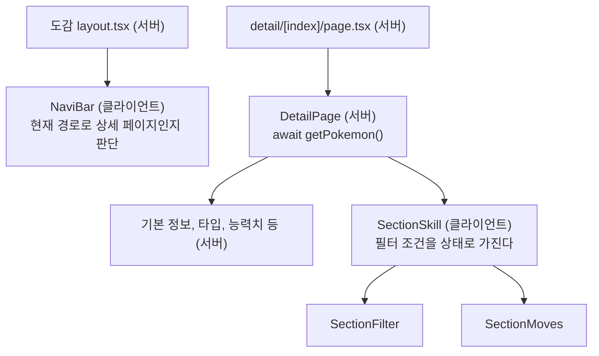

백엔드(Spring Boot)를 주로 하다가, 프론트엔드 업무에 들어가기 전에 Next.js 연수를 받았다. 목표는 "기본적인 태스크를 받으면 Next.js로 구현해서 형태로 만들 수 있는 상태"였고, 과제는 공개 API인 [PokeAPI](https://pokeapi.co/)로 포켓몬 도감을 만드는 것이었다.

진행 방식은 실제 업무와 같았다. 요구 사항을 PBI(백로그 항목) 단위로 받고, 작업은 PR로 올려서 리뷰를 받았다. 6월 중순부터 7월 13일까지 PR을 스무 개 남짓 올렸다. 이 글은 그 리뷰에서 배운 것을 정리한 것이다.

HTML, CSS, React, 도구 같은 기본은 앞선 글([React 기본 정리](/posts/react-basics/), [React Hooks 기본 정리](/posts/react-hooks/), [프론트엔드 개발 도구 정리](/posts/frontend-dev-tools/))에 있다.

## 만든 것

| 화면 | URL | 요구 사항 |
| --- | --- | --- |
| 목록 | `/pokemon/pokedex/1` | 20마리씩 보여 주고 이전/다음 버튼과 페이지 번호로 넘긴다. 카드에 마우스를 올리면 살짝 뜨고, 누르면 상세로 간다 |
| 상세 | `/pokemon/pokedex/detail/25` | API로 받은 정보를 사람이 보기 좋게 정리한다. 위에는 목록으로 가는 버튼, 아래에는 앞뒤 도감 번호로 가는 링크 |
| 기술 목록 (상세 안) | | 같은 기술은 한 줄로 묶는다. 버전, 습득 방법, 레벨 범위로 거르고 리셋할 수 있다 |

그 밖에 `/pokemon/pokedex`로 들어오면 1페이지로 보내고, 헤더는 스크롤해도 위에 붙어 있게 했다. 스택은 Next.js 16(App Router), React 19, TypeScript, vanilla-extract다.

## 폴더가 곧 URL: App Router

App Router에서는 `app` 폴더의 구조가 그대로 URL이 된다. `page.tsx`가 있는 폴더가 페이지가 되고, `[page]`처럼 대괄호로 감싼 폴더는 URL의 그 자리에 오는 값을 받는다.

```text
app/
├── layout.tsx                    ← 모든 페이지의 뼈대
└── pokemon/pokedex/
    ├── layout.tsx                ← 도감 공통 헤더
    ├── page.tsx                  ← /pokemon/pokedex → 1페이지로 보낸다
    ├── [page]/page.tsx           ← /pokemon/pokedex/3
    └── detail/[index]/page.tsx   ← /pokemon/pokedex/detail/25
```

Spring MVC에 익숙하다면 이렇게 대응시켜 보면 이해가 빠르다.

| Next.js (App Router) | Spring MVC |
| --- | --- |
| `[page]/page.tsx` 폴더 | `@GetMapping("/pokemon/pokedex/{page}")` |
| `params`의 `page` | `@PathVariable String page` |
| `notFound()` | `throw new ResponseStatusException(HttpStatus.NOT_FOUND)` |
| `redirect("/pokemon/pokedex/1")` | `return "redirect:/pokemon/pokedex/1";` |
| `layout.tsx` | 여러 페이지가 같이 쓰는 레이아웃 템플릿 |

목록 페이지는 이렇게 됐다.

```tsx
type PokedexProps = {
  params: Promise<{ page: string }>;
};

async function Pokedex({ params }: PokedexProps) {
  const { page } = await params; // params는 Promise라서 await로 꺼낸다
  const pageNumber = Number(page);

  if (Number.isNaN(pageNumber) || pageNumber <= 0 || !Number.isInteger(pageNumber)) {
    notFound(); // 숫자가 아니거나 1보다 작으면 404
  }

  return (
    <>
      <DexPage pageNumber={pageNumber} />
      <PageButton currentNumber={pageNumber} />
    </>
  );
}
```

여기서 리뷰를 두 번 받았다.

- **`params`는 Promise다.** 처음에는 `params.page`를 바로 읽었는데, 지금의 Next.js에서는 `await`로 꺼내야 한다
- **잘못된 경로는 404로.** 처음에는 `-1` 같은 페이지가 들어오면 1페이지를 보여 주려고 했다. 리뷰는 이랬다. "`-1` 페이지는 애초에 잘못된 경로이니 404가 맞다. 꼭 1페이지로 보내고 싶다면 리다이렉트를 하자." 잘못된 값을 조용히 고쳐서 보여 주면, 주소창의 URL과 화면 내용이 서로 다른 상태가 된다

## 서버 컴포넌트와 클라이언트 컴포넌트

App Router의 컴포넌트는 기본적으로 **서버 컴포넌트**다. 서버에서 실행되어 HTML이 되고, 브라우저에는 결과만 간다. `async` 함수로 만들 수 있어서 컴포넌트 안에서 바로 `await`로 API를 부를 수 있다.

상태(`useState`)나 브라우저에서만 알 수 있는 것(현재 경로 등)이 필요하면, 파일 맨 위에 `'use client'`를 적어 **클라이언트 컴포넌트**로 만든다.

Spring으로 치면 서버 컴포넌트는 컨트롤러에서 데이터를 조회해 Thymeleaf 템플릿으로 HTML을 만드는 쪽에 가깝다. 클라이언트 컴포넌트는 그 HTML 위에서 브라우저가 실행하는 JavaScript다.

### 처음에는 카드마다 브라우저에서 불렀다

첫 목록 페이지에서는 포켓몬 이름을 보여 주는 가장 작은 컴포넌트가 직접 API를 불렀다.

```tsx
'use client';

const PokeName = ({ dexNumber }: DexNumberProps) => {
  const [pokeName, setPokeName] = useState('');

  useEffect(() => {
    getPokemon(dexNumber).then((pokemon) => {
      setPokeName(pokemon.name); // 이름 하나를 얻으려고 포켓몬 정보를 통째로 받는다
    });
  }, [dexNumber]);

  return <div className={pokeNameStyle}>{pokeName}</div>;
};
```

카드마다 브라우저가 페이지를 받은 뒤에 요청을 보내고, 응답이 올 때까지 이름은 비어 있다. 리뷰는 이랬다.

> 가장 작은 단위의 컴포넌트에 통신 처리가 들어가는 건 맞지 않으니, 위쪽 컴포넌트로 옮기거나 props로 이름을 받게 하자. 이름 하나를 얻는 것치고는 성능 면에서도 처리가 너무 크다.

그래서 페이지 단위 컴포넌트(서버)가 목록 API를 부르고, 카드에는 필요한 값만 props로 넘기도록 바꿨다.

```tsx
const LIST_LENGTH = 20;

const DexPage = async (props: DexPageProps) => {
  const offset = (props.pageNumber - 1) * LIST_LENGTH;
  const data = await getPokemonList(offset, LIST_LENGTH); // 서버에서 목록 API 호출

  const pokemonInPage = data.results.map(async (x) => {
    const pokemon = await getPokemon(x.name);
    return <PokedexCard id={pokemon.id} key={pokemon.id} name={pokemon.name} />;
  });

  return <main className={dexPage}>{pokemonInPage}</main>;
};
```

이제 브라우저는 이름까지 채워진 HTML을 받는다. 다만 이 코드에는 아직 아쉬운 점이 남아 있는데, 아래 [다시 본다면](#목록-페이지는-요청을-21번-보낸다)에서 다룬다.

### 상세 페이지의 경계

상세 페이지는 대부분 서버 컴포넌트다. 클라이언트 컴포넌트는 상태나 현재 URL이 필요한 곳뿐이다.



`'use client'`를 적은 파일이 경계가 된다. 그 파일에서 불러오는 컴포넌트(`SectionFilter`, `SectionMoves`)도 클라이언트에서 실행된다. 서버에서 받은 기술 목록은 props로 경계를 넘어 브라우저로 전달된다.

## 컴포넌트를 어디에 둘까: 아토믹 디자인

프로젝트는 컴포넌트를 atoms(가장 작은 부품), molecules(부품 몇 개를 묶은 것), organisms(화면의 한 구역)로 나누는 아토믹 디자인 구조를 썼다. 계층 이름은 알고 있었지만, **무엇을 어디에 둘지**는 리뷰를 받으며 정해졌다.

| 계층 | 리뷰에서 정해진 기준 | 예 |
| --- | --- | --- |
| atoms | 데이터를 가져오지 않는다. 바깥 여백(margin)을 갖지 않는다 | 이름, 도감 번호, 이미지 |
| molecules | 숫자나 문자열처럼 필요한 값만 props로 받는다 | 카드는 `id`와 `name`만 받는다 |
| organisms | API 응답 같은 객체를 받고, 도메인 지식을 가진다 | 기술 목록과 필터 |

atoms에 margin을 주지 말라는 건, 여백은 **쓰는 쪽이 정할 일**이기 때문이다. 부품이 자기 바깥 여백을 갖고 있으면 다른 곳에 가져다 쓸 때마다 그 여백이 따라와서 불편해진다.

## 결국은 HTML이다: 시맨틱 마크업

첫 PR에서 받은 리뷰가 연수 내내 따라다녔다.

> 컴포넌트를 구현하다 보면 HTML을 쓰고 있다는 자각이 옅어져서 뭐든 div로 마크업하기 쉽다. 결국은 HTML이 되니, 의미에 맞는 태그인지 확인해 달라.

| 처음 | 고친 것 | 이유 |
| --- | --- | --- |
| 텍스트를 `div`로 | `span` | 텍스트 요소에 블록용 `div`를 쓰지 않는다 |
| 내비게이션 바를 `div`로 | `header`로 감싸기 | 헤더라는 의미를 태그로 나타낸다 |
| 버튼 + `router.push()`로 페이지 이동 | `Link` | 이동은 링크(`a` 태그)가 할 일이다. 새 탭으로 열기 같은 브라우저 기능도 그대로 쓸 수 있다 |
| 섹션 제목마다 `h1` | `h2` | `h1`은 페이지 제목에만 쓰고, 섹션 제목은 그 아래 단계로 |
| 목록을 `span` 나열로 | `ul`, `li` | 목록이니까 |
| 펼치기를 `useState`로 | `details`, `summary` | HTML만으로 접고 펼 수 있다 |
| 공백 문자로 간격 | CSS로 간격 | 여백은 CSS가 할 일이다 |

`details`는 리뷰에서 처음 알았다. 기술 이름을 누르면 버전별 표가 펼쳐지는 부분을 `useState`로 만들고 있었는데, HTML에 이미 그 기능이 있었다.

```tsx
<td className={skillsStyle}>
  <details>
    <summary className={summaryStyle}>{value.move.name}</summary>
    <SkillCellTable pokemonMove={value} />
  </details>
</td>
```

`table` 안에서는 `tbody` 바로 밑에 `tr`만 올 수 있어서, `details`는 칸(`td`) 안에 넣었다.

## 기술 목록: 같은 기술은 한 줄로, 조건으로 거르기

### 데이터 구조대로 그리기

상세 정보 중 가장 손이 많이 간 곳이 "익히는 기술"이다. PokeAPI는 기술을 이런 구조로 준다(값은 예시).

```json
"moves": [
  {
    "move": { "name": "thunderbolt" },
    "version_group_details": [
      { "level_learned_at": 0, "move_learn_method": { "name": "machine" }, "version_group": { "name": "red-blue" } },
      { "level_learned_at": 0, "move_learn_method": { "name": "machine" }, "version_group": { "name": "gold-silver" } }
    ]
  }
]
```

기술 하나 아래에 "어느 버전에서, 어떤 방법으로, 몇 레벨에" 익히는지가 배열로 들어 있다. 처음에는 이 두 단계를 펼쳐서 한 줄씩 그렸다.

```tsx
{props.moves.map((move) =>
  move.version_group_details.map((detail) => (
    <li key={`${move.move.name}-${detail.version_group.name}`}>
      {/* 기술 이름, 레벨, 습득 방법, 버전 */}
    </li>
  )),
)}
```

그러자 같은 기술이 버전 수만큼 반복해서 나와 읽기가 어려웠다. 그래서 데이터 구조 그대로 **기술 하나에 한 줄**을 쓰고, 버전별 정보는 앞의 `details` 안에 표로 넣었다.

React의 `key`에서도 리뷰를 받았다. 기술 이름은 한 포켓몬 안에서 겹치지 않으니 줄의 `key`로 충분하다. 하지만 펼친 표 안에서는 **같은 버전이 여러 번** 나올 수 있다. 같은 버전에서 레벨업으로도, 기술머신으로도 익히는 경우다. 그래서 표의 각 줄은 세 값을 이어서 `key`로 쓴다.

```tsx
<tr key={`${detail.version_group.name}-${detail.move_learn_method.name}-${detail.level_learned_at}`}>
```

### 필터: 커스텀 훅 하나에 모으기

다음 요구 사항은 버전(여러 개), 습득 방법, 레벨 범위로 거르고, 리셋 버튼으로 되돌리는 것이었다. 최종 코드는 이렇다.

```tsx
const useMoveFilter = ({ beforeFilterMoves }: Props) => {
  const [versions, setVersions] = useState<string[]>([]);
  const [method, setMethod] = useState('');
  const [minLevel, setMinLevel] = useState(0);
  const [maxLevel, setMaxLevel] = useState(100);

  const filteredMoves = useMemo(
    () =>
      beforeFilterMoves
        .map((pokemonMove) => ({
          ...pokemonMove,
          version_group_details: pokemonMove.version_group_details.filter((detail) => {
            const isSameVersion = versions.length === 0 || versions.includes(detail.version_group.name);
            const isSameMethod = method === '' || detail.move_learn_method.name === method;
            const inRange = minLevel <= detail.level_learned_at && detail.level_learned_at <= maxLevel;

            return isSameVersion && isSameMethod && inRange;
          }),
        }))
        .filter((value) => value.version_group_details.length > 0), // 조건에 맞는 버전이 하나도 없는 기술은 뺀다
    [beforeFilterMoves, versions, method, minLevel, maxLevel],
  );

  const resetFilter = () => {
    setVersions([]);
    setMethod('');
    setMinLevel(0);
    setMaxLevel(100);
  };

  return [filteredMoves, { resetFilter, setMaxLevel, setMethod, setMinLevel, setVersions }] as const;
};
```

이 모양이 되기까지 받은 리뷰는 이렇다.

| 처음 | 리뷰 | 바꾼 것 |
| --- | --- | --- |
| 조건을 전부 `!==`로 걸렀다 | 부정형만 이어지면 읽기 어렵다. 조건마다 변수에 담아 `&&`로 묶자 | `isSameVersion && isSameMethod && inRange` |
| 훅 이름 `useFilter` | 기술 필터인데 이름이 너무 일반적이다 | `useMoveFilter` |
| 훅이 거른 결과만 돌려줬다 | 조건을 바꾸는 함수도 훅에 넣어서, 필터에 관한 건 전부 여기서 다루자 | setter와 `resetFilter`도 돌려준다 |
| 객체로 돌려줬다 | 훅은 `useState`처럼 [값, 함수] 모양으로 돌려준다 | `[filteredMoves, {...}] as const` |

버전은 처음에 `select`로 하나만 고르게 했다가, 여러 버전을 함께 고를 수 있게 체크박스로 바꿨다. 조건도 `string`에서 `string[]`로 바꾸고 `includes`로 판정한다.

마지막의 `as const`는 TypeScript 쪽 이야기다. 그냥 배열을 돌려주면 타입이 "값이나 함수 묶음이 섞인 배열"로 추론되어서, 꺼내 쓸 때마다 어느 쪽인지 확인해야 한다. `as const`를 붙이면 "첫 번째는 기술 목록, 두 번째는 함수 묶음"인 튜플로 추론된다.

`useMemo`는 원본 목록이나 조건이 바뀔 때만 다시 계산하게 한다(자세한 건 [React Hooks 기본 정리](/posts/react-hooks/)). 쓰는 쪽은 `useState`처럼 꺼내 쓰면 된다.

```tsx
const [filteredMoves, { setMethod, setVersions, setMinLevel, setMaxLevel, resetFilter }] = useMoveFilter({
  beforeFilterMoves: moves,
});
```

리셋 버튼은 `<input type="reset">`이다. 누르면 폼의 입력칸은 브라우저가 처음 값으로 되돌리고, `onClick`의 `resetFilter`가 상태를 되돌린다.

## 코드 밖에서 배운 것

리뷰는 코드에만 오지 않았다.

- **PR에는 그 작업만 담는다.** 관계없는 설정 파일이나 IDE 설정(`.idea`)이 섞여서 몇 번 지적을 받았고, 결국 `.idea`를 git에서 뺐다
- **새 브랜치는 main에서 딴다.** 진행 중인 다른 PR의 브랜치에서 새 브랜치를 땄더니, 같은 커밋이 두 PR에 겹쳐 올라갔다. 리뷰어가 PR마다 겹친 커밋을 가려낼 수는 없으니 리뷰가 너무 무거워진다
- **브랜치 이름에는 멀티바이트 문자를 쓰지 않는다.** 일본어 브랜치 이름으로 PR을 올렸다가 다시 올렸다
- **다음에 무엇을 할지는 이해관계자가 정한다.** PR 설명에 "다음 작업" 계획을 적었더니 이런 답이 왔다. "그건 이해관계자가 정할 일이니, 신경 쓰이면 나에게 물어보는 게 맞다." 실제로 디자인에 없던 "만날 수 있는 장소" 섹션을 별도 API까지 불러서 만들었는데, "실제 업무라면 미리 상의해 달라"는 말을 들었다

## 다시 본다면

글을 쓰려고 코드를 다시 읽다가 발견한 것들이다.

### 상세 페이지의 이전/다음 링크가 목록으로 간다

상세 페이지 아래의 "← #24 / #26 →" 링크는 앞뒤 도감 번호의 상세로 가야 한다. 그런데 코드는 목록 페이지 경로를 만들고 있었다.

```tsx
'use client';

const FootNaviButton = () => {
  const params = useParams();
  const currentPage = Number(params.index);

  return (
    <div className={footNaviStyle}>
      <Link className={footNaviLinkStyle} href={`/pokemon/pokedex/${currentPage - 1}`}>
        ← #{currentPage - 1}
      </Link>
      {/* ... */}
    </div>
  );
};
```

`/pokemon/pokedex/24`는 `[page]` 경로라서, 25번 상세에서 "← #24"를 누르면 24번 포켓몬이 아니라 **목록 24페이지**가 열린다. 변수 이름도 `currentPage`라서 목록의 페이지 번호처럼 읽힌다.

게다가 이 컴포넌트는 URL에서 번호를 읽으려고 클라이언트 컴포넌트가 되어 있다. 그 번호는 서버의 `DetailPage`가 이미 알고 있으니 props로 받으면 된다.

```tsx
type Props = {
  dexNumber: number;
};

const FootNaviButton = ({ dexNumber }: Props) => {
  return (
    <div className={footNaviStyle}>
      <Link className={footNaviLinkStyle} href={`/pokemon/pokedex/detail/${dexNumber - 1}`}>
        ← #{dexNumber - 1}
      </Link>
      <Link className={footNaviLinkStyle} href={`/pokemon/pokedex/detail/${dexNumber + 1}`}>
        #{dexNumber + 1} →
      </Link>
    </div>
  );
};
```

1번 포켓몬에서 "#0"으로 가는 링크가 생기는 것도 이때 같이 막으면 된다(`dexNumber > 1`일 때만 그린다).

### 목록 페이지는 요청을 21번 보낸다

목록 API로 바꾼 뒤에도 `DexPage`는 포켓몬마다 `getPokemon()`을 한 번씩 더 부른다. 목록 1번에 상세 20번, 페이지 하나에 21번이다. 그렇게 받은 큰 응답에서 쓰는 건 `id`와 `name`뿐이다.

그런데 목록 API의 각 항목에는 이미 `name`과 `url`이 있고, `url`의 끝이 ID다.

```json
{ "name": "pikachu", "url": "https://pokeapi.co/api/v2/pokemon/25/" }
```

URL에서 ID를 꺼내면 요청은 한 번으로 끝난다.

```tsx
const getIdFromUrl = (url: string) => Number(url.split('/').filter(Boolean).pop());

const DexPage = async ({ pageNumber }: DexPageProps) => {
  const offset = (pageNumber - 1) * LIST_LENGTH;
  const data = await getPokemonList(offset, LIST_LENGTH);

  return (
    <main className={dexPage}>
      {data.results.map((x) => {
        const id = getIdFromUrl(x.url);
        return <PokedexCard id={id} key={id} name={x.name} />;
      })}
    </main>
  );
};
```

같은 응답에 전체 개수(`count`)도 들어 있다. 지금 페이지 버튼은 전체 페이지 수를 `100`으로 고정해 두어서, 실제 마지막 페이지 뒤로도 빈 페이지가 이어진다. `Math.ceil(data.count / LIST_LENGTH)`로 계산해서 넘기면 된다.

### 하위 레이아웃이 `html`과 `body`를 또 그린다

도감 레이아웃(`app/pokemon/pokedex/layout.tsx`)이 `<html>`과 `<body>`를 다시 그리고 있었다. 이 두 태그는 루트 레이아웃(`app/layout.tsx`)이 그린다. 하위 레이아웃은 감쌀 내용만 돌려주면 된다.

```tsx
export default function PokedexLayout({ children }: { children: ReactNode }) {
  return (
    <>
      <header className={headerStyle}>
        <NaviBar />
      </header>
      {children}
    </>
  );
}
```

### 리셋 버튼은 조건이 있을 때만

요구 사항은 "입력하면 리셋 버튼이 나타나고, 누르면 초기 상태로 돌아간다"였는데, 지금은 버튼이 항상 보인다. 조건은 이미 훅이 상태로 갖고 있으니, 초깃값과 다른지만 함께 돌려주면 된다.

```tsx
const isFiltering = versions.length > 0 || method !== '' || minLevel !== 0 || maxLevel !== 100;
// 필터 쪽에서는 {isFiltering && <ResetButton reset={resetFilter} />}
```

## 배운 점

- App Router에서는 폴더가 URL이다. `params`는 `await`로 꺼내고, 잘못된 경로는 고쳐 주지 말고 404로 돌려준다
- 데이터는 서버 컴포넌트에서 가져오고, 상태나 브라우저 정보가 필요한 곳만 `'use client'`로 만든다. 서버가 이미 아는 값은 props로 넘긴다
- 작은 부품은 데이터도 바깥 여백도 갖지 않는다. 필요한 값만 props로 받는다
- 컴포넌트로 짜도 결국 HTML이다. 태그의 의미를 먼저 생각하고, `details`처럼 HTML에 이미 있는 기능부터 찾는다
- 화면은 데이터 구조를 먼저 보고 짠다. 기술 → 버전별 정보의 2단 구조를 펼치지 않고 그대로 그리니 요구 사항이 풀렸다
- 상태와 그 상태를 바꾸는 함수는 한 훅에 모은다
- 범위 밖의 일은 만들기 전에 먼저 묻는다
