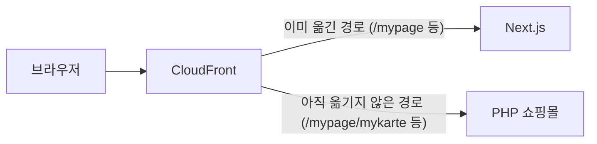

회사 쇼핑몰은 오래된 PHP 애플리케이션(EC-CUBE 기반) 위에서 돌아가고, 화면을 하나씩 Next.js로 옮기는 중이다. 마이페이지 첫 화면처럼 이미 옮긴 화면도 있다.

[Next.js 연수](/posts/nextjs-pokedex-training/)를 마치고 처음 맡은 실무가 마이페이지의 **My 도수** 화면을 옮기는 일이었다. 사용자가 왼쪽·오른쪽 렌즈 도수를 등록해 두면, 상품을 살 때 도수가 자동으로 선택되는 화면이다.

요구 사항은 이랬다.

- 디자인은 스마트폰 기준. 최대 폭과 반응형 동작은 이미 옮긴 마이페이지에 맞춘다
- 로그인하지 않은 상태로 들어오면 로그인 페이지로 보낸다
- 저장 동작은 지금 화면과 같게 한다

## 한 번에 옮기지 않고 단계로

사용자가 어떤 URL로 들어왔을 때 PHP 쇼핑몰로 갈지 Next.js로 갈지는, 앞단의 CloudFront가 경로별로 정한다.



그래서 Next.js에 새 페이지를 배포해도, CloudFront 설정을 바꾸기 전까지 사용자는 계속 PHP 화면을 본다. 이 점을 이용해서 작업을 단계로 나눴다.

| 단계 | 할 일 | 운영 환경 배포 |
| --- | --- | --- |
| 1 | 화면 (컴포넌트와 디자인만) | 7월 27일 |
| 2 | API 연동 (선택지, 내 도수, 저장) | 8월 6일 |
| 3 | CloudFront에서 이 경로를 Next.js로 전환 | 9월 29일 ([경로 전환 글](/posts/cloudfront-path-based-nextjs-migration/)) |
| 4 | PHP 쪽에 남은 코드 삭제 | |

화면만 있는 상태로도 운영 환경에 배포할 수 있으니, PR을 작게 나눠 리뷰받고 하나씩 내보낼 수 있었다. 사용자에게 공개하는 시점은 3단계의 경로 전환 하나로 정해진다.

## 1단계: 화면

### 로그인 확인은 폴더 위치로

Next.js App Router에는 **route group**이 있다. 괄호로 감싼 폴더는 URL에 나타나지 않고, 그 아래 페이지들이 같은 레이아웃을 쓰게 묶는 역할만 한다.

```text
app/(private)/              ← 괄호 폴더는 URL에 나타나지 않는다
├── layout.tsx              ← 로그인 확인 (NeedAuth)
└── mypage/
    ├── page.tsx            ← /mypage (이미 Next.js)
    └── mykarte/
        └── page.tsx        ← /mypage/mykarte (이번에 추가)
```

`(private)`의 레이아웃은 모든 페이지를 `NeedAuth`라는 서버 컴포넌트로 감싸고 있었다. 세션 쿠키를 확인하고 로그인 상태 확인 API를 불러서, 로그인하지 않았으면 `redirect()`로 로그인 페이지에 보낸다.

```tsx
// app/(private)/layout.tsx
const Layout: FC<{ children: ReactNode }> = ({ children }) => (
  <Suspense fallback={<PageLoading />}>
    <NeedAuth>
      <DefaultLayout>{children}</DefaultLayout>
    </NeedAuth>
  </Suspense>
);
```

그래서 "로그인하지 않았으면 로그인 페이지로"라는 요구 사항은, 새 페이지를 이 폴더 아래에 두는 것만으로 채워졌다. 헤더, 내비게이션, 푸터를 묶은 `DefaultLayout`도 함께 따라온다. Spring Security에서 `/mypage/**`에 인증을 걸어 두면 그 아래 컨트롤러가 따로 신경 쓰지 않아도 되는 것과 비슷하다.

### iOS에서 select를 누르면 화면이 확대됐다

화면 PR에서 받은 지적 중 가장 실용적이었던 것이다. select에 글자 크기를 지정하지 않으면, 폼 요소는 본문 글자 크기를 물려받지 않고 브라우저 기본값(약 13px)으로 그려진다. 그리고 iOS Safari는 **글자가 16px보다 작은 입력 요소를 탭하면 화면을 자동으로 확대**하고, 선택을 끝낸 뒤에도 확대된 상태로 남는다.

```ts
export const select = style({
  // ...
  fontSize: '1.6rem', // 이 프로젝트에서는 16px. 이보다 작으면 iOS Safari가 탭할 때 확대한다
});
```

### 스크린 리더에는 "왼쪽, 콤보 상자"만 들렸다

왼쪽·오른쪽 select에는 "왼쪽", "오른쪽"이라는 이름밖에 없었다. 리뷰어가 실제로 스크린 리더로 읽어 보니 "왼쪽, 콤보 상자, 모름"처럼 들려서, 무엇을 고르는 칸인지 알 수 없었다.

여러 입력 요소를 하나의 의미로 묶는 HTML 태그가 `fieldset`이고, 그 묶음의 이름이 `legend`다.

```tsx
<fieldset className={styles.powerBox}>
  <legend className={styles.legend}>My 도수</legend>
  <label className={styles.powerColumn}>
    <span className={styles.powerLabel}>왼쪽</span>
    <SelectBox name={LEFT_SELECT_NAME} /* ... */ />
  </label>
  <label className={styles.powerColumn}>
    <span className={styles.powerLabel}>오른쪽</span>
    <SelectBox name={RIGHT_SELECT_NAME} /* ... */ />
  </label>
</fieldset>
```

화면 위쪽에 이미 "My 도수" 제목이 있어서, `legend`는 화면에서는 숨기고 스크린 리더만 읽게 했다. `display: none`으로 숨기면 스크린 리더도 읽지 않으니, 1px짜리 영역에 잘라 넣는 방식을 쓴다.

```ts
export const legend = style({
  position: 'absolute',
  width: '1px',
  height: '1px',
  padding: 0,
  margin: '-1px',
  overflow: 'hidden',
  clip: 'rect(0 0 0 0)',
  whiteSpace: 'nowrap',
  border: 0,
});
```

### 여백은 누가 갖나

CSS 리뷰에서는 여백을 주는 방법에 대한 지적을 받았다. 리뷰어도 "절대적인 정답은 아니고 내 생각"이라고 했지만, 기준이 생기니 고민이 줄었다.

- 부모와 자식 사이의 여백은 **부모의 padding**으로 준다
- 같은 단계 형제 사이의 여백은 **margin**으로 주고, 방향은 기본적으로 위쪽만 쓴다
- grid로 배치했다면 형제 사이 간격은 음수 margin으로 맞추지 말고 **`gap` 속성**을 쓴다

`label`이 기본적으로 인라인 요소라는 것도 이때 알았다. 인라인인 `label` 안에 `display: block`인 자식을 넣으니 요소가 부모 밖으로 삐져나와 있었다. 지금은 문제가 없어 보여도 나중에 스타일을 바꿀 때 깨지는 원인이 된다.

### AI 리뷰를 사람이 고른다

화면 PR에서는 팀원이 AI 코드 리뷰를 돌려서, 후보 29건 중 검증을 통과한 15건을 인라인 코멘트로 달아 줬다. 그리고 리뷰어가 각 지적에 "꼭 고쳐 줘", "해 줬으면", "안 해도 된다"를 붙였다.

AI 지적이 늘 맞는 건 아니었다.

- AI는 폼에 아직 이벤트 핸들러가 없으니 `'use client'`가 필요 없다고 했다. 그 시점의 코드만 보면 맞는 말이지만, 리뷰어는 "필요하다"며 남겼다. 실제로 다음 PR에서 저장 처리와 상태가 들어가면서 어차피 클라이언트 컴포넌트가 되어야 했다
- 다음 PR에서 Copilot은 `SubmitEventHandler`라는 타입이 React에 없다고 지적했다. `node_modules`의 타입 정의를 열어 보니 들어 있었다. 최근에 추가된 타입이라 몰랐던 것 같다

지적의 근거를 직접 확인하고, 계획이나 맥락을 아는 사람이 고르는 단계가 필요하다.

## 2단계: API 연동

### 서버에서 부를 때는 쿠키를 직접 넘긴다

페이지는 서버 컴포넌트다. 선택지(도수 목록)와 사용자의 My 도수를 `Promise.all`로 동시에 가져와서 폼에 넘긴다.

```tsx
const Page: FC = async () => {
  const cookieStore = await cookies();
  const token = cookieStore.get(LOGIN_COOKIE); // 로그인 쿠키

  const [lensPowerDefinitions, myLensPower] = await Promise.all([
    fetchLensPowerDefinitionsService(), // 선택지
    fetchMyLensPowerService(token?.value), // 로그인한 사용자의 My 도수
  ]);

  return (
    <Container>
      {/* 빵 부스러기, 제목 */}
      <MykarteForm
        lensPowerDefinitions={lensPowerDefinitions}
        leftMyLensPower={myLensPower.leftMyLensPower}
        rightMyLensPower={myLensPower.rightMyLensPower}
      />
    </Container>
  );
};
```

서버 컴포넌트는 브라우저가 아니라 Next.js 서버에서 실행된다. 그래서 여기서 백엔드 API를 부르면 **사용자의 브라우저 쿠키가 저절로 붙지 않는다**. 요청에 들어온 쿠키를 `cookies()`로 읽어서 직접 넘겨야 한다. Spring에서 `RestTemplate`으로 다른 API를 부를 때 사용자의 쿠키가 따라가지 않는 것과 같다.

```ts
export const fetchMyLensPowerService = (token?: string) => {
  if (token === undefined) {
    // 토큰이 없으면 어차피 실패할 요청이니 보내지 않는다
    throw new Error('로그인 토큰이 없어서 My 도수를 가져올 수 없다');
  }
  return fetchMyLensPower({ Cookie: `${LOGIN_COOKIE}=${token};` });
};
```

저장은 처음에 Server Action(`'use server'`를 붙인 서버 함수)으로 만들었다. 버튼을 누르면 브라우저 → Next.js 서버 → 백엔드 순서로 요청이 가니, Next.js 서버에서 쿠키를 꺼내 다시 붙여야 했다. 리뷰에서 "같은 도메인 안의 요청이라, 브라우저에서 바로 부르면 쿠키는 저절로 간다. 쿠키를 다루는 처리 자체가 필요 없다"는 지적을 받았다.

그래서 Server Action을 지우고, 클라이언트 컴포넌트에서 백엔드 API를 바로 부르게 바꿨다. 공통 fetch 함수가 `credentials: 'include'`로 보내니 쿠키는 브라우저가 붙인다. 저장 뒤 화면을 갱신하는 방법도 Server Action의 `revalidatePath()`에서 `router.refresh()`로 바뀌었다.

| 어디서 부르나 | 쿠키 |
| --- | --- |
| Next.js 서버 (서버 컴포넌트, Server Action) | 저절로 붙지 않는다. `cookies()`로 읽어서 넘긴다 |
| 브라우저 (클라이언트 컴포넌트) | 브라우저가 붙인다 |

### 누구의 데이터인지는 API가 정한다

처음에는 프론트에서 로그인 토큰(JWT)을 풀어 고객 ID를 꺼낸 뒤, 그 ID로 My 도수를 조회했다. 리뷰에서 이런 질문이 왔다.

> 혹시 API가 쿠키로 사용자를 판단하지 않고, 넘겨받은 고객 ID로 판단하는 건가? 쿠키만 넘기면 API가 알아서 본인을 판단하는 API가 따로 있으니 그쪽을 쓰자.

요청에 고객 ID를 실어 보내는 구조라면, 서버는 그 ID가 정말 요청한 사람 본인의 것인지 따로 확인해야 한다. 처음부터 세션으로 본인을 판단하는 API를 쓰면 그런 확인이 필요 없다. Spring으로 치면 `@RequestParam Long customerId`가 아니라, 인증 정보(`@AuthenticationPrincipal`)에서 사용자를 꺼내는 API를 쓰는 것이다.

조회와 저장 모두 이 API로 바꾸면서, 이 화면에서 JWT를 풀고 검증용 공개 키를 받아 오던 처리도 같이 사라졌다.

### 정렬은 한 곳에서

선택지는 화면에서 `sortNo` 순으로 다시 정렬하고 있었다. 리뷰는 짧았다. "백엔드가 이미 정렬해서 주니 지우자. 이건 꼭 고쳐 줘."

순서를 API와 화면 두 곳에서 정하면, 나중에 API 쪽 순서 규칙이 바뀌었을 때 화면이 그 변경을 덮어쓴다. 순서는 데이터를 가진 쪽 한 곳에서만 정한다.

### '미선택'과 '모름'은 다르다

도수 선택지에는 "모름"이 있다. 자기 도수를 모르는 사용자가 **스스로 고르는 값**이다. 한편 아무것도 등록하지 않은 상태는 "미선택"이다. 기존 PHP 화면은 이 둘이 섞여 있었다.

- 등록하지 않은 사용자에게 "모름"이 선택된 것처럼 보였다
- 한 번 도수를 저장하고 나면 "모름"을 고를 수 없었다

앱에서는 이미 둘을 나눠서 다루고 있어서, 웹도 앱에 맞췄다. "미선택"은 처음 보여 주기만 하는 값이라 고를 수 없게 하고(`disabled`, `hidden`), "모름"은 다른 도수와 똑같은 선택지로 둔다.

```tsx
<SelectBox
  name={LEFT_SELECT_NAME}
  defaultValue={leftMyLensPower?.lensPowerId ?? unsetLensPowerId}
  options={[
    { value: unsetLensPowerId, label: '미선택', disabled: true, hidden: true },
    ...selectableLensPowerDefinitions.map(({ lensPowerId, lensPower }) => ({
      value: lensPowerId,
      label: lensPower, // "모름"도 여기에 들어 있다
    })),
  ]}
/>
```

### 같은 코드가 20줄 반복되면

처음에는 왼쪽·오른쪽 정보를 배열로 만들어 `map`으로 select를 두 번 그렸다. 리뷰어는 "그 배열은 좌우를 `map`으로 돌리려고만 있어서 의미가 없다. 풀어서 직접 쓰자"고 했다. 직접 쓰면 20줄 정도가 똑같이 반복되니 오히려 읽기 어렵다고 답했더니, 이런 답이 돌아왔다.

> 컴포넌트에서 20줄이나 중복된다는 건 컴포넌트로 뺄 여지가 있다는 뜻이다. 아직 공통 select 컴포넌트가 없어서 중복이 많아 보일 뿐이다.

그래서 좌우는 직접 쓰고, 반복되던 select 부분은 여러 화면에서 쓸 수 있는 `SelectBox` 컴포넌트로 뺐다. 중복을 배열과 `map`으로 숨기는 대신, 반복되는 부분을 부품으로 만든 것이다.

## 저장 버튼 하나에 들어간 것들

저장 처리는 이렇다(일부 생략).

```tsx
const onSubmitHandler: SubmitEventHandler<HTMLFormElement> = async (e) => {
  e.preventDefault();
  const input = toSaveMykarteInput(new FormData(e.target), unsetLensPowerId);
  setSaveResult(null);
  setIsSubmitting(true);

  try {
    await saveMyLensPowerService({
      leftLensPowerId: input.leftId,
      rightLensPowerId: input.rightId,
    });
  } catch (error) {
    if (HTTPError.isUnauthorized(error)) {
      window.location.href = DOMAIN + loginPagePath; // 로그인이 풀렸으면 로그인 페이지로
      return;
    }
    setSaveResult('failed');
    return;
  } finally {
    setIsSubmitting(false);
  }

  setSaveResult('success');
  router.refresh(); // 서버 컴포넌트를 다시 그려 최신 값을 받는다
};
```

```tsx
<form onSubmit={onSubmitHandler} onChange={() => setSaveResult(null)}>
  <fieldset className={styles.powerBox} disabled={isSubmitting}>
    {/* legend, 왼쪽·오른쪽 select */}
  </fieldset>
  <div className={styles.alertArea} role="status">
    {saveResult === 'success' && <Alert level="success">My 도수를 저장했습니다.</Alert>}
    {saveResult === 'failed' && (
      <Alert level="warning">저장하지 못했습니다. 잠시 후 다시 시도해 주세요.</Alert>
    )}
  </div>
  <Button type="submit" disabled={isSubmitting || saveResult === 'success'}>
    저장하기
  </Button>
</form>
```

| 처리 | 이유 |
| --- | --- |
| 결과를 브라우저 `alert()` 대신 화면 안에 표시 | 기존 PHP 화면은 시스템 대화상자를 띄웠다. 공통 `Alert` 컴포넌트를 새로 만들어 화면 안에 보여 준다 |
| 저장에 성공하면 버튼을 잠그고, 값을 바꾸면 다시 연다 | 바뀐 게 없는데 다시 저장할 이유가 없다 |
| 401이면 로그인 페이지로 | 화면을 연 뒤에 로그인이 풀렸을 수 있다 |
| 응답이 2초 넘게 오지 않으면 실패로 처리 | 공통 fetch 함수에 2초 타임아웃이 걸려 있다 |

이 가운데 두 가지는 리뷰에서 처음 알게 된 것이다.

### 저장 중에 select를 바꾸면

저장 버튼을 연타하면 요청이 여러 번 나가는 문제는 `isSubmitting`으로 버튼을 잠가 막았다. 그런데 리뷰어가 패턴을 하나 더 찾아냈다.

1. 도수 A를 고르고 "저장하기"를 누른다 (이 순간의 값 A로 요청이 나간다)
2. 응답이 오기 전에 select를 도수 B로 바꾼다
3. 저장이 성공해서 "저장했습니다"가 뜨고 버튼이 잠긴다

화면은 "B, 저장 성공"으로 아무 문제가 없어 보이지만, **실제로 저장된 건 A**다. 리뷰어는 브라우저 테스트에서 응답을 700ms 늦춰서, 요청에 바꾸기 전의 값이 실리는 것을 실제로 확인했다.

`router.refresh()`로 서버의 최신 값을 다시 받으면 고쳐질 것 같지만 그렇지 않다. select는 `defaultValue`만 주는 비제어 컴포넌트라서, 처음 마운트될 때만 그 값을 쓴다. `router.refresh()`는 클라이언트 컴포넌트의 상태와 DOM을 그대로 둔 채 다시 그리므로, select에는 B가 남는다.

고치는 데는 속성 하나면 충분했다. **`fieldset`에 `disabled`를 주면 그 안의 폼 요소가 전부 비활성화된다.** HTML에 원래 있는 기능이라 `SelectBox`는 고칠 필요가 없다.

```tsx
<fieldset className={styles.powerBox} disabled={isSubmitting}>
```

### 나중에 나타나는 메시지는 읽히지 않는다

스크린 리더는 페이지가 그려진 뒤에 **새로 추가된 요소를 자동으로 읽지 않는다.** 예외는 라이브 리전(live region)이라고 부르는 영역뿐이고, `role="alert"`나 `role="status"`가 여기에 해당한다.

공통 `Alert` 컴포넌트는 경고일 때만 `role="alert"`이고 나머지는 `role="note"`였다. `note`는 라이브 리전이 아니다. 그래서 "저장하지 못했습니다"는 읽히는데 "저장했습니다"는 읽히지 않았다. 게다가 성공하면 버튼이 잠기니, 스크린 리더 사용자에게는 "눌렀더니 반응이 없어졌다"로 느껴진다.

가장 확실한 방법은 **처음부터 DOM에 있는 그릇**을 라이브 리전으로 만들고 그 안의 내용만 바꾸는 것이다. 마침 메시지 자리를 잡아 두는 `div`가 항상 그려지고 있어서, 거기에 `role="status"`를 달았다. `status`는 급하지 않은 알림용 라이브 리전이다.

리뷰어는 "꼭 하지 않아도 된다"고 했지만, 한 줄로 해결되는 일이라 넣었다.

## 다시 본다면

### 저장 흐름에도 테스트를

지금 브라우저 테스트는 처음 화면에 무엇이 보이는지만 확인한다. 등록된 경우, 등록하지 않은 경우, 값이 `null`인 경우다. 저장 성공·실패 메시지나 "저장 중에는 바꿀 수 없다"는 확인하지 않는다.

리뷰어가 버그를 재현한 방식이 그대로 좋은 테스트다. 응답을 늦춘 상태로 저장을 누르고, 그 사이 select가 비활성인지 확인한다. 이걸 남겨 두면 누가 나중에 `fieldset`의 `disabled`를 지워도 바로 알 수 있다.

### 타임아웃은 "실패"가 아니라 "모름"

2초 타임아웃은 프론트가 기다리기를 그만둔다는 뜻이지, 서버가 저장하지 않았다는 뜻이 아니다. 서버에서는 저장이 끝났을 수도 있다. 지금은 타임아웃도 일반 실패와 똑같이 "저장하지 못했습니다"라고 안내한다.

같은 값을 다시 저장해도 결과는 같으니(멱등), "다시 시도해 주세요"라는 안내 자체는 안전하다. 다만 "못 했다"고 단정하는 건 정확하지 않다. 타임아웃만 따로 나눠서 "저장 결과를 확인하지 못했습니다. 화면을 새로 고쳐 확인해 주세요"처럼 안내하는 방법도 있었다.

## 배운 점

- 화면을 옮기는 일은 한 번에 끝낼 필요가 없다. 사용자 공개(경로 전환)를 마지막에 두면, 화면과 API 연동을 따로 운영 환경에 배포하며 리뷰받을 수 있다
- 로그인이 필요한 페이지는 route group의 레이아웃이 지킨다. 새 페이지는 폴더 위치만 맞추면 된다
- 서버 컴포넌트에서 부르는 API에는 쿠키를 직접 넘기고, 브라우저에서 부르면 브라우저가 붙인다
- 누구의 데이터인지는 요청 파라미터가 아니라 서버가 세션으로 정한다
- 정렬 같은 규칙은 데이터를 가진 쪽 한 곳에서 정한다
- 폼은 HTML 기능부터 찾는다. `fieldset`과 `legend`로 묶고, `disabled`로 한꺼번에 잠근다
- 나중에 나타나는 메시지는 처음부터 있는 라이브 리전 안에 넣어야 스크린 리더가 읽는다
- iOS에서 입력 요소의 글자는 16px 이상으로 한다
- AI 리뷰는 근거를 확인하고, 맥락을 아는 사람이 고른다
