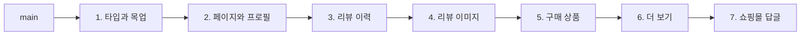

[My 도수 화면](/posts/php-to-nextjs-lens-power-page/)에 이어, 마이페이지의 **리뷰어 프로필** 화면을 PHP 쇼핑몰에서 Next.js로 옮겼다. 내가 쓴 리뷰 목록을 보는 화면과, 닉네임·아이콘을 바꾸는 편집 화면이다. 리뷰 데이터를 다루는 백엔드는 이미 PHP에서 떨어져 나와 있었고, 화면만 남아 있었다.

그런데 쇼핑몰에는 리뷰어의 리뷰를 보여 주는 화면이 하나 더 있다. 상품 상세에서 리뷰어 이름을 누르면 열리는 **공개 리뷰어 페이지**다. 두 화면은 구조가 거의 같아서, 이번 작업에는 이런 요구 사항이 붙어 있었다.

> 마이페이지의 리뷰어 화면과 공개 리뷰어 페이지를 함께 고려해서, 어떤 컴포넌트를 공통화해야 하는지 생각할 것

이 글은 그 질문에 대한 답을 찾아간 기록이다. 무엇을 공통으로 만들었고 무엇을 일부러 만들지 않았는지, 1,178줄짜리 PR을 7개로 나눈 과정도 함께 정리한다.

## 첫 PR: 1,178줄과 어설픈 공통화

첫 PR은 파일 30개, 1,178줄, 커밋 41개였다. 화면 전체를 한 번에 만들었고, 재사용도 의욕적으로 했다.

- 키워드 페이지에 이미 있던 리뷰 표시 컴포넌트에서 이미지 부분을 위쪽 폴더로 옮겨 같이 쓰게 했다
- 상품 스펙 태그를 보여 주는 부분도 그쪽 코드를 가져와 썼다

리뷰는 크게 두 갈래였다.

**보이는 것만 만드는 PR이니 보이는 것에 집착하자.** 기존 PHP 화면과 스마트폰 폭에서 나란히 놓고 비교하니 차이가 보였다. 구분선과 배경이 화면 폭을 꽉 채우지 않았고, 좁은 화면에서는 스펙 태그가 줄바꿈되지 않아 옆으로 삐져나왔다.

**공통으로 꺼낸 부분이 어중간하다.** 리뷰어는 이렇게 짚었다.

> view 폴더는 테스트하기 쉽게 잘게 나눈, 범용이 아닌 컴포넌트를 두는 곳이다. 범용으로 꺼낼 거라면 margin을 컴포넌트가 갖고 있으면 안 된다. 아니면 기존 리뷰 컴포넌트를 통째로 범용화하고, 긴 본문을 접을지 말지를 props로 받는 방법도 있다.

이미지 부분만 떼어 오니, 원래 화면의 사정(바깥 여백, 접기 여부)이 공통 컴포넌트에 묻어 들어온 것이다. 그래서 방향을 바꿨다.

1. 기존 리뷰 컴포넌트와 공유하던 부분은 원래대로 되돌린다
2. 이번 화면의 코드는 아직 다른 곳에서 쓰지 않으니 전부 `mypage/profile` 아래에 모은다. 공개 리뷰어 페이지를 만들 때 공통화가 필요하다고 판단되면 그때 한다
3. 리뷰 한 건(`ReviewItem`)은 조립만 하고, 별점·본문·이미지·상품·답글은 각각의 view 컴포넌트로 나눈다

다시 받은 리뷰는 짧았다.

> 어중간한 공통화가 없어져서, main에 머지해도 크게 거부감이 없는 상태가 됐다.

공통 컴포넌트는 **두 번째로 쓰는 곳이 실제로 생겼을 때** 만든다. 쓰는 곳이 하나뿐일 때 꺼내면, 그 하나의 사정이 공통 컴포넌트에 그대로 따라 들어간다. 두 번째 화면이 생겨야 어디까지가 공통이고 어디부터가 각 화면의 사정인지 보인다.

## 7개로 나눈 PR 스택

리뷰어는 승인을 하면서도 머지 버튼은 누르지 말라고 했다. 다음 날 선배와 함께 이 PR을 7개로 나눴다. 각 PR은 바로 앞 PR의 브랜치를 base로 삼는, 이른바 **PR 스택**이다. GitHub의 스택 도구(GitHub Stacks CLI)를 썼다.



| PR | 내용 | 추가 줄 수 |
| --- | --- | --- |
| 1 | 리뷰·리뷰어·리뷰 상품 타입과 화면 확인용 목업 | 127 |
| 2 | `/mypage/profile` 페이지, 아이콘·닉네임·작성 건수 | 141 |
| 3 | 리뷰 이력 목록 (별점, 본문, 작성일, 세 줄이 넘으면 접기) | 325 |
| 4 | 첨부 이미지 (썸네일을 누르면 모달로 확대) | 378 |
| 5 | 어떤 상품에 쓴 리뷰인지 보여 주는 상품 블록 | 208 |
| 6 | 리뷰가 5건을 넘으면 "더 보기" 버튼 | 127 |
| 7 | 쇼핑몰의 답글 (답글이 있을 때만) | 156 |

PR 하나가 한 가지 주제만 다루니, 리뷰어는 100~400줄 정도를 한 주제씩 읽으면 된다. 7개는 함께 머지해서 한 번에 배포했다.

배포해도 사용자에게 바로 보이지는 않는다. [My 도수 때](/posts/php-to-nextjs-lens-power-page/)처럼 이 경로를 Next.js로 보내는 설정은 따로 바꾸기 때문이다. Next.js 쪽에 페이지가 있어도, 사용자는 경로가 전환될 때까지 기존 PHP 화면을 본다.

## 컴포넌트는 어디에 두나

7개를 머지한 뒤의 구조는 이렇다. 그 뒤에 만든 공통 컴포넌트도 함께 적었다.

```text
src/
├── app/
│   ├── _component/                  ← 앱 전체 공통 (Button, SelectBox, TextInput 등)
│   └── (private)/mypage/
│       ├── _component/MypageHeader/ ← 마이페이지 하위 페이지들이 같이 쓴다
│       └── profile/
│           ├── page.tsx
│           └── _component/          ← 이 페이지만 쓴다
│               ├── ReviewerProfile/
│               ├── ReviewHistory/
│               └── ReviewItem/
│                   └── view/        ← ReviewItem을 테스트하기 좋게 나눈 조각 (…View)
├── domain-model/review/             ← 리뷰·리뷰어·리뷰 상품·답글의 타입
└── mocks/const/reviewerReviewsMock.ts
```

| 누가 쓰나 | 두는 곳 | 예 |
| --- | --- | --- |
| 이 페이지만 | 페이지 폴더의 `_component` | 리뷰 이력, 리뷰 한 건 |
| 같은 단계의 형제 페이지들 | 부모 폴더의 `_component` | `MypageHeader` |
| 앱 전체 | `app/_component` | `Button`, `SelectBox`, `TextInput` |
| 화면과 상관없이 같은 데이터를 다루는 곳 | `domain-model` | `ReviewType`, `ReviewerType` |

컴포넌트를 쓰는 곳 가까이 두고, 쓰는 범위가 넓어지면 한 단계 위로 올린다. Java로 치면 한 기능에서만 쓰는 클래스를 그 기능의 패키지 안에 두는 것과 비슷하다.

### 화면보다 데이터의 모양을 먼저 공유한다

컴포넌트는 공유하지 않았지만, **타입은 첫 PR부터 공통 위치(`domain-model`)에 두었다.** 리뷰 한 건이 어떤 값을 가지는지는 마이페이지든 공개 리뷰어 페이지든 같기 때문이다.

```ts
export type ReviewType = {
  reviewId: string;
  rating: number;
  content: string;
  reviewImages: string[];
  reviewTnImages: string[];
  registerDate: string;
  product: ReviewProductType;
  shopComment?: ShopCommentType; // 답글이 없으면 아예 없다
};
```

화면은 각 화면의 사정을 품고 있지만, 데이터의 모양은 그런 사정이 적다. 그래서 공유하는 비용이 작다. API를 연결하기 전이라 화면은 이 타입으로 만든 목업(`reviewerReviewsMock`)을 보여 준다.

### 표시 컴포넌트에 업무 규칙을 들고 오지 않는다

쇼핑몰의 답글은 리뷰 API 응답에 이런 모양으로 들어 있다(값은 한국어로 옮겼다).

```jsonc
"shopComment": {
  "shopCommentBody": "string",
  "commentVisibility": "표시", // "비표시"일 때가 있다
  "defectFormGuide": "표시"
}
```

그런데 화면용 타입 `ShopCommentType`에는 공개 여부가 없다. 본문과 "불량 문의 안내를 보여 줄지"만 있다.

```ts
export type ShopCommentType = {
  body: string;
  showsDefectFormGuide: boolean;
};
```

"비표시"인 답글은 API를 연결할 때 서비스 계층에서 아예 `undefined`로 바꾸기로 하고, 그 규칙을 PR 설명에 남겼다.

```ts
const toShopComment = (
  resp: GetReviewResponse['shopComment'],
): ShopCommentType | undefined =>
  resp === undefined || resp.commentVisibility !== '표시'
    ? undefined
    : {
        body: resp.shopCommentBody,
        showsDefectFormGuide: resp.defectFormGuide === '표시',
      };
```

이렇게 하면 표시 컴포넌트는 "답글이 있으면 그린다"만 알면 된다. 공개 여부라는 업무 규칙이 화면 곳곳의 `if`로 흩어지지 않는다. 같은 저장소의 다른 서비스도 이미 "공개 상태가 아니면 서비스에서 거른다"는 방식을 쓰고 있어서 거기에 맞췄다.

## 같은 단계의 페이지는 같은 머리: MypageHeader

첫 PR 리뷰에서 하나가 더 나왔다.

> 이 제목은 My 도수 페이지 제목과 같은 컴포넌트여야 한다. 둘 다 마이페이지 바로 아래에 있는 페이지라서 통일감이 있어야 한다. 글자 크기가 다른데, 한쪽에 맞추고 PO에게는 "통일감을 위해 이렇게 했다"고 공유하자.

그래서 빵 부스러기(breadcrumb)와 제목(`h1`)을 묶은 `MypageHeader`를 만들고, My 도수 화면과 리뷰어 프로필 화면이 함께 쓰게 했다.

```tsx
export const MypageHeader: FC<MypageHeaderProps> = ({ breadcrumbList, title }) => {
  return (
    <header className={styles.header}>
      <Breadcrumb list={breadcrumbList} />
      <h1 className={styles.heading}>{title}</h1>
    </header>
  );
};
```

```ts
export const header = style({
  display: 'grid',
  gap: '10px',
  padding: '10px 11px', // 제목 주변 여백은 이 컴포넌트가 갖는다
});
```

제목 주변 여백을 각 페이지의 CSS에서 지우고 컴포넌트 안쪽(padding)으로 옮겼다. 이제 마이페이지에 화면을 추가하면 제목 모양이 저절로 맞는다. 그 대신 기존 화면의 모양이 조금 바뀌었다. My 도수의 좌우 여백이 15px에서 11px로 줄었고, 리뷰어 프로필의 제목 아래 구분선이 없어졌다. 둘 다 다른 마이페이지 화면에 맞춘 변화라 릴리스 노트에 적어 두었다.

이름에서도 이야기가 오갔다. 상위 폴더의 의미를 이름에 또 넣지 말라는 이야기를 들은 적이 있어서, 나는 `mypage/_component/Header` 정도를 생각했다. 리뷰어의 의견은 달랐다.

> 그 말도 맞지만, 앞으로 컴포넌트를 정리하기 쉽게 폴더를 보지 않아도 구분되는 이름으로 하고 싶다. 쓰는 곳 가까이에 두는 방식에서 언젠가 벗어나고 싶어서다.

실제로 3주 뒤, 팀원이 `MypageHeader`를 `PageHeader`로 바꿔서 웹 화면 전체의 공통 폴더로 옮겼다. 커밋 메시지에 적힌 이유는 "빵 부스러기가 붙은 제목은 마이페이지 밖에서도 쓰기 때문"이었다. 쓰는 범위가 넓어지자 한 단계 위로 올라간 것이다. 바뀐 파일은 컴포넌트 자신과, 그것을 쓰던 마이페이지 두 곳뿐이었다.

## 공통 TextInput

편집 화면에는 닉네임 입력칸이 필요했다. 이것도 다른 폼에서 계속 쓸 테니 공통 컴포넌트로 만들었다.

```tsx
type Props = Omit<ComponentProps<'input'>, 'type' | 'className'> & {
  name: string;
};

export const TextInput: FC<Props> = (props) => {
  return <input type="text" className={styles.textInput} {...props} />;
};
```

`ComponentProps<'input'>`는 `<input>`이 받을 수 있는 모든 속성의 타입이다. 여기서 `Omit`으로 `type`과 `className`을 빼고(컴포넌트가 정한다), `name`은 필수로 덮어썼다.

`name`을 필수로 한 이유는 이 컴포넌트를 `new FormData(form)`으로 값을 모으는 폼에서 쓰기 때문이다. [My 도수 화면](/posts/php-to-nextjs-lens-power-page/)도 그렇게 저장한다. `FormData`는 `name`을 키로 값을 모으므로, `name`이 없는 입력칸의 값은 **에러 없이 조용히 빠진다.** HTML에서는 선택인 속성이지만, 타입으로 필수로 만들어 두면 빠뜨렸을 때 컴파일 단계에서 걸린다.

린터에서도 하나 걸렸다. Biome의 `noLabelWithoutControl` 규칙은 `<label>` 안에 입력 요소가 있는지 검사하는데, 직접 만든 `TextInput`은 입력 요소로 알아보지 못한다. 설정의 `inputComponents`에 `TextInput`을 등록해서 해결했다.

리뷰에서는 "`type`을 `text`로 고정하지 않아도 되지 않나. 비밀번호나 숫자 입력에도 쓰고 싶어질 것 같다"는 말이 나왔다. 결론은 "필요해지면 그때 바꾸거나, 다른 컴포넌트로 나누자"였다. 지금 쓰는 곳이 없는 기능은 미리 넣지 않는다는 점에서, 앞의 공통화 이야기와 같은 판단이다.

## 그 밖에 리뷰에서 배운 것

### 픽셀보다 컴포넌트의 통일감

리뷰어 프로필의 닉네임 옆에 "편집" 버튼을 달 때, 기존 PHP 화면의 버튼과 공통 `Button` 컴포넌트는 모양이 조금 달랐다. 그래도 공통 `Button`을 썼다. PHP에서 화면을 하나씩 옮기는 중이니, 앞으로 옮길 화면들과 통일감을 맞추는 쪽을 택했다.

이때 `Button`에 `pureAnchor` 옵션을 붙였다가 지적을 받았다. 이 옵션은 Next.js의 `Link` 대신 평범한 `<a>` 태그로 그리게 한다. 리뷰어의 설명은 이랬다.

> 같은 도메인이라도 아직 PHP에 있는 페이지로 가는 링크를 `Link`로 만들면, Next.js가 화면만 바꾸는 방식으로 이동하려다가 Next.js 밖의 페이지라서 화면이 하얗게 멈춘다. 그래서 PHP 페이지로 가는 링크에만 `pureAnchor`를 쓴다. Next.js 안의 페이지끼리라면 필요 없다.

한 도메인에 두 애플리케이션이 섞여 있는 동안에는, 링크 하나에도 "이 페이지는 지금 어느 쪽에 있나"를 생각해야 한다.

### 상태의 이름이냐, 동작의 이름이냐

"더 보기" 버튼을 다루는 훅은 `isShowAll`(전부 보였다)과 `isShortList`(목록이 짧다)를 돌려준다. 리뷰어 한 분은 동작의 이름이 낫다고 했다. 전부 보였을 때 하고 싶은 일은 버튼을 비활성화하는 것이니 `isButtonDisabled`, 목록이 짧을 때는 버튼을 숨기는 것이니 `isHiddenButton`이라는 이름이다. 버튼을 어떻게 보여 줄지는 훅이 정하고, 컴포넌트는 그대로 따르기만 하면 된다는 생각이다.

다른 리뷰어는 훅이라면 상태 자체가 돌아오는 편이 알기 쉽다며 지금 이름도 괜찮다고 했다. 나는 쓰는 쪽에서 `disabled={isShowAll}`가 "전부 보였으면 비활성화"로 자연스럽게 읽힌다고 생각해서 그대로 두었다. 마지막에 받은 말은 이랬다.

> 결국은 취향이다. 자신 있게 설명할 수 있는 쪽으로 하면 된다.

### 메타데이터는 서버 컴포넌트에서만

편집 화면에서는 아이콘 이미지를 고르면 바로 미리 보여 주고, 형식과 크기도 그 자리에서 검사한다. 상태가 필요하니 클라이언트 컴포넌트다. 그런데 페이지 파일은 `export const metadata`로 브라우저 탭 제목을 정하고 있었고, `metadata`는 서버 컴포넌트에서만 내보낼 수 있다. 그래서 페이지는 서버 컴포넌트로 두고, 아이콘 입력 부분(`ProfileIconField`)만 클라이언트 컴포넌트로 떼어 냈다. 저장 처리와 이미지 업로드는 다음 글에서 다룬다.

## 다시 본다면

### TextInput의 글자 크기

`TextInput`의 글자 크기는 디자인에 맞춰 12px(`1.2rem`)이다. [My 도수 화면](/posts/php-to-nextjs-lens-power-page/)을 만들 때 배운 대로라면, iOS Safari는 글자가 16px보다 작은 입력칸을 탭하면 화면을 확대한다. 이 쇼핑몰의 viewport 설정에는 확대를 막는 값도 없다. 그러니 규칙대로라면 닉네임 칸을 누를 때도 화면이 확대될 것이다.

공통 컴포넌트라서 더 신경 써야 했다. 한 화면의 실수는 그 화면에서 끝나지만, 공통 컴포넌트의 실수는 쓰는 곳 전부로 퍼진다. 실제 기기에서 확인하고, 디자인과 상의해서 16px로 올리는 게 맞다.

### 처음부터 스택으로

1,178줄짜리 PR은 결국 7개로 나뉘었다. 처음부터 "타입 → 페이지 → 부분 화면" 순서로 작게 올렸다면 첫 리뷰가 훨씬 가벼웠을 것이다. 어중간한 공통화도 첫 번째 PR(타입과 목업)이나 세 번째 PR(리뷰 이력)에서 일찍 드러났을 것이다.

## 배운 점

- 공통 컴포넌트는 두 번째로 쓰는 곳이 생겼을 때 만든다. 하나만 보고 꺼내면 그 화면의 사정이 따라온다
- 데이터의 모양(타입)은 화면보다 먼저 공유해도 된다
- 컴포넌트는 쓰는 범위에 맞는 폴더에 두고, 범위가 넓어지면 한 단계 위로 올린다. 옮기기 쉽도록 이름은 폴더를 보지 않아도 구분되게 짓는다
- 같은 단계 페이지의 머리는 같은 컴포넌트로 만들고, 여백도 그 컴포넌트가 갖게 한다
- 공개 여부 같은 업무 규칙은 표시 컴포넌트가 아니라 서비스에서 변환한다
- 공통 컴포넌트의 props 타입으로 실수를 막는다 (`name` 필수)
- 큰 PR은 주제별로 쌓은 PR 스택으로 나눈다
