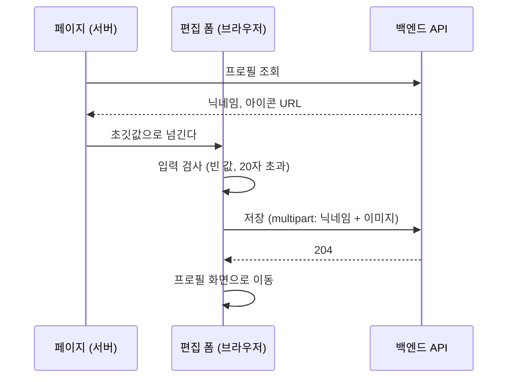

[앞 글](/posts/when-to-make-shared-components/)에서 리뷰어 프로필 편집 화면을 모양까지만 만들었다. 이번에는 실제로 저장되게 했다. 바꿀 수 있는 건 닉네임과 프로필 아이콘(이미지) 두 가지다. 요구 사항은 두 줄이었다.

- 리뷰어 정보를 수정할 수 있다
- **자기** 리뷰어 정보만 수정할 수 있다

저장 버튼 하나를 붙이는 일이었는데, 리뷰를 거치며 생각보다 많은 걸 배웠다. 닉네임 20자를 어떻게 셀지, 업로드에 타임아웃을 얼마나 줄지, 미리 보기 이미지의 메모리는 누가 치울지 같은 것들이다.

## 저장 흐름

구조는 [My 도수 화면](/posts/php-to-nextjs-lens-power-page/)과 같다. 페이지(서버 컴포넌트)가 지금의 프로필을 가져와 초깃값으로 넘기고, 폼(클라이언트 컴포넌트)이 저장한다. 로그인 확인은 상위 레이아웃이 맡는다.



"자기 정보만 수정할 수 있다"는 요구 사항은 저장 API의 모양으로 채워진다. 저장 API는 고객 ID를 받지 않고 경로가 `/me`로 끝난다. 누구의 프로필인지는 서버가 로그인 세션으로 정한다. My 도수 때 배운 "누구의 데이터인지는 API가 정한다"를 그대로 따른 것이다. 요청에 남의 ID를 넣을 자리가 없으니, 프론트에서 따로 막을 일도 없다.

### 이름은 쿼리가 아니라 본문으로

처음에는 API 문서(Swagger)에 적힌 대로 닉네임은 쿼리 문자열로, 이미지는 multipart로 보냈다.

```ts
// 처음
path: `${SAVE_PROFILE_PATH}?name=${encodeURIComponent(name)}`,
data: body, // 이미지만 들어 있는 FormData
```

리뷰는 이랬다.

> POST니까 이름도 본문으로 보내자. 이번에는 공개 정보라 괜찮지만, POST로 보내는 값은 대부분 밖에서 보이면 안 되는 것들이다.

URL은 서버나 프록시, CDN의 접근 로그처럼 생각보다 여러 곳에 남는다. 이미지를 담는 `FormData`에 이름도 같이 넣으니 인터페이스도 단순해졌다.

```ts
export const postReviewerProfile = (name: string, image?: File) => {
  const body = new FormData();
  body.append('name', name);
  if (image !== undefined) {
    body.append('image', image);
  }
  return postApi<void>({ path: SAVE_PROFILE_PATH, data: body, timeout: 10_000 });
};
```

### 업로드는 2초 안에 끝나지 않는다

마지막 줄의 `timeout: 10_000`에도 사연이 있다. 공통 fetch 함수에는 2초 타임아웃이 걸려 있다([My 도수 글](/posts/php-to-nextjs-lens-power-page/)에서 본 그것이다). 그런데 프로필 이미지는 기존 PHP 화면과 똑같이 10MB까지 허용한다. 10MB를 2초 안에 올리라는 건 사실상 불가능하다.

PR을 AI 코드 리뷰에 돌렸다가 이 지적을 받았고, 리뷰어도 업로드라면 10초 정도로 늘려도 된다고 했다. 그래서 공통 fetch 함수가 타임아웃을 인자로 받게 하고(기본값은 그대로 2초), 이미지를 올리는 저장 API만 10초로 늘렸다.

```ts
export const fetchBase = <T>({ path, method, body, headers, timeout = 2000 }: Params): Promise<T> => {
  // timeout(기본 2초)이 지나도 응답이 없으면 요청을 끊는다
  const controller = new AbortController();
  const timer = setTimeout(() => controller.abort(), timeout);
  // ...
};
```

### 오류는 사용자가 할 수 있는 일로 나눈다

처음에는 어떤 오류든 "저장하지 못했습니다. 잠시 후 다시 시도해 주세요."를 띄웠다. 리뷰어가 짚었다.

> 입력 검증에 걸린 400도, 서버가 죽은 500도, 타임아웃도 전부 같은 안내가 나간다. 아주 긴 닉네임을 넣으면 거짓 안내를 하게 된다.

닉네임이 너무 길어서 거절당했는데 "잠시 후 다시 시도"하라고 하면, 몇 번을 다시 해도 결과는 같다. 그래서 사용자가 할 수 있는 일을 기준으로 나눴다.

| 오류 | 사용자가 할 일 | 처리 |
| --- | --- | --- |
| 401 | 다시 로그인 | 로그인 페이지로 이동 |
| 400 | 입력을 고친다 | "입력 내용을 확인한 뒤 다시 시도해 주세요." |
| 그 밖 (500, 타임아웃) | 잠시 후 다시 시도 | "저장하지 못했습니다. 잠시 후 다시 시도해 주세요." |

타임아웃은 `HTTPError`가 아니라 별도의 `TimeoutError`라서 마지막 줄로 떨어진다. 이 경우도 테스트에 넣었다.

## 닉네임 20자는 어떻게 세나

400을 받기 전에, 브라우저에서 미리 알려 주는 검사도 넣었다. 빈 닉네임과 20자를 넘는 닉네임이다. 그런데 "20자"를 세는 방법이 생각보다 여러 가지였다.

### 사람이 보는 한 글자는 몇 글자인가

JavaScript에서 문자열 길이를 재는 방법은 대표적으로 셋이다.

| 문자열 | 사람이 보는 글자 | `str.length` (UTF-16) | `[...str].length` (코드 포인트) |
| --- | --- | --- | --- |
| `あ` | 1 | 1 | 1 |
| `😀` | 1 | 2 | 1 |
| `🇰🇷` (국기) | 1 | 4 | 2 |
| `👨‍👩‍👧‍👦` (가족 이모지) | 1 | 11 | 7 |
| `한` (초성·중성·종성으로 분리된 형태) | 1 | 3 | 3 |

가족 이모지는 사람 이모지 넷을 보이지 않는 결합 문자(ZWJ)로 이은 것이라, 화면에는 한 글자인데 코드 포인트는 7개다. 한글도 자모가 분리된 형태(NFD)로 들어오면 한 글자가 코드 포인트 3개가 된다. 이렇게 사람이 한 글자로 보는 단위를 문자소, 영어로 **grapheme**이라고 부른다.

백엔드(Java)는 닉네임 길이를 grapheme 단위로 센다(정규 표현식 `\b{g}`로 나눈다). 프론트가 다른 기준으로 세면, 한쪽에서는 통과하고 다른 쪽에서는 걸리는 닉네임이 생긴다. 그래서 프론트도 grapheme으로 센다. 브라우저에는 이걸 위한 `Intl.Segmenter`가 있다.

```ts
const segmenter = new Intl.Segmenter('ja', { granularity: 'grapheme' });
[...segmenter.segment('👨‍👩‍👧‍👦')].length; // 1
```

리뷰에서는 가족 이모지나 결합 문자(`か`에 결합용 탁점을 붙인 `が`)가 백엔드와 같은 수로 세어지는지까지 확인했고, 그 문자열들을 테스트 케이스로 넣었다. `あ`나 `😀`만으로는 코드 포인트 수와 grapheme 수가 같아서, `Intl.Segmenter`가 없어도 테스트가 통과해 버리기 때문이다.

### 지원 브라우저에 없는 API

여기서 리뷰가 하나 더 왔다. 처음 코드는 `Intl.Segmenter`를 모듈 맨 위에서 만들었다.

```ts
// 처음: 모듈을 읽는 순간 실행된다
const graphemeSegmenter = new Intl.Segmenter('ja', { granularity: 'grapheme' });
```

이 프로젝트가 지원하는 브라우저 목록(browserslist)에는 Safari 14와 Firefox 111이 들어 있다. 그런데 `Intl.Segmenter`는 Safari 14.1, Firefox 125부터 있다. 그 사이 버전에서는 `new Intl.Segmenter`가 에러를 던진다.

문제는 **언제** 던지느냐다. 모듈 맨 위의 코드는 그 모듈을 불러오는 순간 실행된다. 그래서 저장 버튼을 누를 때가 아니라 **페이지를 여는 순간** 폼이 들어 있는 클라이언트 코드 전체가 실패하고, 폼을 전혀 조작할 수 없게 된다. 테스트에 쓰는 Playwright의 WebKit은 최신 버전이라 이 차이를 잡아내지 못한다.

iOS 14 사용자도 지원 대상이라, 기능이 있는지 확인하고 없으면 코드 포인트 수로 세도록 바꿨다.

```ts
const countGraphemes = (value: string) => {
  if (typeof Intl.Segmenter === 'function') {
    return [...new Intl.Segmenter('ja', { granularity: 'grapheme' }).segment(value)].length;
  }
  // 코드 포인트 수는 언제나 grapheme 수 이상이라, 검사가 백엔드보다 느슨해지지는 않는다
  return [...value].length;
};
```

대체 방법을 고를 때의 기준은 **틀리더라도 엄격한 쪽으로 틀리기**였다. 오래된 브라우저에서는 이모지가 많은 닉네임이 "20자 이내" 경고에 걸릴 수 있다. 하지만 백엔드보다 느슨해지는 일은 없고, 혹시 어긋나더라도 서버의 400으로 한 번 더 걸러진다.

### 검사한 값과 보내는 값을 같게

빈 값 검사는 앞뒤 공백을 지운 값(`trim()`)으로 했는데, 보내는 값은 공백을 지우기 전 그대로였다. 그래서 `" 닉네임 "`처럼 앞뒤에 공백이 붙은 이름이 그대로 저장됐다. 백엔드도 공백만 있는 이름을 거절할 뿐, 앞뒤 공백을 지워 주지는 않는다.

`FormData`에서 값을 꺼내자마자 `trim()`하고, 검사와 전송에 같은 값을 쓰도록 바꿨다.

```ts
const name = formData.get('reviewerName');
const reviewerName = typeof name === 'string' ? name.trim() : '';
// 이 reviewerName으로 검사하고, 이 reviewerName을 보낸다
```

JavaScript의 `trim()`은 전각 공백(U+3000)과 탭도 지운다. 그래서 테스트의 "공백만 있는 이름"에 반각 공백뿐 아니라 전각 공백과 탭도 넣어서, 백엔드의 `isBlank()`와 같은 결과가 나오는지 확인한다.

### `maxLength`가 이모지를 잘랐다

나중에 입력칸에 `maxLength={20}`을 달았다가 다시 지웠다. HTML의 `maxlength`는 UTF-16 단위로 센다. `😀`는 2로 세어지니 10개밖에 못 넣고, 가족 이모지는 입력하는 도중에 잘려 버린다. grapheme 기준인 검사와도 어긋났다. 길이 제한은 우리 검사와 서버 검사에 맡겼다.

## 이미지 미리 보기와 메모리

아이콘 이미지를 고르면 바로 미리 보여 준다. 미리 보기 URL은 `URL.createObjectURL(file)`로 만든다. 이렇게 만든 `blob:` URL은 `URL.revokeObjectURL()`로 해제하거나 문서가 닫힐 때까지 메모리를 잡고 있다. 그런데 처음 코드는 한 번도 해제하지 않아서, 이미지를 다시 고를 때마다 메모리가 쌓였다.

그래서 미리 보기 URL이 바뀌거나 컴포넌트가 사라질 때 이전 URL을 해제하도록 했다.

```tsx
useEffect(() => {
  return () => {
    // 업로드할 이미지의 미리 보기 URL을 해제한다
    if (previewUrl !== null) {
      URL.revokeObjectURL(previewUrl);
    }
  };
}, [previewUrl]);
```

리뷰어는 처음에 `useEffect`를 되도록 쓰고 싶지 않다고 했다. 단순한 표시 제어라면 렌더링 안에서 해도 되기 때문이다. 하지만 이건 렌더링 중에 할 수 없는 일이다. 렌더링 중에 해제하면 이미지가 그려지기도 전에 URL이 사라진다. 리뷰어도 MDN의 "만든 URL은 필요 없어지면 해제하라"는 설명을 확인하고 동의했다. 대신 그 의도가 코드에서 잘 보이게 고쳐 달라고 해서, 위처럼 주석을 달았다.

React 문서의 "Effect가 필요하지 않을 수도 있다"는 이야기는 렌더링으로 계산할 수 있는 일을 Effect로 하지 말라는 것이다. 브라우저가 관리하는 자원(blob URL)과 화면을 맞추는 일은, 반대로 Effect가 맡아야 하는 몫이다.

이 밖에 기존 PHP 화면에 맞춰, 고른 이미지를 원래 비율로 미리 보여 주고 선택을 취소하는 버튼도 붙였다. 파일 검사는 확장자 대신 MIME 타입으로 하도록 바꿨다. 브라우저가 MIME 타입을 정하지 못한 경우(빈 문자열)에만 확장자를 본다.

## fieldset으로 잠갔는데 버튼은 회색이 아니었다

저장하는 동안에는 My 도수 때처럼 `<fieldset disabled={isSubmitting}>`으로 폼 전체를 잠근다. 그런데 이미지 첨부 버튼은 저장 중에도 눌릴 것처럼 평소 모양 그대로였다.

공통 `Button`의 비활성 스타일이 속성 선택자 `[disabled]`로 적혀 있었기 때문이다. `fieldset`의 `disabled`는 안쪽 요소들을 비활성으로 **만들지만**, 그 요소들에 `disabled` **속성을 붙이지는 않는다.** 그래서 속성 선택자에는 걸리지 않는다. 비활성 상태 자체를 가리키는 가상 클래스 `:disabled`는 `fieldset` 때문에 비활성이 된 요소에도 걸린다.

```ts
export const button = style({
  selectors: {
    // '&[disabled]': {   ← disabled 속성이 붙은 버튼만
    '&:disabled': {   // ← fieldset 때문에 비활성이 된 버튼도
      color: theme.color.white,
      backgroundColor: theme.color.secondary,
      cursor: 'auto',
    },
  },
});
```

공통 컴포넌트 한 줄을 바꾼 것이라, 앞으로 `fieldset`으로 잠그는 모든 폼에 같이 적용된다.

## 그 밖에 리뷰에서 배운 것

- **이름은 구현이 아니라 의미로.** "클라이언트 쪽 검사가 통과했다"는 뜻으로 `isClientValid`라고 지었다가, "`client`는 우리 사정이지 실제 도메인이 아니다"라는 리뷰를 받고 `isFormValid`로 바꿨다. 아이콘 칸의 `currentImagePath`도 `defaultSrc`가 됐다. `current`는 바꾸기 전인지 후인지 모호하고, React에서 "입력 전 값"은 `defaultValue`처럼 `default`로 부르기 때문이다
- **PR과 커밋은 작게.** 첫 PR(커밋 21개, 762줄)에서는 "리팩터링 커밋과 수정 커밋을 나누면 차이가 최소가 된다"는 말을 들었다. 다음 PR(112줄)에서는 "이 정도 크기면 엄청 빨리 리뷰할 수 있으니 앞으로도 부탁한다"는 말을 들었다

## 출시, 그리고 며칠 뒤

9월 14일에 출시했다. 그리고 며칠 뒤, 이미지를 바꿨는데도 이전 이미지가 계속 보인다는 문제가 나왔다. 저장은 제대로 됐지만 CloudFront 캐시가 이전 이미지를 내주고 있었다. 이 이야기는 [CloudFront 캐시 때문에 프로필 이미지가 바뀌지 않던 문제](/posts/cloudfront-cache-busting/)에 정리했다.

## 다시 본다면

### 리팩터링에서 사라진 안전장치

리뷰에서 이런 지적이 있었다.

> 아이콘 칸에 "JPEG 또는 PNG를 사용해 주세요" 오류가 떠 있어도 저장할 수 있다. 오류가 나면 파일 선택이 비워지니 닉네임만 저장되고 화면이 넘어가는데, 사용자는 이미지도 바뀌었다고 오해하기 쉽다.

그래서 아이콘 칸이 오류를 부모 폼에 알리고, 폼은 오류가 있으면 저장 버튼을 잠그게 했다. 테스트도 붙였다. 그런데 다음 날 "아이콘 오류 상태를 두 곳에서 관리하고 있다"는 리뷰를 받고 하나로 정리하면서, 폼 쪽 상태를 지웠다. 이때 저장을 막던 연결과 그 테스트까지 함께 지워졌다. 지금 코드에서도 저장 가능 여부는 닉네임 오류만 본다.

리팩터링은 동작을 바꾸지 않는 변경인데, 테스트를 지웠다는 건 그 테스트가 지키던 동작도 지웠다는 뜻이다. 리팩터링 커밋에서 테스트를 지울 때는, 그 동작이 정말 필요 없어졌는지부터 확인했어야 했다. 상태를 하나로 모은다면 아이콘 칸 안이 아니라 폼 쪽에 두고, 아이콘 칸은 받아서 보여 주기만 하는 편이 맞았다.

```tsx
const [iconError, setIconError] = useState<string | null>(null);
const isFormValid = reviewerNameError === null && iconError === null;
// ...
<ProfileIconField defaultSrc={reviewerImagePath} errorMessage={iconError} onErrorChange={setIconError} />
```

## 배운 점

- "자기 정보만 수정"은 프론트가 막는 게 아니라, 세션으로 본인을 정하는 API(`/me`)가 보장한다
- POST로 보내는 값은 쿼리가 아니라 본문에 담는다
- 타임아웃은 요청의 성격에 맞춘다. 업로드에 일반 API와 같은 2초를 주면 안 된다
- 오류 안내는 사용자가 할 수 있는 일(로그인, 입력 수정, 재시도)로 나눈다
- "글자 수"는 정의부터 정한다. UTF-16, 코드 포인트, grapheme은 다르고, 서버와 같은 기준으로 센다. `maxlength`는 UTF-16 기준이다
- 지원 브라우저에 없는 API는 기능을 확인한 뒤 엄격한 쪽으로 대체한다. 모듈 맨 위의 코드는 불러오는 순간 실행된다
- 검사한 값과 보내는 값은 같은 값이어야 한다
- `createObjectURL`은 `revokeObjectURL`까지가 한 쌍이다
- `fieldset`으로 비활성이 된 요소는 `[disabled]`가 아니라 `:disabled`로 잡힌다
- 리팩터링에서 테스트를 지울 때는 그 테스트가 지키던 동작부터 확인한다
