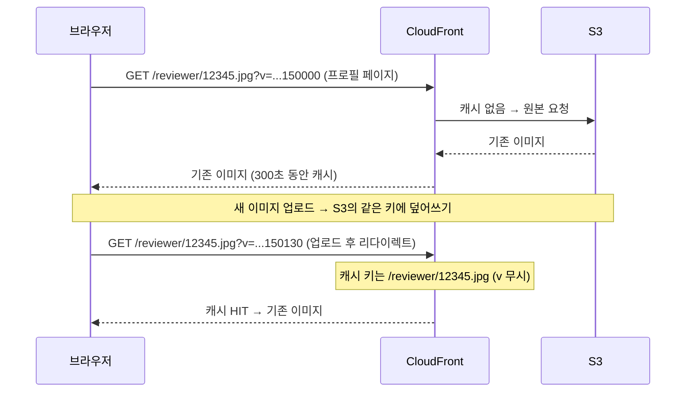

회사 서비스에서 리뷰어 프로필 이미지를 바꿔도 **이전 이미지가 계속 보이는** 문제가 있었다.
이미지 URL에 `?v=` 파라미터를 붙여서 캐시를 피하도록 만들어 두었는데, 왜 동작하지 않았는지 정리해 둔다.

## 문제 상황

- 프로필 편집 화면에서 이미지를 변경하면 업로드는 성공한다 (API 응답 `204`)
- 그런데 화면에는 **변경 전 이미지**가 그대로 표시된다
- 약 5분이 지나서 다시 접속하면 새 이미지가 보인다
- 데이터가 깨진 것은 아니고 **표시만의 문제**였지만, "변경이 안 됐다"고 생각한 사용자가 짧은 시간에 여러 번 다시 업로드하는 일이 생겼다

재미있는 점은 사용자에 따라 증상이 달랐다는 것이다.

| 사용자 | 증상 |
| --- | --- |
| 이미 프로필 이미지를 설정한 사용자 | **첫 번째 변경부터** 이전 이미지가 보임 |
| 기본 아이콘을 쓰던 사용자 | 첫 번째 등록은 정상, **두 번째 변경부터** 이전 이미지가 보임 |

## 구조

이미지가 화면에 표시되기까지의 흐름은 이렇다.

1. 백엔드는 프로필 이미지를 S3의 **고정된 키** `reviewer/{회원ID}.jpg`에 덮어써서 저장한다
2. 이미지는 CloudFront를 거쳐 배포되고, 캐시 TTL은 **300초(5분)** 이다
3. 프론트 템플릿은 이미지 URL 뒤에 **렌더링 시각**을 붙인다

```html

```


_실제 요청 URL 끝에 `?v=` 타임스탬프가 붙어 있다. 응답 헤더의 `Server: AmazonS3`, `Via: ... (CloudFront)`를 보면 S3 원본을 CloudFront가 중계하고 있다는 것도 알 수 있다_

URL이 고정이니 캐시가 문제가 될 수 있다는 건 알고 있었고, 그래서 `?v=` 값을 매번 바꿔 **다른 URL처럼 보이게 해서 캐시를 피하는 것**(캐시 버스팅)이 원래 의도였다.

## 원인: CloudFront 캐시 키에 쿼리 문자열이 포함되지 않았다

CloudFront는 **캐시 키**가 같으면 같은 객체로 판단하고 캐시된 응답을 돌려준다.
그런데 해당 배포의 캐시 동작 설정이 이렇게 되어 있었다.

```yaml
ForwardedValues:
  QueryString: false   # 쿼리 문자열을 캐시 키에 포함하지 않음
```

즉 CloudFront 입장에서는

- `/reviewer/12345.jpg?v=20260918150000`
- `/reviewer/12345.jpg?v=20260918150130`

이 두 요청이 모두 `/reviewer/12345.jpg` 하나로 취급된다. `v` 값을 아무리 바꿔도 TTL 300초 동안은 **같은 캐시에 계속 HIT** 하는 것이다.

캐시 계층별로 보면 이렇다.

| 캐시 계층 | `?v=` 효과 | 결과 |
| --- | --- | --- |
| 브라우저 캐시 | URL 전체가 키라서 `v`가 바뀌면 다른 리소스로 인식 | 회피됨 ✅ |
| CloudFront 캐시 | 쿼리 문자열이 키에 없어서 `v`를 무시 | 회피 안 됨 ❌ |

브라우저 캐시는 피했지만 그 앞단의 CDN 캐시에 그대로 걸린 것이다.



### 이미 이미지가 있던 사용자는 왜 첫 변경부터 문제가 됐을까

이미지를 바꾸려면 반드시 **프로필 페이지**를 거쳐야 한다. 이 페이지에 현재 이미지가 표시되기 때문에, 그 순간 CloudFront에 기존 이미지가 300초 동안 캐시된다.
업로드가 끝나면 다시 프로필 페이지로 리다이렉트되고, 같은 캐시에 HIT 해서 기존 이미지가 보인다.

### 기본 아이콘 사용자는 왜 첫 번째는 괜찮았을까

이미지를 설정하지 않은 사용자에게는 백엔드가 **다른 경로의 기본 아이콘**을 내려준다.
그래서 `reviewer/{회원ID}.jpg`는 한 번도 요청된 적이 없고, 캐시도 존재하지 않는다.

첫 업로드 후 처음으로 요청되니 새 이미지가 정상적으로 보이고, **바로 그 시점부터 캐시된다**.
그래서 5분 안에 한 번 더 바꾸면 첫 번째 이미지가 보이게 된다.

## 해결: 캐시 키에 `v`만 포함시키기

CloudFront 캐시 키에 쿼리 문자열 `v`를 포함하도록 설정을 바꿨다.

```yaml
ForwardedValues:
  QueryString: true      # false → true
  QueryStringCacheKeys:
    - v                  # v 만 캐시 키에 포함
```

쿼리 문자열 전체가 아니라 **`v`만** 지정한 이유는, 관계없는 파라미터(트래킹용 파라미터 등)까지 캐시 키에 들어가면 같은 이미지가 여러 개의 캐시로 쪼개져서 캐시 효율이 떨어지기 때문이다.

변경 후 동작은 이렇다.

- **프로필 이미지**: URL에 `?v=`가 붙어 있으니 변경이 즉시 반영된다
- **상품 페이지의 리뷰어 이미지**: 쿼리 문자열 없이 `{회원ID}.jpg`를 쓰고 있어서 기존처럼 캐시가 잘 동작한다

> `ForwardedValues`는 CloudFront의 레거시 캐시 설정 방식이다. 최근에는 **캐시 정책(Cache Policy)** 의 쿼리 문자열 설정을 `whitelist`로 두고 `v`를 지정하는 방식이 권장된다.
{: .prompt-tip }

## 영향 범위는 어떻게 파악했나

이미지 업로드 API 호출 기록(APM 스팬)을 **사용자별·1분 단위**로 집계해서, 이전 업로드로부터 **5분 이내에 다시 업로드한 사용자**를 추려냈다.
이 사용자들은 TTL 안에 다시 요청했으니 확실히 이전 이미지를 봤다고 판단할 수 있다.

다만 한계도 있었다.

- 스팬 보관 기간(30일)보다 이전의 영향은 알 수 없다
- 스팬은 샘플링되어 저장되기 때문에 집계한 숫자는 **최소값**이다
- 한 번만 업로드한 사용자 중 "원래 이미지를 설정해 둔 사람"(= 첫 변경부터 영향을 받은 사람)은 S3에 같은 키로 덮어쓰기만 해서 이력이 남지 않기 때문에 APM만으로는 구분할 수 없다

## 근본적인 개선: 캐시 갱신을 설정이 아니라 URL로 보장하기

이번 해결은 **CDN 설정을 고친 것**이고, 파일명 설계 자체는 그대로다.
돌아보면 이 문제가 생기기 쉬운 구조였다.

- 프로필 이미지 파일명이 `{회원ID}.jpg`로 **고정**되어 있어서, 이미지가 바뀌어도 URL은 그대로다
- `?v=` 방식은 **CDN이 쿼리 문자열을 캐시 키로 쓰느냐**에 의존한다. 설정 하나가 빠지면 바로 동작하지 않는다 (이번이 딱 그 경우)
- 실제로 상품 페이지 쪽은 지금도 최대 5분 동안 이전 이미지가 보일 수 있는, **같은 구조**가 남아 있다

더 나은 방법은 **업로드할 때마다 고유한 파일명**을 붙이는 것이다.

```text
reviewer/12345.jpg                 # 지금: 항상 같은 URL
reviewer/12345_20260918150130.jpg  # 개선: 업로드마다 다른 URL
```

이미지가 바뀌는 순간 URL 자체가 바뀌기 때문에, CDN 설정과 상관없이 **캐시는 반드시 새로 고쳐진다**.
프로필 페이지와 상품 페이지 문제를 한 번에 해결할 수 있다.

## 배운 점

- `?v=` 캐시 버스팅이 확실히 피하는 건 **브라우저 캐시**뿐이다. CDN에서도 효과를 보려면 쿼리 문자열이 **캐시 키에 포함**되어 있어야 한다
- 캐시 문제를 볼 때는 브라우저 / CDN 등 **계층마다 무엇을 캐시 키로 쓰는지** 확인해야 한다
- "같은 URL에 덮어쓰고 파라미터로 피한다"보다 **"내용이 바뀌면 URL도 바뀐다"** 는 설계가 설정 실수에 강하다
