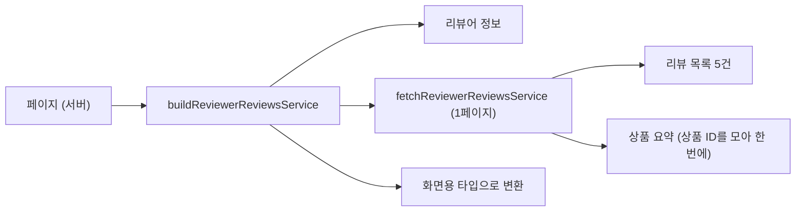

[공통 컴포넌트 글](/posts/when-to-make-shared-components/)에서 만든 리뷰어 프로필 화면은 고정 목업(`reviewerReviewsMock`)을 보여 주고 있었다. 이번에는 실제 API에 연결했다. 요구 사항은 두 줄이었다.

- 로그인한 상태에서 **자기** 프로필만 볼 수 있다
- API로 가져온 내용을 보여 준다

목업을 실데이터로 바꾸는 일은 "가짜 값을 진짜 값으로 갈아 끼우는 것"쯤으로 생각했다. 그런데 연결하는 순간 목업 뒤에 숨어 있던 문제가 여럿 드러났다.

## 세 API를 한 화면으로

화면에 필요한 데이터는 세 곳에서 온다.

| API | 받는 것 |
| --- | --- |
| 리뷰어 정보 (백엔드) | 닉네임, 아이콘 |
| 리뷰어의 리뷰 목록 (백엔드) | 리뷰 5건씩, 전체 건수. 상품은 ID만 있다 |
| 상품 요약 (쇼핑몰 DB를 읽는 API) | 상품 이름, 색, 가격, 스펙, 이미지 |

이 셋을 모아서, 앞 글에서 만든 화면용 타입(`ReviewType` 등)으로 바꾸는 일을 서비스 함수가 맡는다.



리뷰 한 페이지를 화면용으로 바꾸는 부분은 이렇다(일부 생략, 값은 한국어로 옮겼다).

```ts
export const fetchReviewerReviewsService = async (customerId: string, pageNumber: PageNumberType) => {
  const reviewsResp = await fetchReviewerReviews(customerId, pageNumber, REVIEWER_REVIEWS_PER_PAGE);

  // 상품 ID를 중복 없이 모아서 상품 요약을 한 번에 가져온다
  const productIds = [...new Set(reviewsResp.reviews.map((review) => review.productId))];
  const { products } = productIds.length > 0 ? await findProductSummaries(productIds) : { products: [] };

  const reviews = reviewsResp.reviews.flatMap<ReviewType>((review) => {
    const product = products.find((product) => product.productId === review.productId);
    if (product === undefined) {
      return []; // 상품을 찾지 못한 리뷰는 화면에서 뺀다
    }
    return [
      {
        reviewId: review.reviewId,
        // ... (별점, 본문, 이미지, 상품 정보)
        ...(review.shopComment?.commentVisibility === '표시'
          ? { shopComment: { body: review.shopComment.shopCommentBody, /* ... */ } }
          : {}),
      },
    ];
  });

  return { reviews, reviewCount: reviewsResp.reviewCount };
};
```

몇 가지를 정해 두었다.

- **상품은 ID를 모아 한 번에 가져온다.** 리뷰마다 상품 API를 부르면 [포켓몬 도감 연수](/posts/nextjs-pokedex-training/)에서 반성했던 "요청이 리뷰 수만큼 늘어나는" 구조가 된다. 같은 상품에 리뷰를 여러 개 쓴 경우도 있어서 `Set`으로 중복도 없앴다
- **상품을 찾지 못한 리뷰는 조용히 뺀다.** 판매가 끝난 상품에도 리뷰는 남는다. 상품 하나를 못 찾았다고 마이페이지 전체가 에러가 되는 것보다, 그 리뷰 한 건만 빠지는 편이 낫다
- **쇼핑몰의 답글은 '표시'일 때만 넘긴다.** 앞 글에서 "공개 여부는 서비스에서 걸러 표시 컴포넌트가 모르게 한다"고 정해 둔 규칙을 여기서 구현했다

## 목업이 실제보다 친절했다

### 색 이름이 두 번 나왔다

실제 API를 연결하니, 리뷰마다 붙는 구매 상품 블록에 색 이름이 두 번 나왔다.

```text
샘플 원데이 내추럴 시어 브라운   ← productName (색 이름까지 들어간 전체 이름)
시어 브라운                      ← colorName
```

상품 요약 API의 `productName`은 색 이름까지 들어간 **전체 상품명**이었다. 그런데 화면은 첫 줄에 `productName`, 둘째 줄에 `colorName`을 보여 주고 있었다. 목업의 `productName`에는 시리즈 이름만 들어 있어서, 실제 API를 붙이기 전까지는 이 문제가 보이지 않았다.

기존 쇼핑몰 화면에 맞춰 첫 줄은 시리즈 이름(응답의 `brand.name`)을 쓰고, 이미지의 `alt`에는 전체 상품명을 그대로 쓰도록 고쳤다. 다시 헷갈리지 않게 필드 이름도 `productName`에서 `brandSeriesName`으로 바꿨다. 목업도 실제 응답처럼 `productName`에는 전체 이름을 넣었다.

### 다른 API의 목업을 빌려 쓰지 않는다

목업을 고치면서 리뷰를 하나 더 받았다. 상품 요약 목업을 키워드 페이지용 API의 목업에서 가져다 쓰고 있었기 때문이다.

> 지금 같은 값이 들어 있다고 해서 쉽게 재사용하면 안 된다. 그렇게 하면 "상품 요약과 키워드 페이지용 상품 정보는 같은 개념이다"라고 못 박는 셈이다. 키워드 페이지 쪽에서 무언가 바뀌면 상품 요약 목업까지 바뀐다. 귀찮아도 상품 요약은 상품 요약의 목업으로 쓰자.

"코드에 한 개념에는 한 타입"이라는 규칙에 맞춰 `BrandSeriesNameType`도 따로 정의했다.

### 실제 API에 없는 필드

다음 리뷰는 더 따끔했다.

> 백엔드가 돌려주는 건 `reviews`와 `reviewCount`뿐이다. `postedReviewCount`는 실제 API에 없다. 실행할 때는 `??`로 `reviewCount`를 대신 쓰니 깨지지는 않는다. 하지만 목업에서는 두 값이 늘 같아서 테스트로 차이를 잡을 수 없고, 존재하지 않는 사양을 코드와 테스트가 굳혀 버린다.

응답 타입에 실제 API에는 없는 필드가 들어가 있었고, 목업도 그 타입에 맞춰 만들었다. 그러니 테스트는 통과했다. 목업이 실제와 다르면 테스트는 통과해도 아무것도 지켜 주지 못한다. 실제 API에 있는 `reviewCount`만 쓰도록 고쳤다.

## 서버에서 5건, 그다음은 브라우저에서

리뷰는 5건씩 보여 주고, "리뷰 더 보기"를 누르면 5건씩 늘어난다. 처음에는 서버에서 리뷰를 가져와 두고, 브라우저에서 5건씩 펼쳐 보이게 하려고 했다. 그러다 PR에 질문을 남겼다.

> 버튼을 누를 때마다 5건씩 요청하는 게 맞나? 그런데 이 페이지는 서버에서 렌더링하니, 버튼을 누를 때마다 가져오려면 `'use client'`를 써야 하고, 그러면 서버 렌더링을 포기해야 하지 않나?

답은 둘 다 할 수 있다는 것이었다.

> 서버 렌더링과 브라우저에서의 추가 로딩은 같이 쓸 수 있다. 페이지에 들어온 직후에는 처음 5건만 서버에서 가져와 보여 주고, "더 보기"를 누르면 브라우저에서 다음 5건을 가져온다. 표시할 리뷰가 없어질 때까지 반복한다. 서버에서 다 가져와서 나눠 보여 주는 방식은, 리뷰를 아주 많이 쓴 사람이라면 처음에 가져오는 건수를 충분히 크게 잡지 않는 한 끝까지 볼 수 없다.

쇼핑몰의 다른 목록 화면이 이미 이렇게 하고 있었다. 그쪽은 버튼 대신 스크롤이 끝에 닿으면 불러오는데, 계기만 다를 뿐 하는 일은 같다. Spring으로 치면 첫 페이지는 서버 템플릿으로 그리고, 다음 페이지부터는 브라우저가 REST API를 부르는 구조다.

```tsx
// 페이지 (서버): 첫 5건과 전체 건수만 가져온다
const { reviewer, initialReviews, reviewCount } = await buildReviewerReviewsService(payload.customerId);
// ...
<ReviewHistory customerId={payload.customerId} initialReviews={initialReviews} totalCount={reviewCount} />
```

```tsx
// ReviewHistory (클라이언트): 서버에서 받은 5건 뒤에, 브라우저에서 가져온 리뷰를 이어 붙인다
const { reviews: addedReviews, canLoad, isLoading, handleShowMore } = useReviewHistory(customerId, totalCount);

{[...initialReviews, ...addedReviews].map((review) => (
  <li key={review.reviewId}>
    <ReviewItem review={review} />
  </li>
))}
```

```ts
// useReviewHistory: 다음 페이지 번호를 기억해 두고, 누를 때마다 5건씩 더 가져온다
const handleShowMore = async () => {
  if (isLoading) {
    return;
  }
  setIsLoading(true);
  const nextPageNumber = pageNumber.current + 1;
  try {
    const resp = await fetchReviewerReviewsService(customerId, nextPageNumber);
    if (resp.reviewCount <= nextPageNumber * REVIEWER_REVIEWS_PER_PAGE) {
      setCanLoad(false); // 더 가져올 리뷰가 없다
    }
    setReviews((current) => [...current, ...resp.reviews]);
    pageNumber.current = nextPageNumber;
  } catch (_e) {
    alert('불러오지 못했습니다. 잠시 후 다시 시도해 주세요.');
  } finally {
    setIsLoading(false);
  }
};
```

이름에서도 리뷰를 두 번 받았다.

- 서비스가 돌려주는 값은 그냥 `reviews`가 아니라 `initialReviews`가 됐다. 1페이지만 들어 있다는 사실이 이름에서 보이게 하기 위해서다
- 훅 안에서는 `addedReviews`라고 부르지 않는다. 이 훅이 하는 일은 리뷰를 가져오는 것이고, "추가로 붙인다"는 건 쓰는 쪽의 사정이다. 그래서 훅은 `reviews`를 돌려주고, 쓰는 쪽에서 `addedReviews`로 이름을 바꿔 받는다

"더 보기" 버튼은 리뷰가 5건 이하여도 늘 보여 주고, 더 가져올 게 없으면 비활성화한다. 기존 쇼핑몰 화면과 같은 동작이다.

## 고객 ID가 빈 문자열일 때

"자기 프로필만 본다"는 로그인 쿠키의 JWT에서 꺼낸 고객 ID로 API를 불러서 채운다. 여기서도 리뷰가 왔다.

> JWT를 읽는 함수는 `sub`가 없으면 고객 ID로 `undefined`가 아니라 빈 문자열(`''`)을 돌려준다. 그래서 `undefined`만 확인하면, ID 자리가 빈 `/reviewers//reviews` 같은 요청이 그대로 나간다. 편집 페이지도 같은 문제가 있다.

"값이 없다"를 `undefined`로만 생각하고 있었다. 프로필과 편집 두 페이지 모두, 빈 문자열이어도 API를 부르기 전에 멈추게 고쳤다.

```tsx
const payload = await getLoginUserPayload();

if (payload === undefined || payload.customerId === '') {
  throw new Error('고객 ID를 얻지 못해서 리뷰어 프로필을 가져올 수 없다');
}
```

확인하는 위치도 정리했다. 처음에는 프로필 페이지는 서비스 안에서, 편집 페이지는 페이지에서 확인하고 있었다. "누가 로그인했는가"는 페이지가 알아낼 일이고, 서비스는 "받은 ID로 데이터를 만드는 일"만 알면 된다고 보고 둘 다 페이지에서 확인하도록 맞췄다.

쿠키에서 JWT를 꺼내 읽는 코드는 페이지와 컴포넌트 여섯 곳에 똑같이 흩어져 있었다. "JWT에서 사용자 정보를 꺼내는 건 페이지 컴포넌트가 할 일이 아니다"라는 리뷰를 받고, 공통 함수 `getLoginUserPayload`로 뽑아 여섯 곳을 모두 바꿨다. 동작은 바꾸지 않는 리팩터링이라 PR을 따로 냈다.

## 이미지가 뜨지 않은 이유: `new URL()`로 쓴 remotePatterns

실제 데이터를 붙이자 상품 이미지와 리뷰 이미지가 뜨지 않았다. 실제 이미지 URL 끝에는 `?v=...` 같은 버전 쿼리가 붙어 있었다. [CloudFront 캐시 글](/posts/cloudfront-cache-busting/)에서 다룬 바로 그 `?v=`다.

Next.js의 `next/image`는 외부 이미지를 `next.config.ts`의 `remotePatterns`에 맞는 주소만 허용한다. 설정은 이렇게 되어 있었다.

```ts
remotePatterns: [
  new URL('https://<이미지 CDN>/**'),
],
```

Next.js는 이 `URL` 객체에서 `protocol`, `hostname`, `port`, `pathname`, `search`를 꺼내 패턴으로 쓴다. 그런데 쿼리가 없는 `URL` 객체의 `search`는 `undefined`가 아니라 빈 문자열(`''`)이다. Next.js의 패턴 비교 코드는 `search`가 지정되어 있으면 요청 URL의 쿼리와 정확히 같은지 본다. 결국 이 패턴은 "**쿼리 문자열이 없는 URL만 허용**"이 되어, `?v=`가 붙은 이미지를 막고 있었다.

객체 형태로 바꾸고 `search`를 아예 적지 않으니, 쿼리가 붙은 URL도 통과했다.

```ts
remotePatterns: [
  // 쇼핑몰 CDN: 상품 이미지와, 쇼핑몰이 가진 예전 리뷰 이미지
  { protocol: 'https', hostname: '<쇼핑몰 CDN>', pathname: '/**' },
  // 백엔드 S3(운영): 새 리뷰 이미지와 리뷰어 이미지
  { protocol: 'https', hostname: '<운영 이미지 CDN>', pathname: '/**' },
  // 백엔드 S3(스테이징)
  { protocol: 'https', hostname: '<스테이징 이미지 CDN>', pathname: '/**' },
],
```

처음에는 상품 이미지 CDN 하나만 고쳤다. 리뷰어가 리뷰 이미지와 리뷰어 이미지가 있는 다른 CDN(운영, 스테이징)도 같이 고쳐야 한다고 짚어 줬다. 어느 CDN에 무엇이 있는지는 코드만 봐서는 알 수 없어서, 항목마다 주석을 달았다.

## 큰 PR은 결국 다시 나눴다

처음 PR은 8월 말에 올렸다. API 클라이언트, 목업, 조립 서비스, 페이지 연결이 한 PR에 들어 있었다. 편집 화면과 출시 준비를 하는 사이 이 PR은 한 달 넘게 열려 있었고, main을 합치고 수정을 더하면서 점점 커졌다. 10월 초에 이를 주제별로 쌓은 6개의 PR(스택)로 다시 나눴다.

| 순서 | 내용 |
| --- | --- |
| 1 | 쿼리가 붙은 이미지 URL을 `next/image`로 보여 줄 수 있게 |
| 2 | "더 보기" 버튼 표시 조건 (5건 이하여도 보여 주고 비활성화) |
| 3 | 색 이름이 두 번 나오는 문제 |
| 4 | 리뷰 목록과 상품 요약의 API 클라이언트, 목업 핸들러 (화면 동작은 그대로) |
| 5 | 페이지를 실데이터로 전환 |
| 6 | JWT 읽기 공통화 (동작은 그대로) |

10월 14일에 6개를 함께 머지해서 배포했다. 이때도 사용자는 여전히 PHP 화면을 봤다. 실제 공개는 닷새 뒤의 [경로 전환](/posts/cloudfront-path-based-nextjs-migration/)이었다.

## 다시 본다면

### "더 보기"가 실패하면 `alert()`

[My 도수 화면](/posts/php-to-nextjs-lens-power-page/)에서는 결과 안내를 브라우저 `alert()` 대신 화면 안에 보여 주도록 바꿨다. 그런데 이 화면의 "더 보기"는 불러오기에 실패하면 여전히 `alert()`를 띄운다. 버튼 아래에 화면 안 안내(`role="status"` 영역)를 두는 편이 앞의 화면들과 맞는다.

### 목업은 실제 응답에서 시작하기

목업을 만들 때 실제 데이터를 볼 수 없어서, 값을 임의로 넣었다. 그 결과 색 이름 문제와 없는 필드 문제가 실제 API를 붙일 때까지 숨어 있었다. 목업을 만들기 전에 스테이징에서 실제 응답을 한 번 받아 보거나, 백엔드의 응답 클래스나 API 문서(Swagger)에서 타입을 만드는 편이 나았다. 목업은 손으로 만든 "계약서 사본"이라, 원본과 대조하지 않으면 언제든 어긋난다.

## 배운 점

- API 응답을 화면용 타입으로 바꾸는 일은 서비스 한 곳에서 한다. 표시 컴포넌트는 화면용 타입만 안다
- 여러 API를 합칠 때는 ID를 모아 한 번에 가져온다
- 목업은 실제 API를 따라 만든다. 지금 값이 같다고 다른 API의 목업을 빌려 쓰지 않고, 실제에 없는 필드를 만들지 않는다
- 서버 렌더링과 브라우저 추가 로딩은 함께 쓸 수 있다. 첫 페이지는 서버에서, 다음 페이지는 브라우저에서 가져온다
- "값이 없음"은 `undefined`만이 아니다. 빈 문자열도 확인한다
- `new URL()`로 쓴 `remotePatterns`는 쿼리 없는 URL만 허용한다
- 오래 열어 둔 PR은 커지기 전에 나눈다
