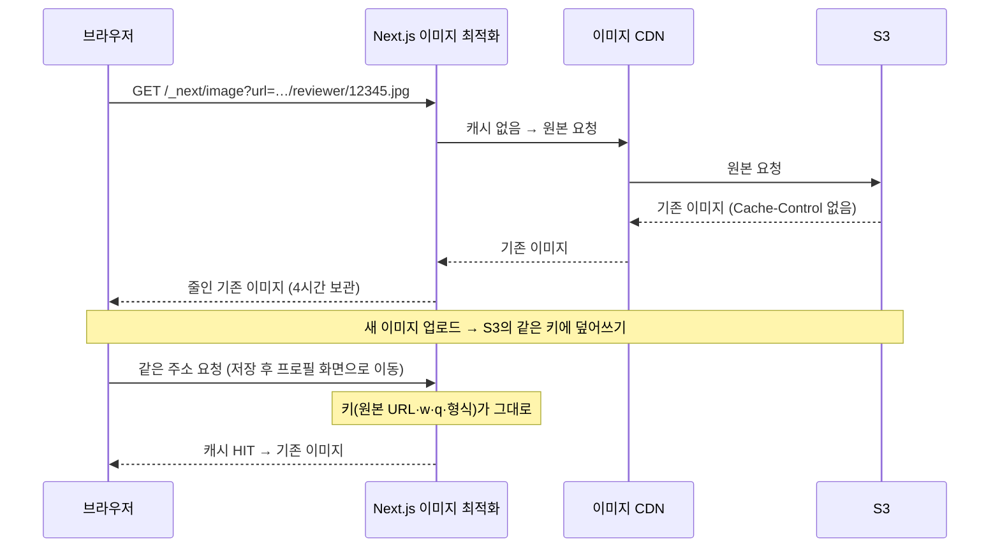

[CloudFront 캐시 글](/posts/cloudfront-cache-busting/)에서 리뷰어 프로필 이미지를 바꿔도 이전 이미지가 계속 보이던 문제를 다뤘다. 그때는 기존 쇼핑몰(PHP) 화면이었고, CloudFront 캐시 키에 `v`를 넣어서 해결했다.

그 뒤 같은 화면을 Next.js로 옮겼다([프로필 편집 API 연동](/posts/reviewer-profile-edit-api/), [실데이터 연결](/posts/reviewer-profile-mock-to-api/)). 그런데 Next.js 화면에서 같은 증상이 또 나왔다. 아이콘을 바꿔 저장해도 이전 아이콘이 보였다. 이번에는 CloudFront보다 앞에 있는 Next.js가 이전 이미지를 쥐고 있었다.

PR 두 개로 고쳤고, 둘 다 10월 16일에 배포했다. 사용자가 Next.js 화면을 보게 된 건 사흘 뒤 [경로 전환](/posts/cloudfront-path-based-nextjs-migration/)부터라서, 이 문제가 사용자에게 나가지는 않았다.

| 단계 | 한 일 | 피한 캐시 |
| --- | --- | --- |
| 1 | `next/image` 대신 ``로 원본을 바로 받는다 | Next.js 이미지 최적화 캐시 |
| 2 | 이미지 URL에 요청 시각을 `?v=`로 붙인다 | CDN·브라우저 캐시 |

## 이번에는 Next.js가 캐시하고 있었다

### `next/image`는 최적화 서버의 주소를 쓴다

프로필 아이콘은 `next/image`의 `Image` 컴포넌트로 그리고 있었다.

```tsx
<Image
  src={reviewer.reviewerImagePath} // https://<이미지 CDN>/reviewer/12345.jpg
  alt={`${reviewer.reviewerName}의 프로필 이미지`}
  width={70}
  height={70}
/>
```

이 컴포넌트가 실제로 그리는 ``의 주소는 원본이 아니다. Next.js의 이미지 최적화 경로(`/_next/image`)에 원본 주소를 쿼리로 넘긴다.

```html
%2Freviewer%2F12345.jpg&w=256&q=75"
  srcset="/_next/image?url=…&w=96&q=75 1x, /_next/image?url=…&w=256&q=75 2x"
/>
```

브라우저가 이 주소를 요청하면 Next.js 서버가 원본을 받아 와서, 화면 크기에 맞게 줄이고 WebP처럼 가벼운 형식으로 바꿔 돌려준다. 그리고 그 결과를 저장해 두었다가 다음 요청에 다시 쓴다. Spring으로 치면 원본 URL을 키로 쓰는 `@Cacheable` 메서드 같은 것이다.

### 캐시 키와 유지 시간

Next.js 16 소스에서 확인한 규칙은 이렇다.

- **캐시 키**: 원본 URL, 너비(`w`), 품질(`q`), 결과 형식(WebP 등)
- **유지 시간**: 원본 응답의 `Cache-Control` max-age와 `images.minimumCacheTTL` 중 큰 값
- **`minimumCacheTTL` 기본값**: Next.js 15에서는 60초였는데, 16에서 4시간(14400초)으로 늘었다

우리 `next.config.ts`에는 `minimumCacheTTL` 설정이 없고, 원본 이미지 응답에는 `Cache-Control`이 없었다(뒤에서 다시 본다). 그래서 한 번 최적화한 아이콘은 4시간 동안 다시 만들지 않는다. `minimumCacheTTL`은 하한이라서, 원본이 `Cache-Control: max-age=60`을 보내더라도 결과는 4시간이다.

여기에 [1편](/posts/cloudfront-cache-busting/)과 같은 구조가 겹친다. 백엔드는 프로필 이미지를 S3의 고정 키 `reviewer/{회원ID}.jpg`에 덮어쓴다. 이미지를 바꿔도 원본 URL은 그대로이니, 최적화 캐시가 보기에는 키가 같은 요청이다.



4시간이 지나도 바로 바뀌지는 않는다. Next.js 서버는 기한이 지난 항목에 요청이 오면 **일단 이전 결과를 돌려주고**, 새로 만드는 일은 뒤에서 한다(stale-while-revalidate). 기한이 지난 뒤의 첫 요청까지는 이전 이미지가 나간다.

운영 환경은 AWS Amplify Hosting에서 돌고 있다. Amplify 문서에도 같은 규칙이 나온다. 최적화한 이미지는 CDN에 캐시하고, 유지 시간은 원본의 `Cache-Control`을 따르되 `minimumCacheTTL`보다 짧아지지 않는다.

> 로컬에서 `next start`로 띄웠다면 `/_next/image` 응답의 `X-Nextjs-Cache` 헤더로 최적화 캐시를 탔는지 볼 수 있다. 값은 `MISS`, `HIT`, `STALE`(기한이 지난 결과를 돌려줌) 중 하나다.
{: .prompt-tip }

## 1단계: ``로 원본을 바로 받기

팀에서 이야기한 끝에, 최적화를 거치지 않고 `` 태그로 원본을 바로 받기로 했다. 바꾼 곳은 프로필 화면의 아이콘과 편집 화면의 아이콘 선택 칸, 두 컴포넌트다.

```diff
-import Image from 'next/image';
 import type { FC } from 'react';
 ...
-        <Image
+        `에는 최적화가 없으니 필요 없어졌다. 소스를 보니 `next/image`는 원래 `blob:`과 `data:` 주소면 알아서 최적화를 건너뛴다. 처음부터 없어도 되는 속성이었다.

### 최적화를 포기해도 괜찮은가

`next/image`를 빼면 크기 조절과 WebP 변환도 같이 빠진다. 이번에는 괜찮다고 봤다.

- 화면에 그리는 크기가 70×70인 아이콘 한 장이다
- 확인해 보니 백엔드 쪽에서 이미 150×150 썸네일을 만들어 같은 키에 저장하고 있었다(S3 이벤트로 도는 Lambda가 줄인다). 실제 응답 하나는 2KB 남짓이었다

대신 캐시는 원본을 주는 CDN(CloudFront)과 브라우저의 규칙을 그대로 따르게 된다. 이것이 2단계로 이어진다.

### 린터 규칙은 두 파일에서만 끈다

Biome에는 Next.js 프로젝트에서 ``를 쓰면 경고하는 `noImgElement` 규칙이 있다. "`next/image`를 쓰라"는 규칙이다. 프로젝트 전체가 아니라 두 컴포넌트 파일에서만 끄는 설정을 더했다. 분석 태그를 넣는 컴포넌트에서 이미 같은 방식으로 끄고 있어서 그 형식을 따랐다.

```jsonc
{
  // 프로필 이미지는 next/image의 최적화 캐시가 갱신 후에도 이전 이미지를 돌려주므로 를 쓴다
  "includes": [
    "src/app/**/mypage/profile/_component/ReviewerProfile/*.tsx",
    "src/app/**/mypage/profile/edit/_component/ProfileIconField/*.tsx"
  ],
  "linter": {
    "rules": {
      "performance": { "noImgElement": "off" }
    }
  }
}
```

이유를 주석으로 남겨 두면, 나중에 누군가 이 설정을 보고 "성능을 위해" `next/image`로 되돌리는 일을 막을 수 있다. 되돌리는 순간 이 버그도 돌아온다.

## 2단계: 원본 URL이 그대로라는 문제는 남았다

``로 바꾸면서 Next.js의 캐시는 사라졌다. 하지만 원본 URL이 고정이라는 사실은 그대로다. 브라우저와 S3 사이에는 아직 캐시가 두 겹 있다.

- **이미지 CDN**(CloudFront): 원본에 `Cache-Control`이 없으면 300초 동안 캐시한다([1편](/posts/cloudfront-cache-busting/))
- **브라우저**: 같은 URL이면 캐시해 둔 이미지를 다시 쓸 수 있다

브라우저 쪽은 생각보다 오래갈 수 있다. 아래는 나중에 운영 환경에서 본 프로필 이미지의 응답 헤더다.

```text
Content-Type: image/jpeg
Content-Length: 2177
Date: Fri, 23 Oct 2026 08:46:56 GMT
Last-Modified: Mon, 19 Oct 2026 05:30:05 GMT
Server: AmazonS3
Via: 1.1 xxxxxxxx.cloudfront.net (CloudFront)
```

`Cache-Control`도 `Expires`도 없다. 백엔드와 Lambda가 S3에 올릴 때 `Content-Type`만 정하기 때문이다. 이렇게 유효 기간이 없는 응답은 브라우저가 **스스로 기간을 정해서** 캐시한다(휴리스틱 캐시). HTTP 캐시 표준(RFC 9111)이 예로 드는 값이 "마지막 수정 후 지난 시간의 10%"이고, 크롬도 이 값을 쓴다. 위 응답은 수정된 지 4일 남짓 지났으니, 브라우저는 약 10시간 동안 서버에 묻지 않고 캐시한 이미지를 쓸 수 있다.

### 기존 쇼핑몰은 `?v=`를 붙이고 있었다

기존 쇼핑몰(PHP)은 이 문제를 이미 피하고 있었다. 리뷰어 이미지 주소를 화면에 넘기는 PHP 코드가 요청 시각을 `?v=`로 붙인다.

```php
'icon' => $reviewer['reviewerImagePath'] . '?v=' . date('YmdHis'),
```

Next.js 화면은 백엔드 API가 주는 주소를 그대로 썼다. 화면을 옮기면서 이 한 줄이 빠진 것이다. 그래서 같은 처리를 Next.js에도 넣었다.

```ts
import { format } from 'date-fns/format';

/**
 * S3 키가 회원 ID로 고정이라, 이미지를 바꿔도 같은 URL에 덮어쓰인다.
 * 그래서 CDN·브라우저 캐시가 이전 이미지를 계속 돌려줄 수 있다.
 * 요청 시각을 ?v= 쿼리로 붙여 캐시를 피하고, 최신 이미지를 보여 준다.
 */
export const appendImageVersionQuery = (imagePath: string): string =>
  `${imagePath}?v=${format(new Date(), 'yyyyMMddHHmmss')}`;
```

이 함수는 리뷰어 정보를 화면용으로 바꾸는 서비스 두 곳(프로필 화면용, 편집 화면용)에서만 부른다.

```ts
export const fetchReviewerProfileService = async (customerId: string) => {
  const profile = await fetchReviewerProfile(customerId);
  return {
    ...profile,
    reviewerImagePath: appendImageVersionQuery(profile.reviewerImagePath),
  };
};
```

리뷰 사진이나 상품 이미지에는 붙이지 않았다. 요청마다 URL이 바뀌면 그 이미지는 캐시를 전혀 쓰지 못한다. 그래서 꼭 필요한 이미지에만, 서비스에서 명시적으로 부른 곳에만 붙인다.

### 새 `v`가 붙는 시점

두 페이지는 요청마다 서버에서 그리는 서버 컴포넌트다(로그인 쿠키를 읽으므로 미리 만들어 둘 수 없다). 그래서 화면을 열 때마다 새 `v`가 붙는다. 편집 화면에서 저장하면 `router.push`로 프로필 화면에 돌아가는데, 이때도 서버에서 다시 그리면서 새 `v`가 붙는다. 경로 전환 날 운영 환경 확인에서도, 저장하고 돌아간 화면에 바뀐 아이콘이 보였다.

CDN도 이 `v`를 알아본다. [1편](/posts/cloudfront-cache-busting/)에서 CloudFront 캐시 키에 `v`를 넣어 두었기 때문에, 새 `v`는 다른 객체로 보고 S3에서 새로 가져온다. 1편에서 고친 설정이 여기서 다시 쓰였다.

### 대가: 이 아이콘은 캐시되지 않는다

요청할 때마다 URL이 바뀌니 이 아이콘은 CDN에도 브라우저에도 사실상 캐시되지 않는다. 마이페이지 안의 70×70 아이콘 한 장이고 자주 여는 화면도 아니라서, 기존 쇼핑몰과 같은 선에서 받아들였다.

## 리뷰에서 바뀐 것

### 날짜 포맷은 date-fns로

처음에는 `Date`로 직접 만들었다.

```ts
const now = new Date();
const pad = (value: number) => String(value).padStart(2, '0');
const version = [
  now.getFullYear(),
  pad(now.getMonth() + 1),
  pad(now.getDate()),
  pad(now.getHours()),
  pad(now.getMinutes()),
  pad(now.getSeconds()),
].join('');
```

리뷰에서 "날짜는 프로젝트에 들어 있는 date-fns를 쓰자"는 의견을 받았다. `getMonth()`는 0부터 시작해서 `+ 1`이 필요하고(Java의 옛 `Calendar.MONTH`와 같다), 자릿수마다 0을 채워야 한다. 읽는 사람이 한 줄씩 맞는지 따져 봐야 하는 코드다. date-fns의 `format`을 쓰면 Java의 `DateTimeFormatter.ofPattern("yyyyMMddHHmmss")`처럼 패턴 하나로 끝난다(앞의 최종 코드).

### 왜 붙이는지 코드에 남기기

다른 리뷰어는 "왜 쿼리 파라미터를 붙여야 하는지 주석으로 남겨 두면 알기 쉽겠다"고 했다. 함수만 보면 URL에 쓸데없는 값을 붙이는 코드처럼 보여서, 나중에 누가 지워도 이상하지 않다. 앞의 주석(JSDoc)은 이때 더한 것이다. 1단계의 린터 설정에 주석을 단 것과 같은 이유다.

### 시각에 따라 바뀌는 값 테스트하기

결과가 현재 시각에 따라 달라지니, 테스트에서는 시각을 고정했다. Vitest의 가짜 타이머로 시스템 시각을 정해 두는 방법이다. Java에서 `Clock.fixed(...)`를 주입해서 테스트하는 것과 목적이 같다.

```ts
beforeEach(() => {
  vi.useFakeTimers();
});

afterEach(() => {
  vi.useRealTimers();
});

it('월·일·시·분·초가 한 자리면 0을 채운다', () => {
  vi.setSystemTime(new Date('2026-01-02T03:04:05'));

  const target = appendImageVersionQuery(
    'https://example.com/reviewer/12345.png',
  );

  expect(target).toBe(
    'https://example.com/reviewer/12345.png?v=20260102030405',
  );
});
```

화면용 데이터를 만드는 서비스의 테스트는 시각을 고정하지 않고, 원래 주소에 14자리 `v`가 붙었는지만 본다.

```ts
expect(reviewer).toEqual({
  ...reviewerReviewsMock.reviewer,
  reviewerImagePath: expect.stringMatching(/\?v=\d{14}$/),
});
expect(reviewer.reviewerImagePath).toContain(
  reviewerReviewsMock.reviewer.reviewerImagePath,
);
```

## 캐시 계층 정리

| 계층 | 캐시 키 | 유지 시간 | 1단계 후 | 2단계 후 |
| --- | --- | --- | --- | --- |
| Next.js 이미지 최적화 | 원본 URL, w, q, 형식 | 4시간 (`minimumCacheTTL` 기본값) | 거치지 않음 | 거치지 않음 |
| 이미지 CDN (CloudFront) | 경로 + `v` | 300초 | 이전 이미지가 나올 수 있음 | 매번 새로 가져옴 |
| 브라우저 | URL 전체 | 휴리스틱 (위 예시는 약 10시간) | 이전 이미지가 나올 수 있음 | 매번 새로 가져옴 |

## 다시 본다면

### 요청 시각 대신 "이미지가 바뀐 시각"을 쓰기

요청 시각 `v`는 이미지가 그대로여도 매번 URL을 바꾼다. 캐시를 피하는 대신, 캐시를 아예 쓰지 않는 방식이다. PR에도 적어 두었듯이, 이미지가 바뀔 때만 바뀌는 값(갱신 시각 등)을 백엔드가 함께 내려 주면 더 낫다. 이미지가 그대로인 동안에는 캐시를 쓰고, 바뀌는 순간 URL이 바뀐다. [1편](/posts/cloudfront-cache-busting/)에 적은 "업로드마다 고유한 파일명"도 같은 생각이다. 둘 다 백엔드가 함께 바뀌어야 하는 방법이라, 이번에는 기존 쇼핑몰과 같은 방식을 프론트에서 먼저 적용했다.

### 저장 직후에는 줄이기 전의 원본을 받을 수 있다

백엔드 코드를 보니, 업로드한 이미지를 먼저 그대로 `reviewer/{회원ID}.jpg`에 저장하고, 150×150 썸네일은 Lambda가 조금 뒤에 같은 키에 덮어쓴다. 저장하자마자 프로필 화면이 열릴 때 Lambda가 아직 끝나지 않았다면, 새 `v`는 S3까지 가서 줄이기 전의 원본(최대 10MB)을 받아 온다. 한 번뿐이라 큰 문제는 아니지만, "70×70 아이콘이라 전송량 영향이 작다"고 판단할 때 이 순간까지 보지는 못했다.

## 배운 점

- `next/image`는 원본 URL을 키로 최적화 결과를 캐시한다. 같은 URL에 덮어쓰는 이미지와는 맞지 않는다
- Next.js 16의 `minimumCacheTTL` 기본값은 4시간이고, 하한이라서 원본의 `Cache-Control`로는 줄일 수 없다
- `Cache-Control`이 없는 응답도 브라우저는 캐시한다(휴리스틱 캐시)
- 레거시 화면을 옮길 때는 화면에 드러나지 않는 처리(`?v=` 한 줄 같은 것)도 옮길 목록에 넣는다
- 일부러 규칙을 거스르는 코드(``, `?v=`)에는 이유를 남긴다. 그래야 "최적화"라는 이름으로 되돌아오지 않는다
