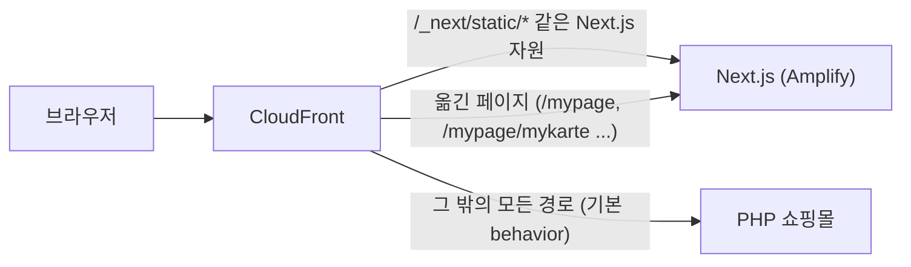

[My 도수 화면을 옮긴 글](/posts/php-to-nextjs-lens-power-page/)에서, 사용자에게 공개하는 일은 마지막 단계의 "CloudFront 경로 전환" 하나로 정해진다고 적었다. 화면과 API 연동은 7~8월에 이미 운영 환경에 배포했지만, 사용자는 그동안 계속 기존 PHP 화면을 보고 있었다.

그 경로 전환을 두 번 했다.

| 날짜 | 전환한 경로 |
| --- | --- |
| 9월 29일 | My 도수 (`/mypage/mykarte`) |
| 10월 19일 | 리뷰어 프로필과 프로필 편집 (`/mypage/profile`, `/mypage/profile/edit`) |

두 번 모두 Next.js 코드는 한 줄도 바꾸지 않았다. 바꾼 건 CloudFront 설정 몇십 줄이다. 이 글에서는 CloudFront가 경로로 요청을 나누는 방식, 추가한 설정을 한 줄씩 읽은 내용, 출시 당일의 절차를 정리한다.

## 한 도메인, 두 애플리케이션

쇼핑몰 도메인 앞에는 CloudFront 배포 하나가 있다. 그 뒤에 있는 오리진 가운데 이 글과 관계있는 것은 두 애플리케이션이다.

- 기존 PHP 쇼핑몰
- 새 Next.js 앱 (AWS Amplify Hosting)

요청이 어느 쪽으로 갈지는 CloudFront의 **cache behavior**가 경로별로 정한다.



새 앱이 옛 앱을 경로 하나씩 감싸면서 대체해 가는 이런 방식을 **스트랭글러 피그(Strangler Fig) 패턴**이라고 부른다. 숙주 나무를 감싸며 자라다 결국 대신 서는 무화과나무에서 따온 이름이다. nginx에서 `location` 블록마다 다른 서버로 보내는 것과 비슷하다고 생각하면 쉽다.

같은 도메인에 두 앱이 섞여 있으면 화면 쪽에서도 신경 쓸 일이 생긴다. 예를 들어 아직 PHP에 있는 페이지로 가는 링크를 Next.js의 `Link`로 만들면 화면이 하얗게 멈춘다([리뷰어 프로필 글](/posts/when-to-make-shared-components/)에서 다뤘다).

## Cache behavior: 경로마다 갈 곳을 정하는 규칙

behavior 하나는 경로 패턴과, 그 경로의 요청을 어떻게 처리할지에 대한 설정의 묶음이다. 어느 오리진(뒤쪽 서버)으로 보낼지, 캐시할지, 어떤 헤더와 쿠키를 넘길지 같은 것들이다.

요청이 들어오면 CloudFront는 요청 경로를 **behavior 목록의 위에서부터 순서대로** 비교하고, **처음 맞는 것**을 쓴다. 어디에도 맞지 않으면 경로 패턴이 `*`로 고정된 기본(default) behavior가 쓰인다. 이 배포의 기본 behavior는 PHP 쇼핑몰로 간다.

그래서 페이지 하나를 Next.js로 옮기는 일은 **그 페이지 경로를 Next.js로 보내는 behavior를 추가하는 것**이다. 다만 페이지 HTML만 Next.js로 가서는 화면이 뜨지 않는다. 그 페이지가 불러오는 JavaScript와 CSS(`/_next/static/*` 등)도 Next.js로 가야 한다. 이런 자원 경로는 앞서 옮긴 페이지들(마이페이지 첫 화면 등) 때문에 이미 설정되어 있어서, 이번에는 페이지 경로만 더하면 됐다.

## 추가한 behavior 읽기

CloudFront 설정은 인프라 저장소에서 CloudFormation 템플릿으로 관리한다. My 도수를 위해 추가한 behavior는 이렇다(읽기 쉽게 항목 순서를 바꿨다).

```yaml
- PathPattern: /mypage/mykarte
  TargetOriginId: !FindInMap [EnvironmentConfig, !Ref EnvironmentValue, AmplifyOriginId]
  AllowedMethods: [GET, HEAD, OPTIONS, PUT, PATCH, POST, DELETE]
  CachePolicyId: 4135ea2d-6df8-44a3-9df3-4b5a84be39ad # CachingDisabled
  OriginRequestPolicyId: b689b0a8-53d0-40ab-baf2-68738e2966ac # AllViewerExceptHostHeader
  ViewerProtocolPolicy: redirect-to-https
- PathPattern: /mypage/mykarte/ # 끝에 슬래시가 붙은 요청 (나머지 설정은 위와 같다)
```

두 ID는 AWS가 미리 만들어 둔 관리형 정책이라, 어느 계정에서나 같은 값이다.

| 항목 | 값 | 이유 |
| --- | --- | --- |
| `PathPattern` | `/mypage/mykarte` | 옮긴 페이지의 경로만 정확히 |
| `TargetOriginId` | Next.js (Amplify) | 스테이징과 운영 중 어느 쪽인지는 환경별 맵에서 고른다 |
| `CachePolicyId` | CachingDisabled | 로그인한 사람마다 내용이 다른 페이지다 |
| `OriginRequestPolicyId` | AllViewerExceptHostHeader | 쿠키와 쿼리는 그대로, Host 헤더만 빼고 넘긴다 |
| `ViewerProtocolPolicy` | redirect-to-https | HTTP로 온 요청은 HTTPS로 보낸다 |
| `AllowedMethods` | 전부 | 기존 Next.js 경로들과 같은 설정 |

### 캐시를 끄는 이유

마이페이지는 로그인한 사람마다 내용이 다르다. 이런 페이지를 CloudFront가 캐시하면, 먼저 들어온 사람의 페이지가 다음 사람에게 그대로 나갈 수 있다. 그래서 캐시를 끈다(CachingDisabled). 출시 문서의 "개인 정보 유출 위험" 항목에도 이 점을 근거로 적었다.

반대로 이미지처럼 누구에게나 같은 파일은 캐시하는 편이 빠르다. 다만 그 캐시가 [프로필 이미지가 바뀌지 않는 문제](/posts/cloudfront-cache-busting/)를 만들기도 했다. 무엇을 캐시하고 무엇을 캐시하지 않을지는 경로마다 따로 정해야 한다.

### Host 헤더만 빼는 이유

AllViewerExceptHostHeader는 브라우저가 보낸 헤더, 쿠키, 쿼리 문자열을 전부 오리진에 넘기되 `Host` 헤더만 뺀다. 대신 CloudFront가 오리진 자신의 도메인을 `Host`로 넣는다.

쿠키를 넘기는 건 로그인 확인 때문이다. Next.js 쪽은 쿠키로 로그인 여부를 판단한다([My 도수 글](/posts/php-to-nextjs-lens-power-page/)의 `NeedAuth`). `Host`를 빼는 건 오리진 쪽 사정 때문이다. Amplify처럼 자기 도메인이 `Host`에 오기를 기대하는 오리진에 쇼핑몰 도메인을 그대로 넘기면, 요청을 제대로 처리하지 못한다. AWS 문서도 이 정책을 "`Host` 헤더에 오리진의 도메인이 오기를 기대하는 오리진용"이라고 설명한다.

### 정확한 경로를 두 개씩

경로 패턴은 `*`, `?` 같은 와일드카드를 빼면 글자 그대로 비교된다. 그래서 `/mypage/mykarte`와 `/mypage/mykarte/`는 다른 경로다. 슬래시가 붙은 요청도 Next.js로 보내려면 behavior가 하나 더 필요하다.

`/mypage/mykarte*`처럼 와일드카드 하나로 묶으면 behavior는 하나로 끝난다. 하지만 그러면 같은 글자로 시작하는 PHP 쪽 경로까지 Next.js로 끌려갈 수 있다. 옮긴 페이지만 정확히 보내려고 경로를 그대로 적었다. 리뷰어 프로필은 프로필과 편집 두 페이지라서 behavior가 네 개였다.

### 환경별 오리진: FindInMap

`TargetOriginId`의 `!FindInMap`은 템플릿의 `Mappings` 섹션에서 환경별 값을 꺼내 오는 CloudFormation 함수다. 같은 템플릿으로 스테이징과 운영을 배포하면서, 오리진만 환경에 맞게 고른다. Spring에서 `application-{프로필}.yml`로 환경마다 설정값을 바꾸는 것과 같은 역할이다.

처음 PR을 만들었을 때는 이 자리가 `!Ref AmplifyOriginId`(템플릿 파라미터)였다. PR을 열어 둔 사이 main에서 기존 behavior들이 `!FindInMap` 방식으로 바뀌었다. 그래서 출시 당일에 새 behavior도 같은 방식으로 맞췄다. 이 이야기는 아래 [다시 본다면](#다시-본다면)에서 이어진다.

## 기능 플래그 대신 경로

Next.js 저장소에는 기능 플래그(feature flag) 구조가 따로 없다. 그 역할을 경로 전환이 했다.

- 화면만 있는 PR, API를 연동한 PR을 각각 운영 환경에 배포해도, 그 경로로 가는 사용자 요청이 없으니 영향이 없다
- 배포한 화면은 Next.js 쪽 주소로 직접 열어서 확인할 수 있다
- 사용자에게 공개하는 순간은 behavior를 추가하는 PR 하나로 정해진다

덕분에 [My 도수](/posts/php-to-nextjs-lens-power-page/)와 [리뷰어 프로필](/posts/when-to-make-shared-components/) 작업을 작은 PR로 나눠 하나씩 운영 환경에 내보낼 수 있었다. 공개를 켜고 끄는 단위가 페이지 하나라는 점만 빼면, 기능 플래그와 같은 역할이다.

## 출시 당일

경로 전환 PR은 머지가 곧 출시다. 출시 문서에 적은 절차는 이랬다.

1. 인프라 저장소의 PR을 머지한다
2. CloudFormation으로 배포한다. 실행 전에 **변경 세트**에서 바뀌는 내용이 추가한 behavior뿐인지 확인한다
3. 출시 뒤 확인 목록을 하나씩 확인한다

변경 세트는 CloudFormation이 "이 템플릿을 적용하면 무엇이 바뀌는지"를 실행 전에 보여 주는 기능이다. CloudFront 배포는 설정 하나를 바꿔도 배포 전체가 다시 반영된다. 그래서 의도하지 않은 차이가 섞이지 않았는지 미리 보고, 출시 뒤에는 옮기지 않은 페이지까지 확인했다.

| 출시 | 확인한 것 (일부) |
| --- | --- |
| My 도수 | 저장되는가. 등록하지 않은 사람에게 '미선택'으로 보이는가. 한쪽 눈만 '모름'으로 저장해도 양쪽이 '모름'이 되지 않는가. 웹에서 저장한 값이 앱에, 앱에서 저장한 값이 웹에 보이는가. 상품을 살 때 My 도수가 초깃값으로 들어가는가 |
| 리뷰어 프로필 | 본인 정보와 리뷰 이력이 보이는가. 편집하고 저장하면 반영되는가. 로그인하지 않으면 로그인 화면으로 가는가. 기존 마이페이지와 My 도수가 그대로인가. 톱, 상품, 장바구니 같은 PHP 페이지가 그대로인가 |

리뷰어 프로필을 출시할 때는 "상품 페이지에 보이는 리뷰어 이미지는 CloudFront 캐시 때문에 최대 5분 정도 늦게 바뀔 수 있다"는 점도 확인 목록에 적어 두었다. 앞의 캐시 문제를 겪은 뒤라, 늦게 바뀌는 것을 버그로 오해하지 않게 하려는 메모였다.

## 다시 본다면

### 출시 스위치 PR은 오래 열려 있게 된다

My 도수의 경로 전환 PR은 8월 7일에 만들었고, 8월 말에 승인을 받았고, 9월 29일 출시 당일에 머지했다. 출시할 때까지 7주 넘게 열려 있었던 셈이다. 리뷰어 프로필도 8월 말에 만든 PR을 편집 페이지 PR과 합쳐서, 10월 19일에 머지했다.

머지가 곧 출시라 미리 머지해 둘 수 없는 PR이다. 그 사이 main은 계속 바뀌었고, 앞에서 본 오리진 지정 방식처럼 출시 직전에 따라가야 하는 변경이 생겼다. 출시 당일에는 확인할 일이 많은데, 거기에 수정까지 얹힌 것이다.

이런 PR은 열어 둔 동안 주기적으로 main을 합치고, 출시 며칠 전에 변경 세트를 한 번 미리 만들어 보는 편이 낫다. 그러면 출시 당일에는 확인만 하면 된다.

### 페이지를 옮길 때마다 behavior가 두 개씩 는다

정확한 경로를 두 개씩 적는 방식은 안전하지만, 페이지를 옮길 때마다 behavior가 늘어난다. 배포 하나에 둘 수 있는 cache behavior는 기본 75개다(늘려 달라고 요청할 수 있다). 아직 여유는 있지만, 옮긴 페이지가 늘어나면 언젠가는 묶는 방법을 생각해야 한다.

예를 들어 `/mypage` 아래가 전부 Next.js로 옮겨진 뒤라면 `/mypage/*` 하나로 묶을 수 있다. 더 나아가 대부분의 페이지가 옮겨지면, 기본 behavior를 Next.js로 바꾸고 남은 PHP 경로를 나열하는 쪽이 더 짧아진다. 스트랭글러 피그 패턴의 마지막 모습이다.

## 배운 점

- 한 도메인에 두 앱이 있을 때 CloudFront의 cache behavior는 경로별 라우팅 표다. 위에서부터 비교해서 처음 맞는 규칙이 쓰이고, 나머지는 기본 behavior로 간다
- 페이지를 옮기는 일은 그 페이지 경로를 새 앱으로 보내는 behavior를 더하는 일이다. 새 앱의 자원 경로도 함께 보내야 한다
- 사람마다 내용이 다른 페이지는 CDN에서 캐시하지 않는다
- 오리진이 자기 도메인을 `Host`로 기대하면, `Host`만 빼고 넘기는 정책을 쓴다
- 기능 플래그가 없어도, 경로 전환을 공개 스위치로 쓰면 화면과 API를 먼저 운영 환경에 내보낼 수 있다
- 인프라 변경은 변경 세트로 차이를 확인하고, 관계없는 페이지까지 확인한다
- 머지가 곧 출시인 PR은 열어 둔 동안 main을 따라가게 한다
